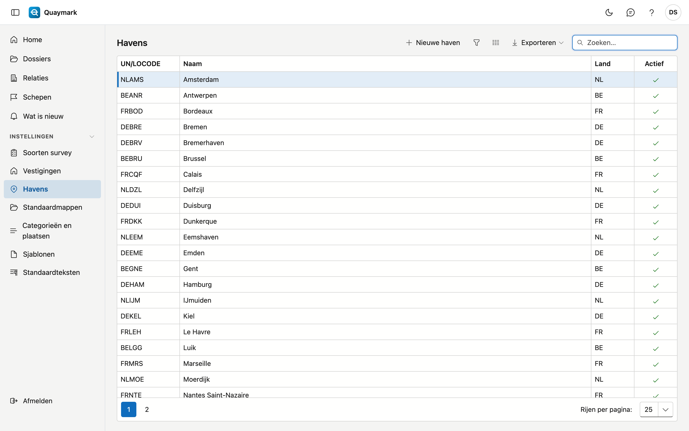

# Havens

De havens waaruit een dossier kiest. Een nieuw bureau start met de grote havens van België, Nederland, Frankrijk en Duitsland.

## Het scherm openen

Klik in het menu links op **Instellingen** en dan op **Havens**.

## Velden en functies

- Een haven heeft een **UN/LOCODE**: vijf tekens, de landcode gevolgd door de plaats, bijvoorbeeld BEANR voor Antwerpen.
- Dubbelklik op een rij om ze te bewerken; **Nieuwe haven** voegt er een toe.
- Een haven verwijderen kan niet, want oude dossiers verwijzen ernaar. Zet een haven die u niet bedient op **niet actief**: ze verdwijnt dan uit de keuzelijst.

## Zie ook

- [Dossiers](dossiers.md)
