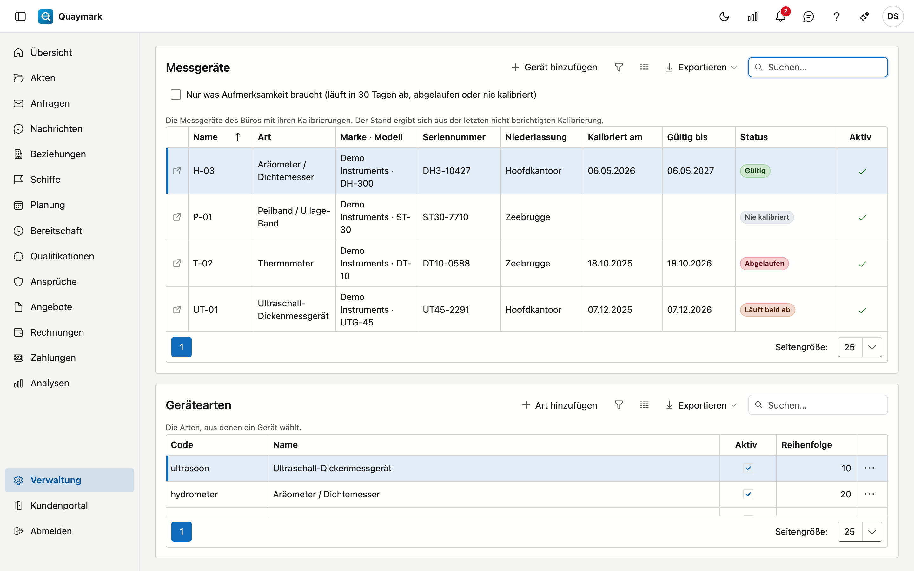
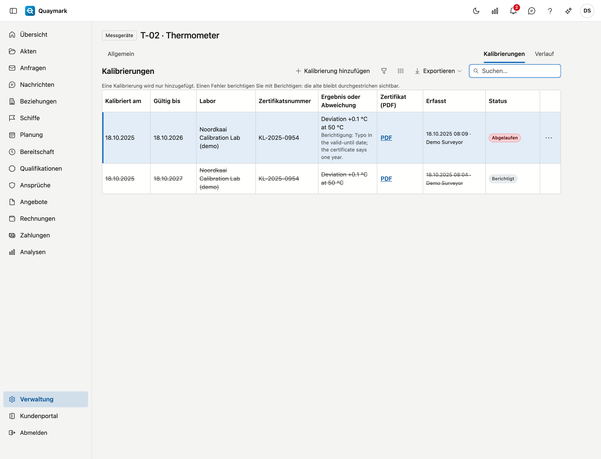

# Messgeräte

Die Messgeräte des Büros, etwa Ultraschall-Dickenmessgeräte, Aräometer, Thermometer und Peilbänder, mit ihren Kalibrierungen. Eine Messung ist nur so zuverlässig wie das Gerät, mit dem sie gemacht wurde. Hier zeigt das Büro, welche Geräte es hat und bis wann sie kalibriert sind.

## Bildschirm öffnen

Klicken Sie unten im Menü auf **Verwaltung** und dann auf die Kachel **Messgeräte**. Nur der Administrator des Büros sieht diesen Bildschirm.

## Die Liste

- Jede Zeile ist ein Gerät: die Bezeichnung des Büros (zum Beispiel *H-03*), die Art, Marke und Modell, die Seriennummer und die Niederlassung.
- **Kalibriert am** und **Gültig bis** stammen aus der geltenden Kalibrierung, also der letzten, die nicht berichtigt wurde.
- Der **Status** sagt, ob das Gerät **Gültig** ist, innerhalb von 30 Tagen abläuft (**Läuft bald ab**), **Abgelaufen** ist oder **Nie kalibriert** wurde. Eine Kalibrierung ohne Enddatum gilt bis zur nächsten.
- Haken Sie **Nur was Aufmerksamkeit braucht** an, um nur zu sehen, was abläuft, abgelaufen ist oder nie kalibriert wurde. Ein nicht aktives Gerät zählt nicht mit: Es ist außer Betrieb.
- Mit der Exportschaltfläche laden Sie die Liste als Datei herunter.

## Ein Gerät hinzufügen

1. Klicken Sie auf **Gerät hinzufügen**.
2. Wählen Sie die **Art** und tragen Sie den **Namen** ein: die Bezeichnung des Büros, die auch auf dem Gerät steht.
3. Tragen Sie bei Bedarf **Niederlassung**, **Marke**, **Modell**, **Seriennummer** und eine **Bemerkung** ein.
4. Klicken Sie auf **Speichern**. Das Datenblatt öffnet sich auf der Registerkarte **Kalibrierungen**.

Ein Doppelklick auf eine Zeile öffnet das Datenblatt des Geräts. Was Sie auf der Registerkarte **Allgemein** ändern, steht im **Verlauf**. **Löschen** verschiebt das Gerät mit seinen Kalibrierungen in den Papierkorb.

## Kalibrierungen

1. Klicken Sie auf der Registerkarte **Kalibrierungen** auf **Kalibrierung hinzufügen**.
2. Tragen Sie das Datum unter **Kalibriert am** ein, und **Gültig bis**. Lassen Sie Gültig bis leer, gilt die Kalibrierung bis zur nächsten.
3. Tragen Sie das **Labor**, die **Zertifikatsnummer** und **Ergebnis oder Abweichung** ein.
4. Wählen Sie das Zertifikat unter **Zertifikat (PDF)**: eine PDF von höchstens 20 MB.
5. Klicken Sie auf **Speichern**.

Eine Kalibrierung wird nur **hinzugefügt**: Sie ändern oder löschen sie nicht. So lässt sich immer zeigen, was an einem bestimmten Tag galt. Die Spalte **Erfasst** sagt, wer sie wann eingegeben hat. **PDF** zeigt das Zertifikat. Quaymark prüft es zuerst anhand seines Fingerabdrucks (SHA-256): Stimmt die Datei nicht mehr, zeigt es nichts an.

### Einen Fehler berichtigen

1. Klicken Sie auf **⋯** in der Zeile der falschen Kalibrierung und dann auf **Berichtigen**.
2. Tragen Sie den **Grund der Berichtigung** ein und verbessern Sie die Daten.
3. Wählen Sie bei Bedarf ein neues Zertifikat. Wählen Sie keines, bleibt das Zertifikat der ersetzten Kalibrierung.
4. Klicken Sie auf **Speichern**.

Die neue Kalibrierung ersetzt die falsche. Die falsche bleibt durchgestrichen in der Liste, mit **Berichtigt**, und unter der neuen steht der Grund.

## Gerätearten

Neben der Liste verwalten Sie die **Arten** des Büros: einen Code (Kleinbuchstaben, Ziffern und _), den Namen in vier Sprachen, aktiv und die Reihenfolge. Der Code ist fest, sobald die Art gespeichert ist, denn Geräte verweisen darauf. Einen Tippfehler beheben Sie mit einer neuen Art, und die falsche setzen Sie auf nicht aktiv. Ein neues Büro beginnt mit fünf Arten: Ultraschall-Dickenmessgerät, Aräometer/Dichtemesser, Thermometer, Peilband/Ullage-Band und anderes Gerät.

## Siehe auch

- [Qualifikationen](bevoegdheden.md)
- [Besichtigungsarten](soorten-survey.md)
