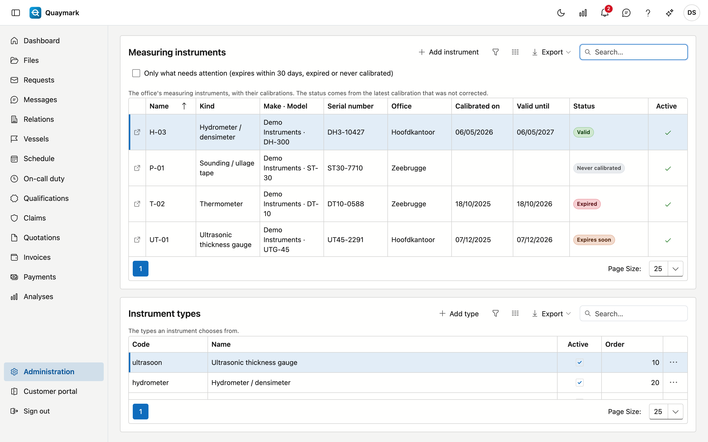
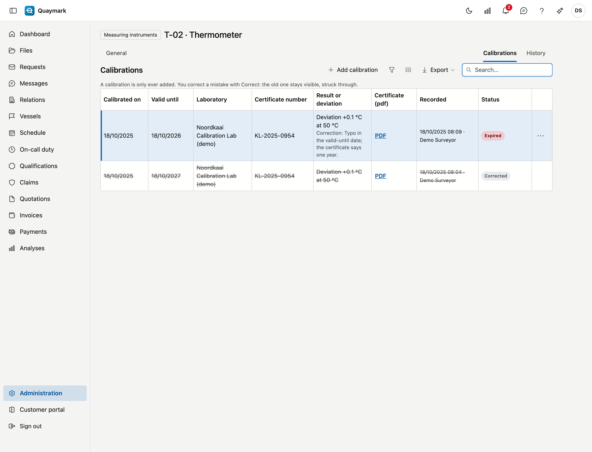

# Measuring instruments

The office's measuring instruments, such as ultrasonic thickness gauges, hydrometers, thermometers and sounding tapes, with their calibrations. A measurement is only as reliable as the instrument it was taken with. Here the office shows which instruments it has and until when they are calibrated.

## Opening the screen

At the bottom of the menu, click **Administration**, then the **Measuring instruments** tile. Only the office administrator sees this screen.

## The list

- Each row is an instrument: the office's own name (for example *H-03*), the type, the make and model, the serial number and the office.
- **Calibrated on** and **Valid until** come from the calibration that applies: the latest calibration that was not corrected.
- The **Status** says whether the instrument is **Valid**, expires within 30 days (**Expires soon**), has **Expired** or was **Never calibrated**. A calibration without an end date stays valid until the next one.
- Tick **Only what needs attention** to see only what expires, has expired or was never calibrated. An inactive instrument does not count: it is out of service.
- The export button downloads the list as a file.

## Adding an instrument

1. Click **Add instrument**.
2. Choose the **Type** and enter the **Name**: the office's own name, which is also on the instrument.
3. Fill in the **Office**, **Make**, **Model**, **Serial number** and a **Note** if needed.
4. Click **Save**. The record opens on the **Calibrations** tab.

Double-clicking a row opens the instrument's record. What you change on the **General** tab appears in the **History**. **Delete** moves the instrument and its calibrations to the recycle bin.

## Calibrations

1. On the **Calibrations** tab, click **Add calibration**.
2. Enter the date under **Calibrated on**, and **Valid until**. If you leave Valid until empty, the calibration applies until the next one.
3. Enter the **Laboratory**, the **Certificate number** and the **Result or deviation**.
4. Choose the certificate under **Certificate (pdf)**: a pdf of 20 MB at most.
5. Click **Save**.

A calibration is only ever **added**: you do not edit or delete it. That way you can always show what applied on a given day. The **Recorded** column says who entered it and when. **PDF** shows the certificate. Quaymark first checks it against its fingerprint (SHA-256): if the file no longer matches, it shows nothing.

### Correcting a mistake

1. Click **⋯** on the row of the wrong calibration, then **Correct**.
2. Enter the **Reason for the correction** and correct the details.
3. Choose a new certificate if needed. If you choose none, the certificate of the replaced calibration is kept.
4. Click **Save**.

The new calibration replaces the wrong one. The wrong one stays in the list, struck through, with **Corrected**, and the reason appears under the new one.

## Instrument types

Next to the list you manage the office's **types**: a code (lowercase letters, digits and _), the name in four languages, active and the order. The code is fixed once the type is saved, because instruments refer to it. You fix a typo with a new type and set the wrong one to inactive. A new office starts with five types: ultrasonic thickness gauge, hydrometer/densimeter, thermometer, sounding/ullage tape and other instrument.

## See also

- [Qualifications](bevoegdheden.md)
- [Survey types](soorten-survey.md)
