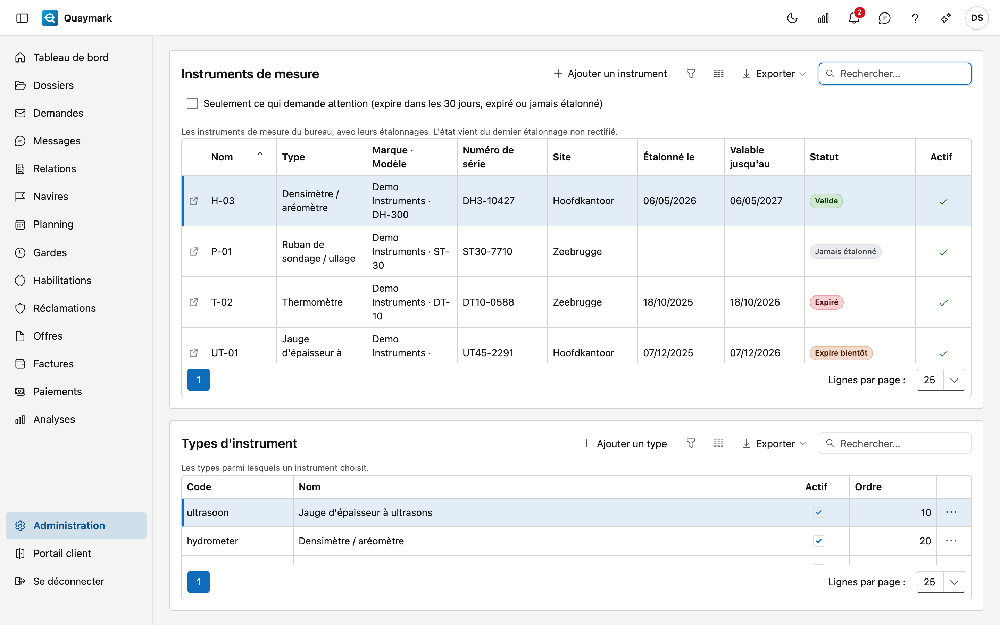
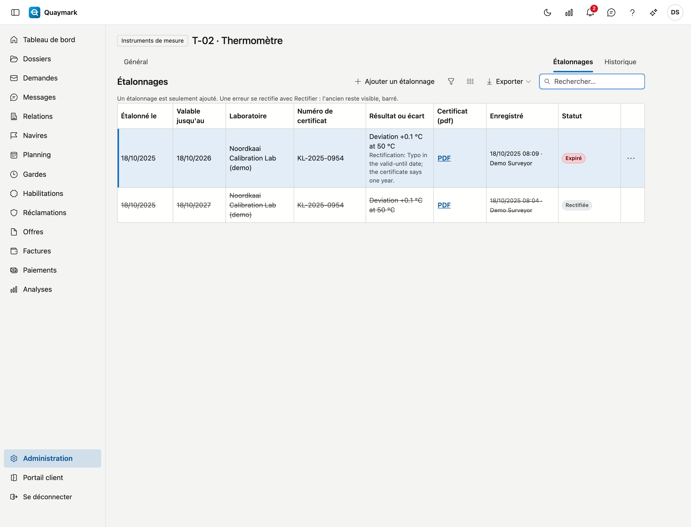

# Instruments de mesure

Les instruments de mesure du bureau, comme les jauges d'épaisseur à ultrasons, les densimètres, les thermomètres et les rubans de sondage, avec leurs étalonnages. Une mesure n'est fiable que si l'instrument l'est. Ici, le bureau montre quels instruments il possède et jusqu'à quand ils sont étalonnés.

## Ouvrir l'écran

En bas du menu, cliquez sur **Administration**, puis sur la tuile **Instruments de mesure**. Seul l'administrateur du bureau voit cet écran.

## La liste

- Chaque ligne est un instrument : le nom du bureau (par exemple *H-03*), le type, la marque et le modèle, le numéro de série et le site.
- **Étalonné le** et **Valable jusqu'au** viennent de l'étalonnage en vigueur, c'est-à-dire le dernier étalonnage non rectifié.
- Le **Statut** indique si l'instrument est **Valide**, s'il expire dans les 30 jours (**Expire bientôt**), s'il est **Expiré** ou s'il n'a **Jamais été étalonné**. Un étalonnage sans date de fin reste valable jusqu'au suivant.
- Cochez **Seulement ce qui demande attention** pour ne voir que ce qui expire, a expiré ou n'a jamais été étalonné. Un instrument inactif n'est pas compté : il est hors service.
- Le bouton d'export télécharge la liste sous forme de fichier.

## Ajouter un instrument

1. Cliquez sur **Ajouter un instrument**.
2. Choisissez le **Type** et indiquez le **Nom** : la désignation du bureau, qui figure aussi sur l'instrument.
3. Complétez si besoin le **Site**, la **Marque**, le **Modèle**, le **Numéro de série** et une **Remarque**.
4. Cliquez sur **Enregistrer**. La fiche s'ouvre sur l'onglet **Étalonnages**.

Un double-clic sur une ligne ouvre la fiche de l'instrument. Ce que vous modifiez dans l'onglet **Général** figure dans l'**Historique**. **Supprimer** met l'instrument et ses étalonnages dans la corbeille.

## Étalonnages

1. Dans l'onglet **Étalonnages**, cliquez sur **Ajouter un étalonnage**.
2. Indiquez la date sous **Étalonné le**, et **Valable jusqu'au**. Si vous laissez Valable jusqu'au vide, l'étalonnage vaut jusqu'au suivant.
3. Indiquez le **Laboratoire**, le **Numéro de certificat** et le **Résultat ou écart**.
4. Choisissez le certificat sous **Certificat (pdf)** : un pdf de 20 Mo au maximum.
5. Cliquez sur **Enregistrer**.

Un étalonnage est seulement **ajouté** : vous ne le modifiez ni ne le supprimez. On peut ainsi toujours montrer ce qui valait à une date donnée. La colonne **Enregistré** indique qui l'a saisi et quand. **PDF** affiche le certificat. Quaymark le vérifie d'abord par rapport à son empreinte (SHA-256) : si le fichier ne correspond plus, il n'affiche rien.

### Rectifier une erreur

1. Cliquez sur **⋯** sur la ligne de l'étalonnage erroné, puis sur **Rectifier**.
2. Indiquez le **Motif de la rectification** et corrigez les données.
3. Choisissez un nouveau certificat si nécessaire. Sinon, le certificat de l'étalonnage remplacé est conservé.
4. Cliquez sur **Enregistrer**.

Le nouvel étalonnage remplace l'erroné. L'erroné reste barré dans la liste avec **Rectifiée**, et le motif figure sous le nouveau.

## Lors d'une mesure

Pour le draft survey (sous chaque mesure) et dans l'onglet **Soutes** (pour les sondages avant et après) se trouve un bloc **Instruments de mesure**. Vous y indiquez avec quel instrument vous avez mesuré.

1. Choisissez l'instrument dans la liste. Les types qui conviennent à la mesure sont en haut (le densimètre pour le draft survey, le thermomètre et le ruban de sondage pour les soutes), chacun avec son statut au jour de la mesure.
2. Cliquez sur **Choisir l'instrument**.

Quaymark enregistre l'instrument tel qu'il était, avec l'étalonnage valable le jour de la mesure : pour les soutes, le jour des sondages ; pour le draft survey, le jour prévu du dossier (sinon le jour du choix). Un étalonnage ultérieur ou une rectification n'y change rien. Pour l'actualiser, cliquez sur **Retirer** et choisissez l'instrument à nouveau. Tant que le dossier est ouvert, vous pouvez retirer un instrument ; ensuite, il est figé.

Si l'étalonnage était expiré, ou si l'instrument n'en avait pas ce jour-là, un avertissement apparaît. Quaymark ne refuse rien : à bord, il faut toujours pouvoir mesurer, et le rapport dit honnêtement ce qu'il en était.

- **Dans le rapport**, sous le draft survey ou l'expertise de soutes, une ligne par instrument : le type, le nom, la marque, le modèle et le numéro de série, et l'étalonnage avec sa validité et son numéro de certificat, ou le fait qu'il était expiré. La ligne accompagne les marqueurs `{{draftsurvey}}` et `{{bunker}}` : si votre modèle ne les affiche pas encore, ajoutez-les (voir [Modèles](sjablonen.md)).
- **Dans le dossier de preuves**, le dossier `meetapparatuur/` contient le certificat (pdf) de chaque étalonnage utilisé, et un aperçu dans `meetapparatuur.json` et `meetapparatuur.csv`.

## Types d'instrument

À côté de la liste, vous gérez les **types** du bureau : un code (minuscules, chiffres et _), le nom en quatre langues, actif et l'ordre. Le code est figé dès que le type est enregistré, car des instruments y renvoient. Une faute de frappe se corrige avec un nouveau type, et l'erroné passe en inactif. Un nouveau bureau commence avec cinq types : jauge d'épaisseur à ultrasons, densimètre/aréomètre, thermomètre, ruban de sondage/ullage et autre appareil.

## Voir aussi

- [Habilitations](bevoegdheden.md)
- [Types d'expertise](soorten-survey.md)
