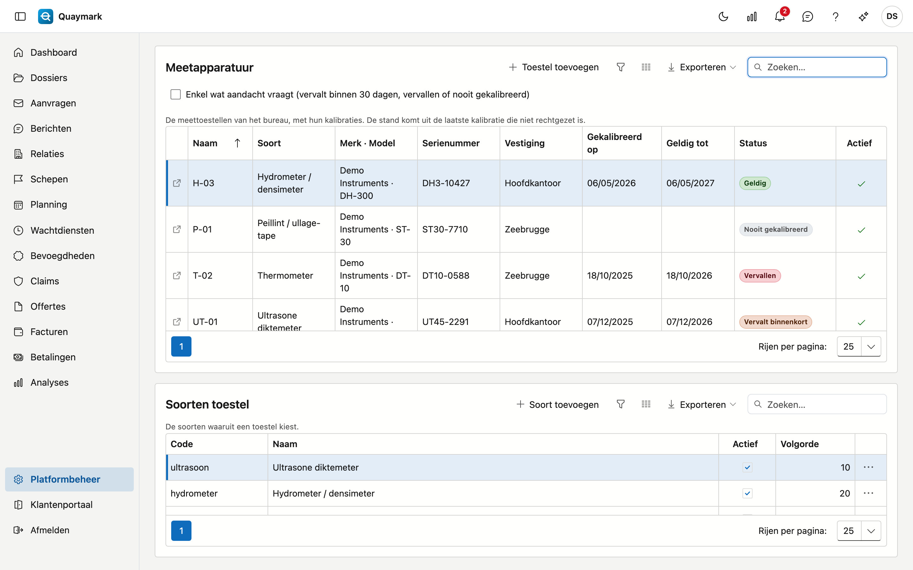
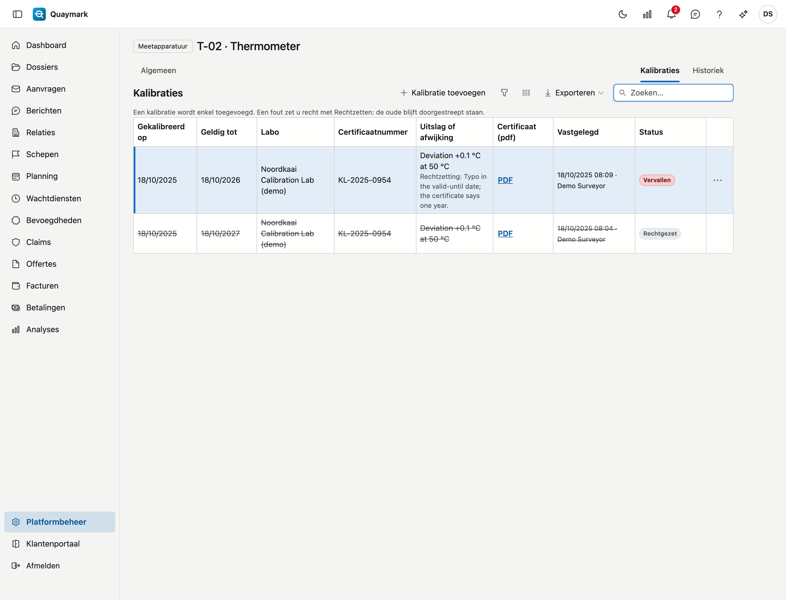

# Meetapparatuur

De meettoestellen van het bureau, zoals ultrasone diktemeters, hydrometers, thermometers en peillinten, met hun kalibraties. Een meting is maar zo betrouwbaar als het toestel waarmee ze gebeurde. Hier toont het bureau welk toestel het heeft en tot wanneer het gekalibreerd is.

## Het scherm openen

Klik onderaan het menu op **Platformbeheer** en dan op de tegel **Meetapparatuur**. Enkel de beheerder van het bureau ziet dit scherm.

## De lijst

- Elke rij is een toestel: de naam van het bureau (bijvoorbeeld *H-03*), de soort, het merk en het model, het serienummer en de vestiging.
- **Gekalibreerd op** en **Geldig tot** komen uit de kalibratie die geldt. Dat is de laatste kalibratie die niet rechtgezet is.
- De **Status** zegt of het toestel **Geldig** is, binnen 30 dagen vervalt (**Vervalt binnenkort**), **Vervallen** is of **Nooit gekalibreerd** werd. Een kalibratie zonder einddatum blijft geldig tot de volgende.
- Vink **Enkel wat aandacht vraagt** aan om enkel te zien wat vervalt, vervallen is of nooit gekalibreerd werd. Een toestel dat niet actief is, telt niet mee: het staat buiten gebruik.
- Met de exportknop haalt u de lijst op als bestand.

## Een toestel toevoegen

1. Klik op **Toestel toevoegen**.
2. Kies de **Soort** en vul de **Naam** in: de benaming van het bureau, die ook op het toestel staat.
3. Vul eventueel de **Vestiging**, het **Merk**, het **Model**, het **Serienummer** en een **Opmerking** in.
4. Klik op **Bewaren**. De fiche gaat open op het tabblad **Kalibraties**.

Een dubbelklik op een rij opent de fiche van het toestel. Wat u op het tabblad **Algemeen** wijzigt, staat in de **Historiek**. **Verwijderen** zet het toestel met zijn kalibraties in de prullenbak.

## Kalibraties

1. Klik op het tabblad **Kalibraties** op **Kalibratie toevoegen**.
2. Vul de datum in onder **Gekalibreerd op**, en **Geldig tot**. Laat u Geldig tot leeg, dan geldt de kalibratie tot de volgende.
3. Vul het **Labo**, het **Certificaatnummer** en de **Uitslag of afwijking** in.
4. Kies het certificaat onder **Certificaat (pdf)**: een pdf van hoogstens 20 MB.
5. Klik op **Bewaren**.

Een kalibratie wordt enkel **toegevoegd**: u wijzigt of verwijdert ze niet. Zo blijft te tonen wat er op een bepaalde dag gold. De kolom **Vastgelegd** zegt wie ze wanneer invoerde. **PDF** toont het certificaat. Quaymark rekent het eerst na tegen zijn vingerafdruk (SHA-256): klopt het bestand niet meer, dan toont het niets.

### Een fout rechtzetten

1. Klik op **⋯** op de regel van de foute kalibratie, en dan op **Rechtzetten**.
2. Vul de **Reden van de rechtzetting** in en verbeter de gegevens.
3. Kies een nieuw certificaat als dat nodig is. Kiest u er geen, dan blijft het certificaat van de vervangen kalibratie.
4. Klik op **Bewaren**.

De nieuwe kalibratie vervangt de foute. De foute blijft doorgestreept in de lijst met **Rechtgezet**, en onder de nieuwe staat de reden.

## Bij een meting

Bij de draft survey (onder elke meting) en op het tabblad **Bunker** (voor de peilingen vóór en na) staat een blok **Meetapparatuur**. Daar legt u vast met welk toestel u mat.

1. Kies het toestel in de lijst. De soorten die bij de meting passen, staan bovenaan (de hydrometer bij de draft survey, de thermometer en het peillint bij de bunker), elk met zijn stand op de dag van de meting.
2. Klik op **Toestel kiezen**.

Quaymark bewaart het toestel zoals het toen was, met de kalibratie die gold op de dag van de meting: bij de bunker de dag van de peilingen, bij de draft survey de geplande dag van het dossier (anders de dag van het kiezen). Een latere kalibratie of rechtzetting verandert dat niet. Wilt u het vernieuwen, klik dan op **Weghalen** en kies het toestel opnieuw. Zolang het dossier open is, kunt u een toestel weghalen; daarna ligt het vast.

Was de kalibratie vervallen, of had het toestel er op die dag geen, dan verschijnt een waarschuwing. Quaymark weigert niets: aan boord moet u altijd kunnen meten, en het rapport zegt eerlijk hoe het zat.

- **In het rapport** staat onder de draft survey of de bunker survey een regel per toestel: de soort, de naam, het merk, het model en het serienummer, en de kalibratie met haar geldigheid en certificaatnummer, of dat ze vervallen was. De regel komt mee met de markeringen `{{draftsurvey}}` en `{{bunker}}`: toont uw sjabloon die nog niet, zet ze erin (zie [Sjablonen](sjablonen.md)).
- **In het bewijspakket** staat de map `meetapparatuur/` met het certificaat (pdf) van elke gebruikte kalibratie, en een overzicht in `meetapparatuur.json` en `meetapparatuur.csv`.

## Het belletje

Wie meetapparatuur beheert, krijgt op het belletje rechtsboven een melding voor elk actief toestel dat aandacht vraagt: de kalibratie vervalt binnen 30 dagen, is vervallen, of het toestel werd nooit gekalibreerd. Een klik opent het toestel op het tabblad **Kalibraties**. Een melding die u zag, blijft weg tot er iets verandert: een nieuwe kalibratie, of een kalibratie die intussen vervallen is. Een toestel dat niet actief is, meldt niets. → [Berichten](berichten.md#het-belletje)

## Soorten toestel

Naast de lijst beheert u de **soorten** van het bureau: een code (kleine letters, cijfers en _), de naam in vier talen, actief en de volgorde. De code ligt vast zodra de soort bewaard is, want toestellen verwijzen ernaar. Een tikfout herstelt u met een nieuwe soort, en de foute zet u op niet actief. Een nieuw bureau start met vijf soorten: ultrasone diktemeter, hydrometer/densimeter, thermometer, peillint/ullage-tape en ander toestel.

## Zie ook

- [Bevoegdheden](bevoegdheden.md)
- [Soorten survey](soorten-survey.md)
