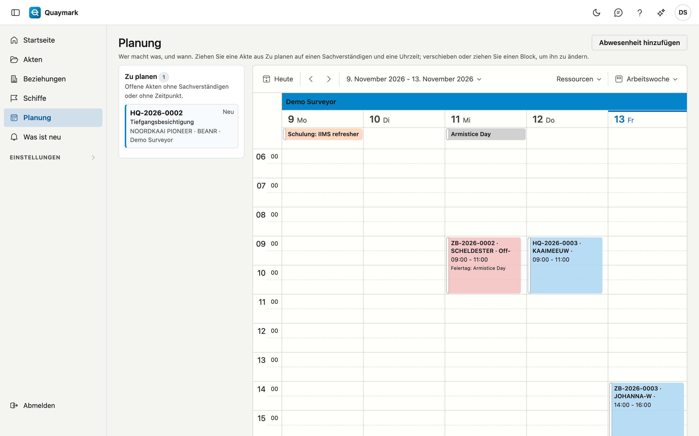

# Planung

Wer welche Akte bearbeitet, und wann: eine Spalte pro Sachverständigen, mit den Akten als Blöcke in der Zeit.

## Bildschirm öffnen

Klicken Sie im Menü links auf **Planung**. Sie sehen den heutigen Tag; oben rechts wählen Sie einen Tag, eine Arbeitswoche oder eine Woche, und mit den Pfeilen blättern Sie.

## Zu planen

Links stehen die offenen Akten ohne Sachverständigen oder ohne Zeitpunkt, mit Nummer, Status, Besichtigungsart, Schiff, Hafen und Sachverständigem (wenn bereits gewählt). Doppelklicken Sie auf eine Karte, um die Akte zu öffnen.

## Eine Akte einplanen

Ziehen Sie eine Karte aus **Zu planen** auf die Spalte eines Sachverständigen und die Uhrzeit, zu der die Arbeit beginnt. Die Akte erhält diesen Sachverständigen und diesen Zeitpunkt, und eine Akte mit Status **Neu** wird **Geplant**. Ein anderer Status bleibt, wie er ist.

Sie können den Zeitpunkt auch in der Akte selbst eintragen: **Geplant am** und **Geplant bis**.

## Verschieben und das Ende

- Verschieben Sie einen Block auf eine andere Uhrzeit, einen anderen Tag oder einen anderen Sachverständigen.
- Ziehen Sie einen Block länger, um das Ende zu ändern. Ohne Ende steht eine Akte zwei Stunden in der Planung.
- Klicken Sie auf einen Block für **Akte öffnen** oder **Zurück zu Zu planen**: Der Zeitpunkt entfällt, der Sachverständige bleibt, und eine Akte mit Status **Geplant** wird wieder **Neu**.

Jede Akte steht in der Zeit ihrer Niederlassung, wie in der Akte selbst.

## Abwesenheiten

**Abwesenheit hinzufügen** erfasst Urlaub, Krankheit, Schulung oder eine andere Abwesenheit, für einen Benutzer, von einem Tag bis einschließlich einem Tag. Sie steht oben in der Spalte dieses Benutzers. Klicken Sie darauf und wählen Sie **Abwesenheit bearbeiten**, um sie zu ändern oder zu löschen; eine gelöschte Abwesenheit steht im Papierkorb.

## Feiertage

Die gesetzlichen Feiertage des Landes Ihrer Niederlassungen erscheinen von selbst, oben in jeder Spalte. Kennt Quaymark die Feiertage eines Landes nicht, sagt die Planung das über dem Kalender.

## Warnungen

Fällt eine Akte auf eine Abwesenheit des Sachverständigen, einen Feiertag oder eine andere Akte desselben Sachverständigen, ist das erlaubt: Ein Schiff wartet nicht auf das Ende eines Feiertags, und zwei kurze Aufträge im selben Hafen passen zusammen. Der Block wird dann rot, und die Planung sagt warum.

Verlangt die Besichtigungsart eine Qualifikation, die der Besichtiger an diesem Tag nicht gültig hat, warnt die Planung auf dieselbe Weise. Siehe [Qualifikationen](bevoegdheden.md).

## Mein Kalender

Oben in der Planung steht der Block **Mein Kalender**. Damit übernehmen Sie Ihre eigenen geplanten Akten und Bereitschaften in Ihren Kalender bei Google oder Microsoft (Outlook).

1. Klicken Sie auf **Mit Google verbinden** oder **Mit Microsoft verbinden**.
2. Melden Sie sich an und erteilen Sie die Berechtigung. Danach kehren Sie automatisch zur Planung zurück.
3. In Ihrem Konto steht jetzt ein separater Kalender **Quaymark**.

Was er enthält:

- **Jede Akte, deren Sachverständiger Sie sind**, sobald sie einen Zeitpunkt hat, von **Geplant am** bis **Geplant bis** (ohne Endzeit zwei Stunden). Der Titel ist die Nummer und die Besichtigungsart; die Beschreibung nennt das Schiff, den Hafen und einen Link zur Akte. Auftraggeber und Beträge stehen nicht darin.
- **Ihre Bereitschaften**, mit der Niederlassung.
- Von einem Monat zurück bis zwölf Monate voraus. Eine abgeschlossene Akte bleibt; eine stornierte oder gelöschte Akte verschwindet.

Quaymark aktualisiert Ihren Kalender nach jeder Änderung in der Planung, an einer Akte oder bei den Bereitschaften. **Jetzt aktualisieren** tut es sofort. Es funktioniert nur in eine Richtung: Was Sie in Google oder Outlook an einem Termin von Quaymark ändern, kommt nicht zurück, und die nächste Aktualisierung stellt es wieder richtig.

Die Zeiten stehen in belgischer Zeit. Liegt eine Niederlassung in einer anderen Zeitzone, steht ihre Ortszeit in der Beschreibung.

Der Block warnt, wenn nur Sie etwas lösen können:

- **Berechtigung abgelaufen**: Verbinden Sie sich erneut mit der Schaltfläche in der Meldung. Bis dahin wird Ihr Kalender nicht aktualisiert.
- **Ihr Kalender würde leer**: Hatten Sie mindestens zehn Termine und plötzlich keinen mehr, überträgt Quaymark das erst nach Ihrer Bestätigung.

**Trennen** leert zuerst den Kalender Quaymark und trennt dann die Verbindung. Den leeren Kalender löschen Sie selbst in Google oder Outlook.

## Siehe auch

- [Akten](dossiers.md)
- [Wie plane ich eine Akte ein?](hoe/dossier-plannen.md)
