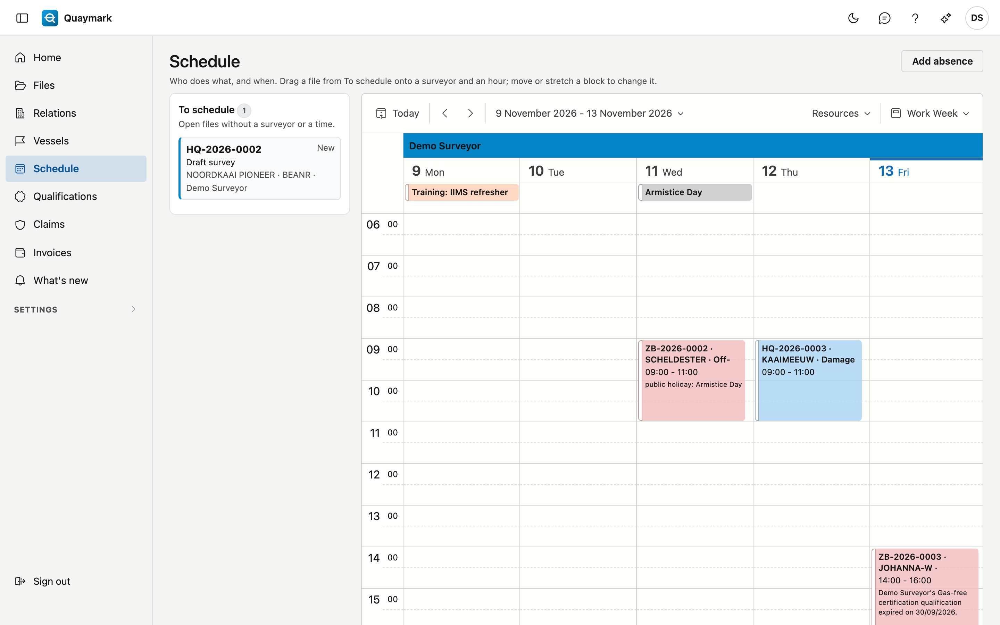

# Schedule

Who does which file, and when: one column per surveyor, with the files as blocks in time.

## Opening the screen

Click **Schedule** in the menu on the left. You see today; at the top right you choose a day, a work week or a week, and the arrows let you browse.

## To schedule

On the left are the open files without a surveyor or a time, with their number, status, survey type, vessel, port and surveyor (if already chosen). Double-click a card to open the file.

## Scheduling a file

Drag a card from **To schedule** onto a surveyor's column and the hour at which the work starts. The file gets that surveyor and that time, and a file with status **New** becomes **Scheduled**. Another status stays as it is.

You can also fill in the time on the file itself: **Scheduled for** and **Scheduled until**.

## Moving and the end time

- Move a block to another hour, another day or another surveyor.
- Stretch a block to change the end time. Without an end time, a file takes two hours on the schedule.
- Click a block for **Open file** or **Back to To schedule**: the time is cleared, the surveyor stays, and a file with status **Scheduled** becomes **New** again.

Each file is shown in the time of its office, as on the file itself.

## Absences

**Add absence** records leave, sick leave, training or another absence, for a user, from one day up to and including another. It appears at the top of that user's column. Click it and choose **Edit absence** to change or delete it; a deleted absence goes to the recycle bin.

## Public holidays

The public holidays of the country of your offices appear automatically, at the top of each column. If Quaymark does not know the holidays of a country, the schedule says so above the calendar.

## Warnings

If a file falls on an absence of the surveyor, a public holiday or another file of the same surveyor, that is allowed: a vessel does not wait for a holiday to end, and two short jobs in the same port go together. The block then turns red, and the schedule says why.

If the survey type requires a qualification the surveyor does not hold validly on that day, the schedule warns in the same way. See [Qualifications](bevoegdheden.md).

## See also

- [Files](dossiers.md)
- [How do I schedule a file?](hoe/dossier-plannen.md)
