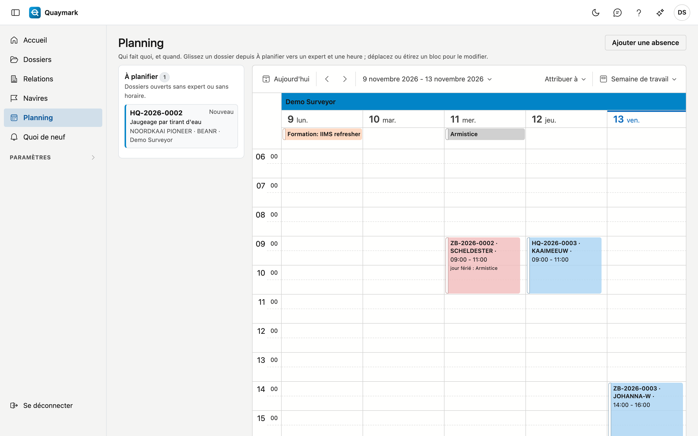

# Planning

Qui fait quel dossier, et quand : une colonne par expert, avec les dossiers sous forme de blocs dans le temps.

## Ouvrir l'écran

Cliquez sur **Planning** dans le menu de gauche. Vous voyez le jour même ; en haut à droite, vous choisissez un jour, une semaine de travail ou une semaine, et les flèches permettent de naviguer.

## À planifier

À gauche figurent les dossiers ouverts sans expert ou sans horaire, avec leur numéro, statut, type d'expertise, navire, port et expert (s'il est déjà choisi). Double-cliquez sur une carte pour ouvrir le dossier.

## Planifier un dossier

Glissez une carte depuis **À planifier** vers la colonne d'un expert et l'heure à laquelle le travail commence. Le dossier reçoit cet expert et cet horaire, et un dossier au statut **Nouveau** passe à **Planifié**. Un autre statut reste inchangé.

Vous pouvez aussi saisir l'horaire sur la fiche du dossier : **Prévu le** et **Prévu jusqu'au**.

## Déplacer et heure de fin

- Déplacez un bloc vers une autre heure, un autre jour ou un autre expert.
- Étirez un bloc pour modifier l'heure de fin. Sans heure de fin, un dossier occupe deux heures au planning.
- Cliquez sur un bloc pour **Ouvrir le dossier** ou **Retour à planifier** : l'horaire disparaît, l'expert reste, et un dossier au statut **Planifié** redevient **Nouveau**.

Chaque dossier figure à l'heure de son établissement, comme sur la fiche.

## Absences

**Ajouter une absence** enregistre un congé, une maladie, une formation ou une autre absence, pour un utilisateur, d'un jour jusqu'à un jour inclus. Elle figure en haut de la colonne de cet utilisateur. Cliquez dessus et choisissez **Modifier l'absence** pour la modifier ou la supprimer ; une absence supprimée se trouve dans la corbeille.

## Jours fériés

Les jours fériés légaux du pays de vos établissements y figurent d'office, en haut de chaque colonne. Si Quaymark ne connaît pas les jours fériés d'un pays, le planning l'indique au-dessus du calendrier.

## Avertissements

Si un dossier tombe sur une absence de l'expert, un jour férié ou un autre dossier du même expert, c'est permis : un navire n'attend pas la fin d'un jour férié, et deux courtes missions dans le même port vont ensemble. Le bloc devient alors rouge, et le planning indique pourquoi.

## Voir aussi

- [Dossiers](dossiers.md)
- [Comment planifier un dossier ?](hoe/dossier-plannen.md)
