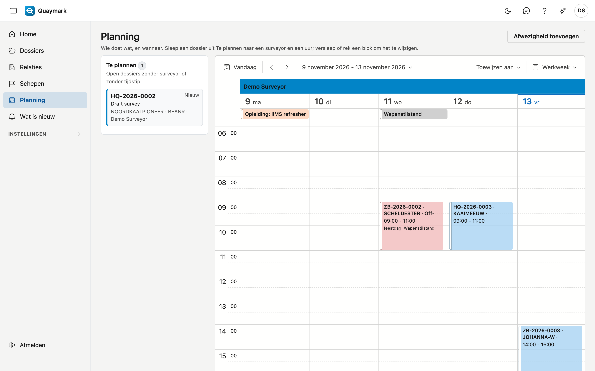

# Planning

Wie welk dossier doet, en wanneer: een kolom per surveyor, met de dossiers als blokken in de tijd.

## Het scherm openen

Klik in het menu links op **Planning**. U ziet de dag van vandaag; rechtsboven kiest u een dag, een werkweek of een week, en met de pijlen bladert u.

## Te plannen

Links staan de open dossiers zonder surveyor of zonder tijdstip, met hun nummer, status, soort survey, schip, haven en surveyor (als die al gekozen is). Dubbelklik op een kaart om het dossier te openen.

## Een dossier inplannen

Sleep een kaart uit **Te plannen** naar de kolom van een surveyor en het uur waarop het werk begint. Het dossier krijgt die surveyor en dat tijdstip, en een dossier met status **Nieuw** wordt **Gepland**. Een andere status blijft wat ze is.

U kunt het tijdstip ook op de fiche van het dossier invullen: **Gepland op** en **Gepland tot**.

## Verplaatsen en de eindtijd

- Versleep een blok naar een ander uur, een andere dag of een andere surveyor.
- Rek een blok uit om de eindtijd te wijzigen. Zonder eindtijd staat een dossier twee uur op de planning.
- Klik op een blok voor **Dossier openen** of **Terug naar te plannen**: het tijdstip valt weg, de surveyor blijft, en een dossier met status **Gepland** wordt weer **Nieuw**.

Elk dossier staat in de tijd van zijn vestiging, zoals op de fiche.

## Afwezigheden

**Afwezigheid toevoegen** geeft verlof, ziekte, opleiding of een andere afwezigheid in, voor een gebruiker, van een dag tot en met een dag. Ze staat bovenaan de kolom van die gebruiker. Klik erop en kies **Afwezigheid bewerken** om ze te wijzigen of te verwijderen; een verwijderde afwezigheid staat in de prullenbak.

## Feestdagen

De wettelijke feestdagen van het land van uw vestigingen staan er vanzelf, bovenaan elke kolom. Kent Quaymark de feestdagen van een land niet, dan zegt de planning dat boven de kalender.

## Waarschuwingen

Valt een dossier op een afwezigheid van de surveyor, op een feestdag of over een ander dossier van dezelfde surveyor, dan mag het: een schip wacht niet op een feestdag, en twee korte opdrachten in dezelfde haven gaan samen. Het blok kleurt dan rood, en de planning zegt waarom.

## Zie ook

- [Dossiers](dossiers.md)
- [Hoe plan ik een dossier in?](hoe/dossier-plannen.md)
