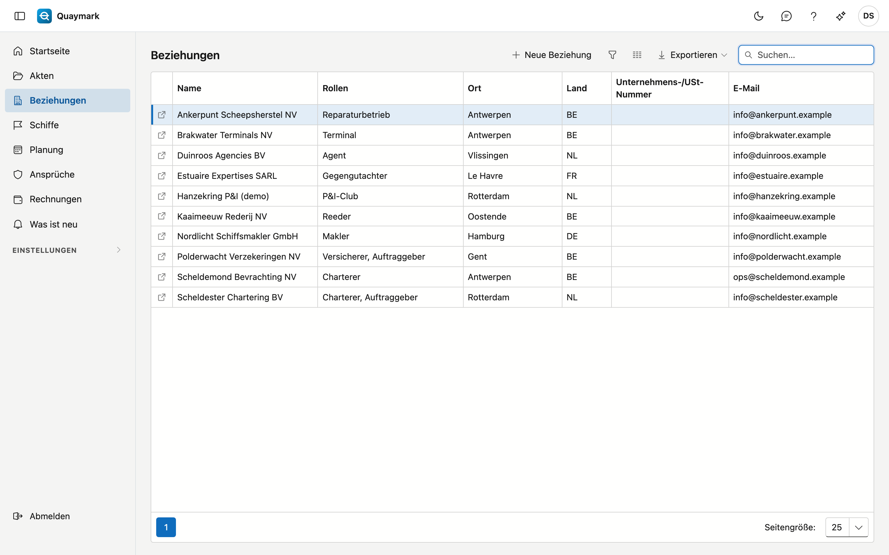
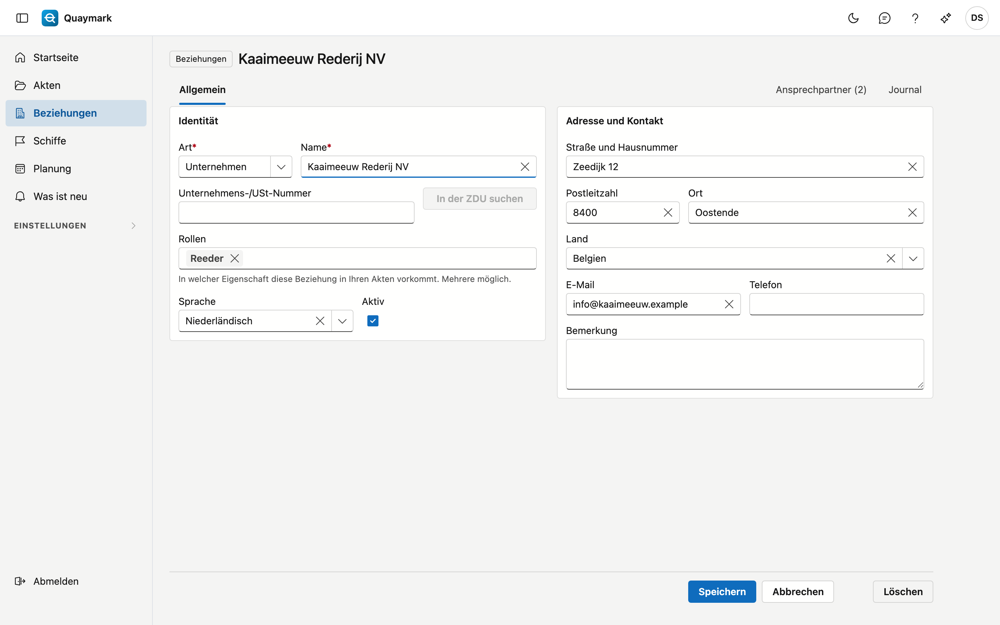

# Beziehungen

Alle Parteien, mit denen das Büro arbeitet, in einer Liste: Auftraggeber, Reeder, Charterer, Versicherer, P&I-Clubs, Terminals, Agenten, Gegengutachter, Makler und Korrespondenten.

## Bildschirm öffnen

Klicken Sie im Menü links auf **Beziehungen**.

## Die Liste

- Die Spalte **Rollen** zeigt, in welcher Eigenschaft eine Beziehung in Ihren Akten vorkommt; eine Beziehung kann mehrere Rollen haben.
- Das **Suchfeld** sucht nach Name, Rolle, Ort, Land, Unternehmensnummer und E-Mail.
- Doppelklicken Sie auf eine Zeile, um den **Datensatz** zu öffnen; der Pfeil am Zeilenanfang öffnet ihn in einem neuen Tab. **Neue Beziehung** legt einen an.

## Beziehung

Die Daten einer Beziehung.

- **Identität**: Art (Unternehmen oder Person), Name, Unternehmens- oder USt-Nummer, Rollen, Sprache und aktiv. Eine Unternehmensnummer kommt pro Land nur einmal vor.
- **In der ZDU suchen** ergänzt Name und Adresse aus der belgischen Zentralen Datenbank der Unternehmen. Das funktioniert nur für belgische Unternehmen.
- **Adresse und Kontakt**: Straße, Postleitzahl, Ort, Land, E-Mail, Telefon und eine Bemerkung.
- Eine Beziehung, die Sie nicht mehr verwenden, setzen Sie auf **inaktiv**: sie verschwindet dann aus den Auswahllisten neuer Akten, und ältere Akten zeigen sie weiterhin.

Eine gespeicherte Beziehung hat die Registerkarte **Ansprechpartner** (Name, Funktion, E-Mail, Telefon, Sprache) und das Journal mit Notizen, Aufgaben, Anlagen und Verlauf. **Löschen** verschiebt die Beziehung in den Papierkorb.

## Kundenportal

Ein Auftraggeber kann seine Akten im Kundenportal selbst verfolgen. Dazu geben Sie einer Kontaktperson der Beziehung Zugang. Die Registerkarte **Kundenportal** auf dem Datensatz sehen Sie nur mit dem Recht, das Kundenportal zu verwalten; standardmäßig hat nur der Administrator dieses Recht.

- **Wer**: eine Kontaktperson mit einer E-Mail-Adresse. Steht die Person noch nicht dabei, fügen Sie sie zuerst auf der Registerkarte **Ansprechpartner** hinzu.
- **Einladen**: Wählen Sie die Kontaktperson und klicken Sie auf **Einladen**. Sie erhält eine E-Mail, in ihrer Sprache oder sonst der der Beziehung, mit einem Link, um ihr Passwort selbst zu wählen. Der Link ist 7 Tage gültig. Bei der ersten Anmeldung richtet sie die Zwei-Faktor-Authentifizierung ein: ohne sie kommt niemand ins Portal.
- **Status**: *Eingeladen* (noch kein Passwort), *Aktiv* oder *Deaktiviert*, und ob die Zwei-Faktor-Authentifizierung aktiv ist. **Erneut einladen** sendet einen neuen Link; der vorige verfällt.
- **Zugang entziehen** ist jederzeit möglich. Ist die Kontaktperson in diesem Moment angemeldet, endet diese Sitzung innerhalb von fünf Minuten.
- **E-Mail-Benachrichtigungen an die Portalbenutzer** ist standardmäßig aktiv: eine E-Mail bei einer Entscheidung über eine Anfrage, beim Planen oder Verschieben und bei einem ausgestellten Bericht, Brief, Zertifikat oder einer Rechnung. Schalten Sie es hier für diese Beziehung aus; jeder Benutzer kann es auch selbst ausschalten. → [Anfragen](aanvragen.md#benachrichtigungen-an-den-auftraggeber)

Was die Kontaktperson im Portal sieht:

- **Meine Akten**: die Akten, in denen diese Beziehung Auftraggeber ist, mit Besichtigungsart, Schiff, Hafen, der eigenen Referenz, dem Status und wann die Arbeit geplant ist. Keine Akte im Papierkorb.
- Je Akte die **ausgestellten** Berichtsversionen und die ausgestellten Briefe und Zertifikate, als PDF. Nie eine Vorschau oder ein Entwurf. Jede Datei wird zuerst gegen ihren Fingerabdruck geprüft.
- **Neuer Auftrag**: einen Auftrag senden, mit Anhängen. Er geht als Anfrage an das Büro und steht unter **Meine Anfragen**, bis das Büro entscheidet. → [Anfragen](aanvragen.md)
- **Meine Rechnungen**: die ausgestellten Rechnungen und Gutschriften mit dieser Beziehung als Kunde, mit ihrem PDF. Kein Entwurf. Ob eine Rechnung bezahlt ist, zeigt das Portal nicht.
- Kein Besichtiger, keine Stunden, Kosten, Feststellungen oder Fotos: Diese stehen im Bericht.

## Rahmenvereinbarungen

Mit einem festen Auftraggeber vereinbart ein Büro oft eigene Tarife. Auf der Registerkarte **Rahmenvereinbarungen** (sichtbar mit dem Recht, Rechnungen anzusehen) halten Sie sie fest.

- **Neue Rahmenvereinbarung**: Wählen Sie **Gültig ab** und gegebenenfalls **Gültig bis**, und geben Sie je Besichtigungsart eine **Pauschale** oder einen **Stundensatz** ein. Neben jedem Feld steht, was das Büro ohne Vereinbarung berechnet. Eine leere Zeile folgt der Tariftabelle des Büros.
- Was nicht in der Vereinbarung steht, folgt der [Tariftabelle des Büros](tarieven.md), ebenso die Zuschläge für Wochenende, Feiertag und Nacht.
- Der **Stundensatz der Vereinbarung geht vor** dem eigenen Stundensatz eines Besichtigers: Der Auftraggeber zahlt, was vereinbart ist, welcher Besichtiger auch geht.
- Eine Akte folgt der Vereinbarung, die am **Datum des Auftrags** galt. So ändert sich der Tarif einer laufenden Akte nicht, wenn eine neue Vereinbarung beginnt.
- Zwei Vereinbarungen desselben Auftraggebers dürfen sich nicht überschneiden.
- Der Rechnungsvorschlag, die Schätzung auf der Registerkarte **Zeit und Kosten** und der Startbildschirm rechnen mit der Vereinbarung. Der Rechnungsvorschlag weist auch darauf hin.
- Ändern und löschen kann, wer die Tarife verwaltet.

## Siehe auch

- [Akten](dossiers.md)
