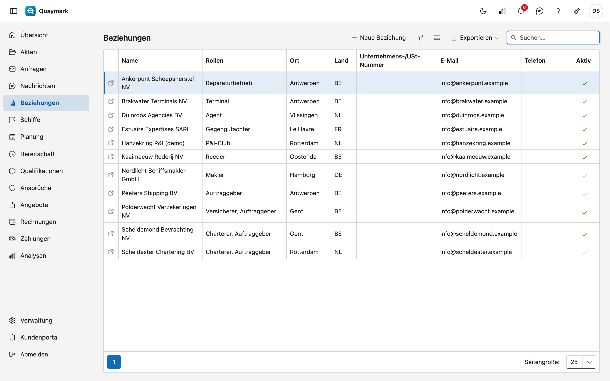
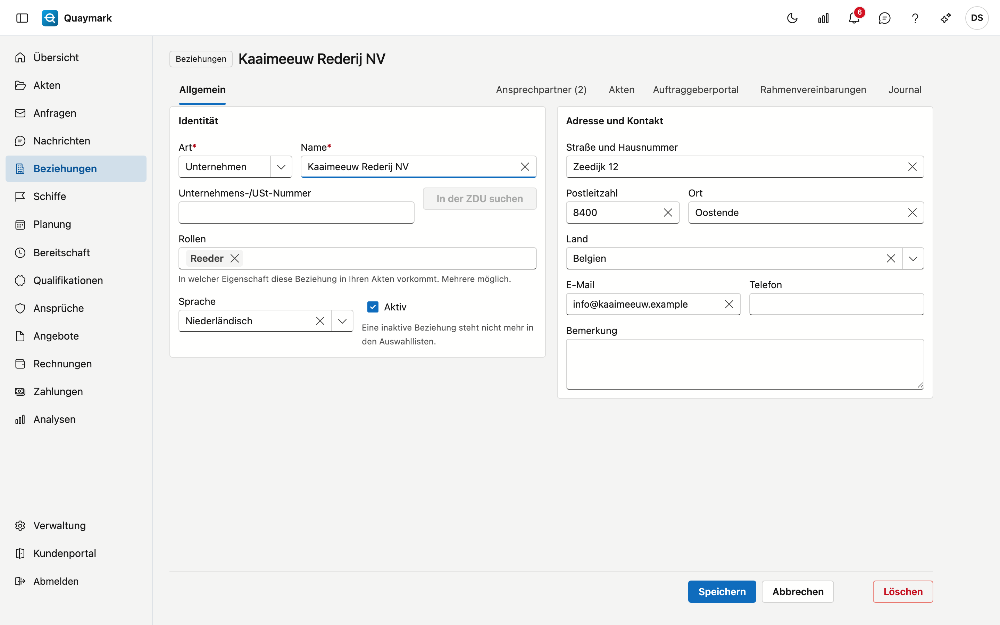

# Beziehungen

Alle Parteien, mit denen das Büro arbeitet, in einer Liste: Auftraggeber, Reeder, Charterer, Versicherer, P&I-Clubs, Terminals, Agenten, Gegengutachter, Makler und Korrespondenten.

## Bildschirm öffnen

Klicken Sie im Menü links auf **Beziehungen**.

## Die Liste

- Die Spalte **Rollen** zeigt, in welcher Eigenschaft eine Beziehung in Ihren Akten vorkommt; eine Beziehung kann mehrere Rollen haben.
- Die Spalte **Aktiv** zeigt, ob eine Beziehung noch in den Auswahllisten steht; ein Strich bedeutet inaktiv.
- Das **Suchfeld** sucht nach Name, Rolle, Ort, Land, Unternehmensnummer, E-Mail und Telefon.
- Doppelklicken Sie auf eine Zeile, um den **Datensatz** zu öffnen; der Pfeil am Zeilenanfang öffnet ihn in einem neuen Tab. **Neue Beziehung** legt einen an.
- Die Leiste **Journal** rechts neben der Liste öffnet das Journal der Zeile, auf der Sie stehen: **Notizen**, **Aufgaben**, **Anhänge** und **Verlauf**, wie im Datensatz. Klicken Sie einmal auf eine andere Zeile, und das Journal folgt: Sie müssen die Beziehung nicht öffnen, um zu sehen, was dazu notiert ist. Der Pfeil oben schließt sie wieder.

## Beziehung

Die Daten einer Beziehung.

- **Identität**: Art (Unternehmen oder Person), Name, Unternehmens- oder USt-Nummer, Rollen, Sprache, aktiv und das **Zahlungsziel (Tage)** dieses Auftraggebers: Jede neue Rechnung an die Beziehung erhält dieses Ziel; leer = das Zahlungsziel des Büros. Eine Unternehmensnummer kommt pro Land nur einmal vor.
- **In der ZDU suchen** ergänzt Name und Adresse aus der belgischen Zentralen Datenbank der Unternehmen. Das funktioniert nur für belgische Unternehmen.
- **Adresse und Kontakt**: Straße, Postleitzahl, Ort, Land, E-Mail, Telefon und eine Bemerkung. Eine ungültige E-Mail-Adresse (zum Beispiel ein Komma statt eines Punkts) speichert Quaymark nicht.
- Eine Beziehung, die Sie nicht mehr verwenden, setzen Sie auf **inaktiv**: sie verschwindet dann aus den Auswahllisten neuer Akten, und ältere Akten zeigen sie weiterhin.

Eine gespeicherte Beziehung hat die Registerkarte **Ansprechpartner** (Name, Funktion, E-Mail, Telefon, Sprache; mit **⋯** am Zeilenende bearbeiten oder löschen Sie einen, und Löschen ist endgültig) und das Journal mit Notizen, Aufgaben, Anlagen und Verlauf. **Löschen** verschiebt die Beziehung in den Papierkorb; dort stellen Sie sie auch wieder her. Öffnen Sie eine Beziehung, die im Papierkorb liegt (zum Beispiel aus einer alten Akte), sagt der Datensatz das oben, und sie kann nur noch angesehen werden.

Die Registerkarte **Akten** zeigt die Akten, in denen die Beziehung vorkommt: als Auftraggeber oder als Partei, mit ihrer **Rolle** (Auftraggeber, Reeder, P&I-Club …), neueste zuerst. Ein Klick auf eine Zeile öffnet die Akte. Die Registerkarte erscheint für alle, die Akten sehen dürfen; eine Akte im Papierkorb steht nicht darin.

## Auftraggeberportal

Ein Auftraggeber kann seine Akten im Auftraggeberportal selbst verfolgen. Dazu geben Sie einer Kontaktperson der Beziehung Zugang. Die Registerkarte **Auftraggeberportal** auf dem Datensatz sehen Sie nur mit dem Recht, das Auftraggeberportal zu verwalten; standardmäßig hat nur der Administrator dieses Recht.

- **Wer**: eine Kontaktperson mit einer E-Mail-Adresse. Steht die Person noch nicht dabei, fügen Sie sie zuerst auf der Registerkarte **Ansprechpartner** hinzu.
- **Einladen**: Wählen Sie die Kontaktperson und klicken Sie auf **Einladen**. Sie erhält eine E-Mail, in ihrer Sprache oder sonst der der Beziehung, mit einem Link, um ihr Passwort selbst zu wählen. Der Link ist 7 Tage gültig. Bei der ersten Anmeldung richtet sie die Zwei-Faktor-Authentifizierung ein: ohne sie kommt niemand ins Portal.
- **Status**: *Eingeladen* (noch kein Passwort), *Aktiv* oder *Deaktiviert*, und ob die Zwei-Faktor-Authentifizierung aktiv ist. **Erneut einladen** sendet einen neuen Link; der vorige verfällt.
- **Zugang entziehen** ist jederzeit möglich. Ist die Kontaktperson in diesem Moment angemeldet, endet diese Sitzung innerhalb von fünf Minuten. Beide Aktionen stehen unter **⋯** am Zeilenende. Liegt die Beziehung im Papierkorb, können Sie niemanden mehr einladen; den Zugang entziehen können Sie weiterhin.
- **E-Mail-Benachrichtigungen an die Portalbenutzer** ist standardmäßig aktiv: eine E-Mail bei einer Entscheidung über eine Anfrage, beim Planen oder Verschieben und bei einem ausgestellten Bericht, Brief, Zertifikat oder einer Rechnung. Schalten Sie es hier für diese Beziehung aus; jeder Benutzer kann es auch selbst ausschalten. → [Anfragen](aanvragen.md#benachrichtigungen-an-den-auftraggeber)

Was die Kontaktperson im Portal sieht:

- **Meine Akten**: die Akten, in denen diese Beziehung Auftraggeber ist, mit Besichtigungsart, Schiff, Hafen (mit Namen, wie in der Hafenliste), der eigenen Referenz, dem Status und wann die Arbeit geplant ist. Keine Akte im Papierkorb. Ab 10 Akten steht darüber ein Suchfeld: nach Nummer, Schiff, Hafen oder der eigenen Referenz.
- Je Akte die **ausgestellten** Berichtsversionen mit ihrer Art (vorläufig, Zwischen- oder Abschlussbericht) und die ausgestellten Briefe und Zertifikate mit ihrer Art (zum Beispiel Mengenbescheinigung), als PDF. Nie eine Vorschau oder ein Entwurf. Jede Datei wird zuerst gegen ihren Fingerabdruck geprüft.
- **Neuer Auftrag**: einen Auftrag senden, mit Anhängen. Er geht als Anfrage an das Büro und steht unter **Meine Anfragen**, bis das Büro entscheidet. → [Anfragen](aanvragen.md)
- **Meine Rechnungen**: die ausgestellten Rechnungen und Gutschriften mit dieser Beziehung als Kunde, mit ihrem PDF; eine Gutschrift negativ, mit der Rechnung, die sie berichtigt. Kein Entwurf. Ob eine Rechnung bezahlt ist, zeigt das Portal nicht.
- **Analysen**: die Feststellungen aus den Berichten seiner Akten, gezählt nach Terminal, Schiff, Ladung, Besichtigungsart, Hafen, Kategorie oder Ort. Eine Akte zählt erst mit einem Bericht, den der Auftraggeber bereits sieht, und mit dem Stand dieses Berichts. → [Analysen](analyses.md#im-auftraggeberportal)
- Pro Akte das **vereinbarte Datum** für den Bericht, wenn die Rahmenvereinbarung eine Frist hat; unter **Analysen** auch, wie viele Berichte fristgerecht kamen.
- **Nachrichten** unten auf einer Akte: das Gespräch mit dem Büro, mit Anhängen. Zu einer Nachricht des Büros erhält die Kontaktperson eine E-Mail mit einem Link. → [Nachrichten](berichten.md#was-der-auftraggeber-sieht)
- Kein Sachverständiger, keine Stunden, Kosten, Feststellungen oder Fotos: Diese stehen im Bericht.

## Rahmenvereinbarungen

Mit einem festen Auftraggeber vereinbart ein Büro oft eigene Tarife. Auf der Registerkarte **Rahmenvereinbarungen** (sichtbar mit dem Recht, Rechnungen anzusehen) halten Sie sie fest.

- **Neue Rahmenvereinbarung**: Wählen Sie **Gültig ab** und gegebenenfalls **Gültig bis**, und geben Sie je Besichtigungsart eine **Pauschale** oder einen **Stundensatz** ein. Neben jedem Feld steht, was das Büro ohne Vereinbarung berechnet. Eine leere Zeile folgt der Tariftabelle des Büros.
- Was nicht in der Vereinbarung steht, folgt der [Tariftabelle des Büros](tarieven.md), ebenso die Zuschläge für Wochenende, Feiertag und Nacht.
- Der **Stundensatz der Vereinbarung geht vor** dem eigenen Stundensatz eines Sachverständigen: Der Auftraggeber zahlt, was vereinbart ist, welcher Sachverständige auch geht.
- Eine Akte folgt der Vereinbarung, die am **Datum des Auftrags** galt. So ändert sich der Tarif einer laufenden Akte nicht, wenn eine neue Vereinbarung beginnt.
- Zwei Vereinbarungen desselben Auftraggebers dürfen sich nicht überschneiden.
- Eine **Frist** ist die Zahl der Arbeitstage, in der der erste Bericht ausgestellt sein muss, gerechnet ab dem Ende der geplanten Besichtigung (ohne Planung: das Datum des Auftrags). Samstag, Sonntag und die Feiertage des Landes der Niederlassung zählen nicht. Die erste Zeile, **Alle Besichtigungsarten**, gilt für die ganze Vereinbarung; eine Frist bei einer Art geht vor. Eine Vereinbarung darf auch nur eine Frist haben, ohne eigene Tarife.
- Mit einer Frist zeigt Quaymark, bis wann der Bericht vorliegen muss: [in der Aktenliste und auf der Akte](dossiers.md#frist-bis-zum-bericht), auf der Glocke des Sachverständigen, auf der [Startseite](aan-de-slag.md) und in den [Analysen](analyses.md#fristen).
- Der Rechnungsvorschlag, die Schätzung auf der Registerkarte **Zeit und Kosten** und der Startbildschirm rechnen mit der Vereinbarung. Der Rechnungsvorschlag weist auch darauf hin.
- Ändern und löschen kann, wer die Tarife verwaltet, mit **⋯** am Zeilenende. Bei einer Beziehung im Papierkorb können die Vereinbarungen nur noch angesehen werden.

## Siehe auch

- [Akten](dossiers.md)
