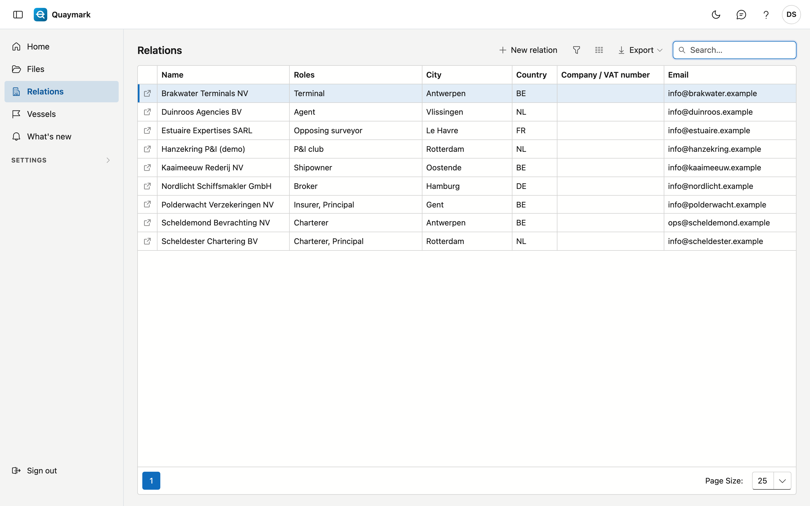
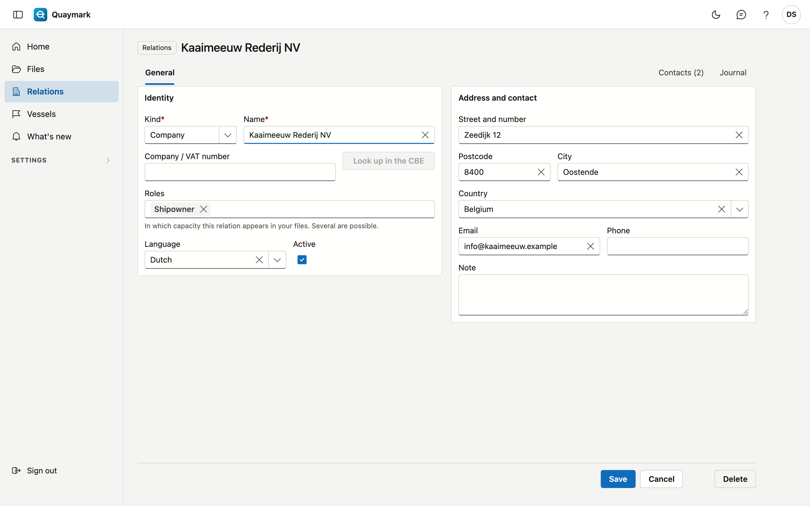

# Relations

All parties the office works with, in one list: principals, shipowners, charterers, insurers, P&I clubs, terminals, agents, opposing surveyors, brokers and correspondents.

## Opening the screen

In the menu on the left, click **Relations**.

## The list

- The **Roles** column shows in which capacity a relation appears in your files; one relation can have several roles.
- The **search box** searches name, role, city, country, company number and email.
- Double-click a row to open the **record**; the arrow at the start of the row opens it in a new tab. **New relation** creates one.

## Relation

The details of one relation.

- **Identity**: kind (company or person), name, company or VAT number, roles, language and active. A company number occurs only once per country.
- **Look up in the CBE** fills in the name and address from the Belgian Crossroads Bank for Enterprises. This only works for Belgian companies.
- **Address and contact**: street, postcode, city, country, email, phone and a note.
- Set a relation you no longer use to **inactive**: it then disappears from the choice lists of new files, while older files keep showing it.

A saved relation has the **Contacts** tab (name, position, email, phone, language) and the journal with notes, tasks, attachments and history. **Delete** moves the relation to the recycle bin.

## See also

- [Files](dossiers.md)
