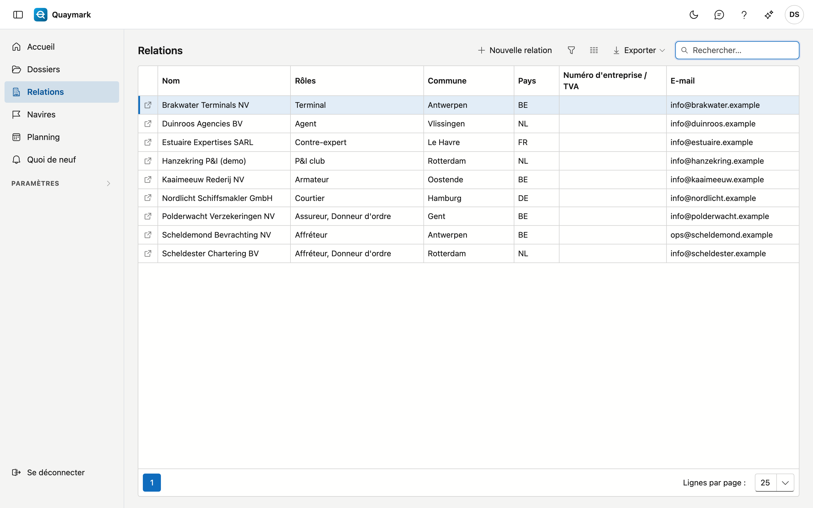
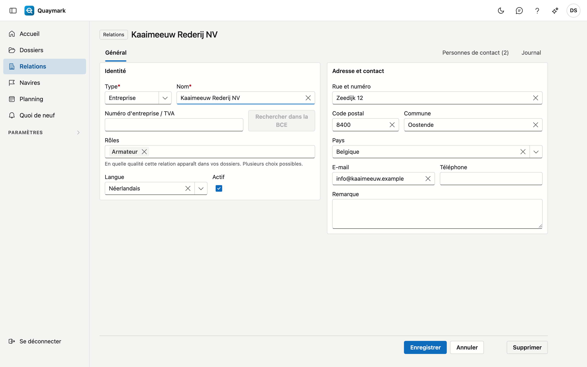

# Relations

Toutes les parties avec lesquelles le bureau travaille, dans une seule liste : donneurs d'ordre, armateurs, affréteurs, assureurs, P&I clubs, terminaux, agents, contre-experts, courtiers et correspondants.

## Ouvrir l'écran

Dans le menu de gauche, cliquez sur **Relations**.

## La liste

- La colonne **Rôles** indique en quelle qualité une relation apparaît dans vos dossiers ; une relation peut avoir plusieurs rôles.
- Le **champ de recherche** cherche sur le nom, le rôle, la commune, le pays, le numéro d'entreprise et l'e-mail.
- Double-cliquez sur une ligne pour ouvrir la **fiche** ; la flèche en début de ligne l'ouvre dans un nouvel onglet. **Nouvelle relation** en crée une.

## Relation

Les données d'une relation.

- **Identité** : type (entreprise ou personne), nom, numéro d'entreprise ou de TVA, rôles, langue et actif. Un numéro d'entreprise n'apparaît qu'une fois par pays.
- **Rechercher dans la BCE** complète le nom et l'adresse depuis la Banque-Carrefour des Entreprises. Cela ne fonctionne que pour les entreprises belges.
- **Adresse et contact** : rue, code postal, commune, pays, e-mail, téléphone et une remarque.
- Une relation que vous n'utilisez plus passe en **non active** : elle disparaît des listes de choix des nouveaux dossiers, et les anciens dossiers continuent à l'afficher.

Une relation enregistrée a l'onglet **Personnes de contact** (nom, fonction, e-mail, téléphone, langue) et le journal avec notes, tâches, pièces jointes et historique. **Supprimer** déplace la relation vers la corbeille.

## Portail client

Un donneur d'ordre peut suivre lui-même ses dossiers dans le portail client. Pour cela, vous donnez accès à une personne de contact de la relation. Vous ne voyez l'onglet **Portail client** de la fiche qu'avec le droit de gérer le portail client ; par défaut, seul l'administrateur a ce droit.

- **Qui** : une personne de contact avec une seule adresse e-mail. Si la personne n'y figure pas encore, ajoutez-la d'abord dans l'onglet **Personnes de contact**.
- **Inviter** : choisissez la personne de contact et cliquez sur **Inviter**. Elle reçoit un e-mail, dans sa langue ou à défaut celle de la relation, avec un lien pour choisir elle-même son mot de passe. Le lien est valable 7 jours. À la première connexion, elle active la vérification en deux étapes : sans elle, personne n'entre dans le portail.
- **Statut** : *Invité* (pas encore de mot de passe), *Actif* ou *Désactivé*, et si la vérification en deux étapes est activée. **Inviter à nouveau** envoie un nouveau lien ; le précédent expire.
- **Retirer l'accès** est toujours possible. Si la personne de contact est connectée à ce moment-là, cette session s'arrête dans les cinq minutes.
- **Notifications par e-mail aux utilisateurs du portail** est activé par défaut : un e-mail lors d'une décision sur une demande, d'une planification ou d'un déplacement, et lors de l'émission d'un rapport, d'une lettre, d'un certificat ou d'une facture. Désactivez-le ici pour cette relation ; chaque utilisateur peut aussi le désactiver lui-même. → [Demandes](aanvragen.md#notifications-au-donneur-dordre)

Ce que la personne de contact voit dans le portail :

- **Mes dossiers** : les dossiers dont cette relation est donneur d'ordre, avec le type d'expertise, le navire, le port, sa propre référence, le statut et la date prévue des travaux. Pas un dossier dans la corbeille.
- Pour chaque dossier, les versions **émises** du rapport et les lettres et certificats émis, en PDF. Jamais un aperçu ni un brouillon. Chaque fichier est d'abord vérifié par rapport à son empreinte.
- **Nouvelle mission** : envoyer une mission, avec pièces jointes. Elle arrive au bureau sous forme de demande et figure sous **Mes demandes** jusqu'à la décision du bureau. → [Demandes](aanvragen.md)
- **Mes factures** : les factures et notes de crédit émises au nom de cette relation, avec leur PDF. Pas un brouillon. Le portail n'indique pas si une facture est payée.
- Pas d'expert, d'heures, de frais, de constatations ni de photos : ils figurent dans le rapport.

## Accords-cadres

Avec un donneur d'ordre régulier, un bureau convient souvent de tarifs propres. Vous les enregistrez dans l'onglet **Accords-cadres** (visible avec le droit de consulter les factures).

- **Nouvel accord-cadre** : choisissez **Valable du** et éventuellement **Valable jusqu'au**, et indiquez par type d'expertise un **forfait** ou un **tarif horaire**. À côté de chaque champ figure ce que le bureau facture sans accord. Une ligne vide suit la grille tarifaire du bureau.
- Ce qui ne figure pas dans l'accord suit la [grille tarifaire du bureau](tarieven.md), de même que les suppléments de week-end, de jour férié et de nuit.
- Le **tarif horaire de l'accord prime** sur le tarif propre d'un expert : le donneur d'ordre paie ce qui est convenu, quel que soit l'expert.
- Un dossier suit l'accord en vigueur à la **date de la mission**. Ainsi, le tarif d'un dossier en cours ne change pas lorsqu'un nouvel accord entre en vigueur.
- Deux accords d'un même donneur d'ordre ne peuvent pas se chevaucher.
- La proposition de facture, l'estimation dans l'onglet **Temps et frais** et l'écran d'accueil calculent avec l'accord. La proposition de facture l'indique aussi.
- Seule la personne qui gère les tarifs peut modifier ou supprimer un accord.

## Voir aussi

- [Dossiers](dossiers.md)
