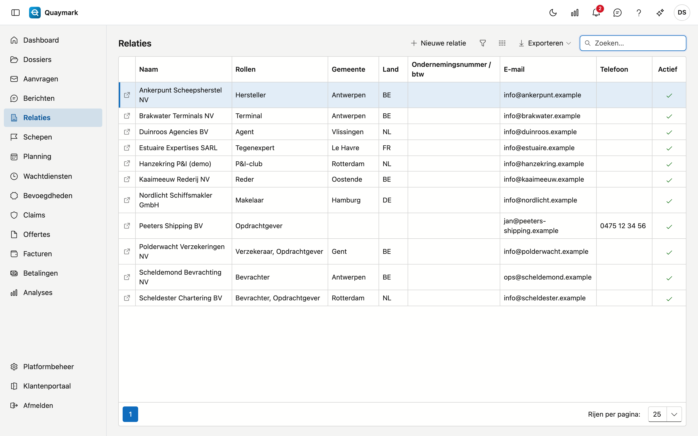
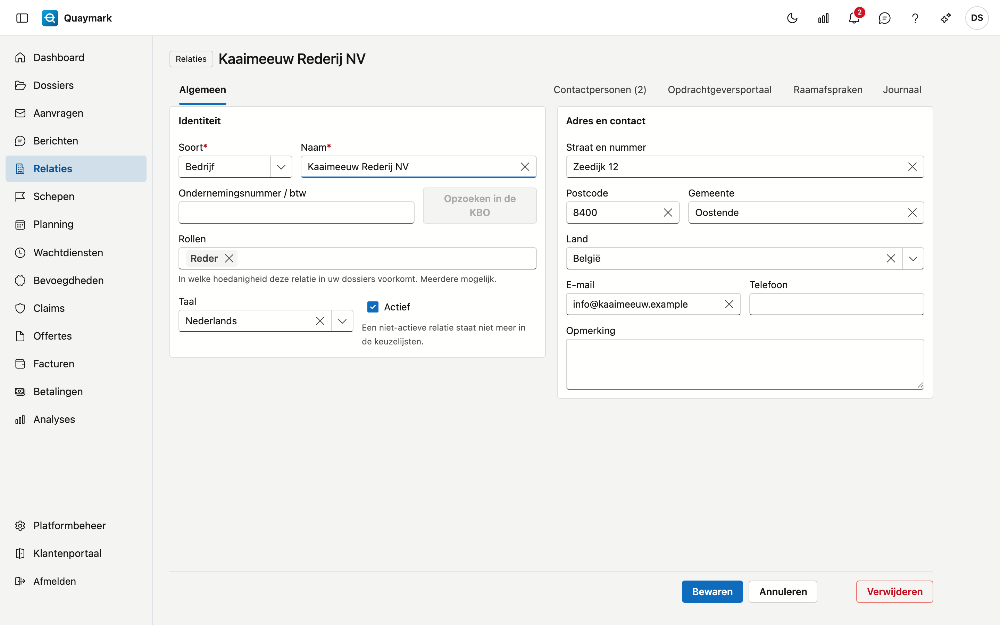

# Relaties

Alle partijen waarmee het bureau werkt, in één lijst: opdrachtgevers, reders, bevrachters, verzekeraars, P&I-clubs, terminals, agenten, tegenexperts, makelaars en correspondenten.

## Het scherm openen

Klik in het menu links op **Relaties**.

## De lijst

- De kolom **Rollen** toont in welke hoedanigheid een relatie in uw dossiers voorkomt; één relatie kan meerdere rollen hebben.
- De kolom **Actief** toont of een relatie nog in de keuzelijsten staat; een streepje betekent niet actief.
- Het **zoekvak** zoekt op naam, rol, gemeente, land, ondernemingsnummer, e-mail en telefoon.
- Dubbelklik op een rij om de **fiche** te openen; met het pijltje vooraan de rij opent ze in een nieuw tabblad. **Nieuwe relatie** maakt er een aan.
- De balk **Journaal** rechts naast de lijst klapt open tot het journaal van de rij waarop u staat: **Notities**, **Taken**, **Bijlagen** en **Historiek**, zoals op de fiche. Klik één keer op een andere rij en het journaal volgt: u hoeft de relatie niet te openen om te zien wat erbij genoteerd is. De pijl bovenaan klapt het weer dicht.

## Relatie

De gegevens van één relatie.

- **Identiteit**: soort (bedrijf of persoon), naam, ondernemingsnummer of btw-nummer, rollen, taal, actief en de **Betaaltermijn (dagen)** van deze opdrachtgever: elke nieuwe factuur aan de relatie krijgt die termijn; leeg = de betaaltermijn van het bureau. Een ondernemingsnummer komt per land maar één keer voor.
- **Opzoeken in de KBO** vult naam en adres aan uit de Kruispuntbank van Ondernemingen. Dat werkt enkel voor Belgische ondernemingen.
- **Adres en contact**: straat, postcode, gemeente, land, e-mail, telefoon en een opmerking. Een e-mailadres dat niet klopt (bijvoorbeeld een komma in plaats van een punt), bewaart Quaymark niet.
- Een relatie die u niet meer gebruikt, zet u op **niet actief**: ze verdwijnt dan uit de keuzelijsten van nieuwe dossiers, en oude dossiers blijven haar tonen.

Een bewaarde relatie heeft het tabblad **Contactpersonen** (naam, functie, e-mail, telefoon, taal; met **⋯** achteraan de rij bewerkt of verwijdert u er een, en verwijderen is definitief) en het journaal met notities, taken, bijlagen en historiek. **Verwijderen** verplaatst de relatie naar de prullenbak; daar zet u ze ook terug. Opent u een relatie die in de prullenbak staat (bijvoorbeeld vanuit een oud dossier), dan zegt de fiche dat bovenaan en is ze enkel nog te lezen.

Het tabblad **Dossiers** toont de dossiers waarin de relatie voorkomt: als opdrachtgever of als partij, met haar **rol** (opdrachtgever, reder, P&I-club …), nieuwste eerst. Een klik op een rij opent het dossier. Het tabblad verschijnt voor wie dossiers mag zien; een dossier in de prullenbak staat er niet in.

## Opdrachtgeversportaal

Een opdrachtgever kan zijn dossiers zelf volgen in het opdrachtgeversportaal. U geeft daarvoor een contactpersoon van de relatie toegang. Het tabblad **Opdrachtgeversportaal** op de fiche ziet u enkel met het recht om het opdrachtgeversportaal te beheren; standaard heeft enkel de beheerder dat recht.

- **Wie**: een contactpersoon met één e-mailadres. Staat de persoon er nog niet bij, voeg die dan eerst toe op het tabblad **Contactpersonen**.
- **Uitnodigen**: kies de contactpersoon en klik op **Uitnodigen**. De contactpersoon krijgt een mail, in de taal van de contactpersoon of anders die van de relatie, met een link om zelf een wachtwoord te kiezen. De link is 7 dagen geldig. Bij de eerste aanmelding stelt de contactpersoon tweestapsverificatie in: zonder komt niemand in het portaal.
- **Status**: *Uitgenodigd* (nog geen wachtwoord), *Actief* of *Uitgeschakeld*, en of tweestapsverificatie aan staat. **Opnieuw uitnodigen** stuurt een nieuwe link; de vorige vervalt.
- **Toegang intrekken** kan altijd. Is de contactpersoon op dat moment aangemeld, dan stopt die sessie binnen vijf minuten. Beide handelingen staan onder **⋯** achteraan de rij. Staat de relatie in de prullenbak, dan kunt u niemand meer uitnodigen; intrekken kan wel.
- **Meldingen per mail aan de portaalgebruikers** staat standaard aan: een mail bij een beslissing over een aanvraag, bij plannen of verplaatsen, en bij een uitgegeven rapport, brief, certificaat of factuur. Zet het hier uit voor deze relatie; elke gebruiker kan het ook zelf uitzetten. → [Aanvragen](aanvragen.md#meldingen-aan-de-opdrachtgever)

Wat de contactpersoon in het portaal ziet:

- **Mijn dossiers**: de dossiers waarin deze relatie opdrachtgever is, met soort survey, schip, haven (bij naam, zoals in de lijst van havens), de eigen referentie, de status en wanneer het werk gepland is. Een dossier in de prullenbak niet. Vanaf 10 dossiers staat er een zoekveld boven: op nummer, schip, haven of de eigen referentie.
- Per dossier de **uitgegeven** rapportversies met hun soort (voorlopig, tussentijds of eindrapport) en de uitgegeven brieven en certificaten met hun soort (bijvoorbeeld Certificaat van hoeveelheid), als PDF. Een voorbeeld of een klad nooit. Elk bestand wordt eerst nagerekend tegen zijn vingerafdruk.
- **Nieuwe opdracht**: een opdracht indienen, met bijlagen. Ze komt als aanvraag bij het bureau en staat onder **Mijn aanvragen** tot het bureau beslist. → [Aanvragen](aanvragen.md)
- **Mijn facturen**: de uitgegeven facturen en creditnota's met deze relatie als klant, met hun PDF; een creditnota negatief, met de factuur die ze rechtzet. Een klad niet. Of een factuur betaald is, toont het portaal niet.
- **Analyses**: de vaststellingen uit de rapporten van zijn dossiers, geteld per terminal, schip, lading, soort survey, haven, categorie of plaats. Een dossier telt pas mee met een rapport dat de opdrachtgever al ziet, en met de stand van dat rapport. → [Analyses](analyses.md#in-het-opdrachtgeversportaal)
- Per dossier de **afgesproken datum** voor het rapport, als de raamafspraak een termijn heeft; onder **Analyses** ook hoeveel rapporten op tijd kwamen.
- **Berichten** onderaan een dossier: het gesprek met het bureau, met bijlagen. Bij een bericht van het bureau krijgt de contactpersoon een mail met een link. → [Berichten](berichten.md#wat-de-opdrachtgever-ziet)
- Geen surveyor, uren, kosten, vaststellingen of foto's: die staan in het rapport.

## Raamafspraken

Met een vaste opdrachtgever spreekt een bureau vaak eigen tarieven af. Op het tabblad **Raamafspraken** (zichtbaar met het recht om facturen te bekijken) legt u die vast.

- **Nieuwe raamafspraak**: kies **Geldig van** en eventueel **Geldig tot**, en vul per soort survey een **forfait** of een **uurtarief** in. Naast elk veld staat wat het bureau zonder afspraak rekent. Een lege regel volgt de tariefkaart van het bureau.
- Wat niet in de afspraak staat, volgt de [tariefkaart van het bureau](tarieven.md); de toeslagen voor weekend, feestdag en nacht ook.
- Het **uurtarief van de afspraak gaat voor** op het eigen uurtarief van een surveyor: de opdrachtgever betaalt wat afgesproken is, welke surveyor ook gaat.
- Een dossier volgt de afspraak die gold op de **datum van de opdracht**. Zo verandert het tarief van een lopend dossier niet als een nieuwe afspraak ingaat.
- Twee afspraken van dezelfde opdrachtgever mogen elkaar niet overlappen.
- Een **termijn** is het aantal werkdagen waarbinnen het eerste rapport uitgegeven moet zijn, gerekend vanaf het einde van de geplande inspectie (zonder planning: de datum van de opdracht). Zaterdag, zondag en de feestdagen van het land van de vestiging tellen niet. De eerste regel, **Alle soorten survey**, geldt voor de hele afspraak; een termijn bij een soort gaat voor. Een afspraak mag ook enkel een termijn hebben, zonder eigen tarieven.
- Met een termijn toont Quaymark tegen wanneer het rapport er moet zijn: [in de dossierlijst en op het dossier](dossiers.md#termijn-tot-het-rapport), op het belletje van de surveyor, op de [startpagina](aan-de-slag.md) en in de [analyses](analyses.md#termijnen).
- Het factuurvoorstel, de raming op het tabblad **Tijd en kosten** en het startscherm rekenen met de afspraak. Het factuurvoorstel zegt het ook.
- Wijzigen en verwijderen kan wie de tarieven beheert, met **⋯** achteraan de afspraak. Bij een relatie in de prullenbak zijn de afspraken enkel nog te lezen.

## Zie ook

- [Dossiers](dossiers.md)
