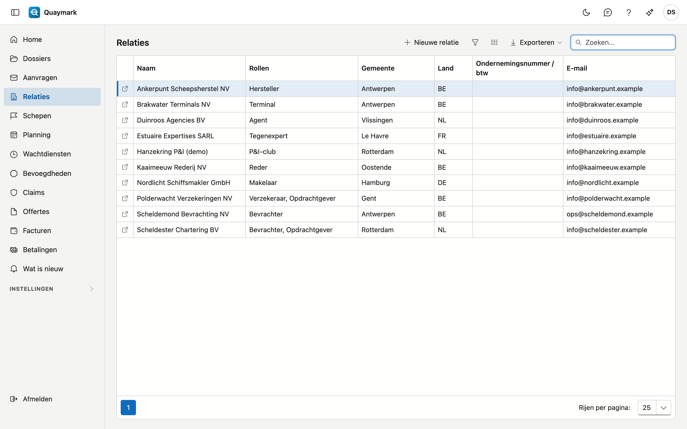
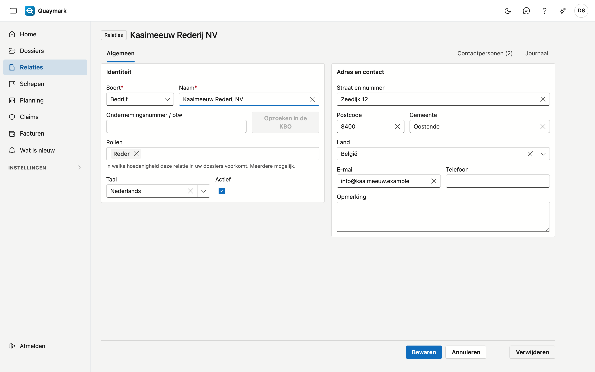

# Relaties

Alle partijen waarmee het bureau werkt, in één lijst: opdrachtgevers, reders, bevrachters, verzekeraars, P&I-clubs, terminals, agenten, tegenexperts, makelaars en correspondenten.

## Het scherm openen

Klik in het menu links op **Relaties**.

## De lijst

- De kolom **Rollen** toont in welke hoedanigheid een relatie in uw dossiers voorkomt; één relatie kan meerdere rollen hebben.
- Het **zoekvak** zoekt op naam, rol, gemeente, land, ondernemingsnummer en e-mail.
- Dubbelklik op een rij om de **fiche** te openen; met het pijltje vooraan de rij opent ze in een nieuw tabblad. **Nieuwe relatie** maakt er een aan.

## Relatie

De gegevens van één relatie.

- **Identiteit**: soort (bedrijf of persoon), naam, ondernemingsnummer of btw-nummer, rollen, taal en actief. Een ondernemingsnummer komt per land maar één keer voor.
- **Opzoeken in de KBO** vult naam en adres aan uit de Kruispuntbank van Ondernemingen. Dat werkt enkel voor Belgische ondernemingen.
- **Adres en contact**: straat, postcode, gemeente, land, e-mail, telefoon en een opmerking.
- Een relatie die u niet meer gebruikt, zet u op **niet actief**: ze verdwijnt dan uit de keuzelijsten van nieuwe dossiers, en oude dossiers blijven haar tonen.

Een bewaarde relatie heeft het tabblad **Contactpersonen** (naam, functie, e-mail, telefoon, taal) en het journaal met notities, taken, bijlagen en historiek. **Verwijderen** verplaatst de relatie naar de prullenbak.

## Klantenportaal

Een opdrachtgever kan zijn dossiers zelf volgen in het klantenportaal. U geeft daarvoor een contactpersoon van de relatie toegang. Het tabblad **Klantenportaal** op de fiche ziet u enkel met het recht om het klantenportaal te beheren; standaard heeft enkel de beheerder dat recht.

- **Wie**: een contactpersoon met één e-mailadres. Staat de persoon er nog niet bij, voeg die dan eerst toe op het tabblad **Contactpersonen**.
- **Uitnodigen**: kies de contactpersoon en klik op **Uitnodigen**. De contactpersoon krijgt een mail, in de taal van de contactpersoon of anders die van de relatie, met een link om zelf een wachtwoord te kiezen. De link is 7 dagen geldig. Bij de eerste aanmelding stelt de contactpersoon tweestapsverificatie in: zonder komt niemand in het portaal.
- **Status**: *Uitgenodigd* (nog geen wachtwoord), *Actief* of *Uitgeschakeld*, en of tweestapsverificatie aan staat. **Opnieuw uitnodigen** stuurt een nieuwe link; de vorige vervalt.
- **Toegang intrekken** kan altijd. Is de contactpersoon op dat moment aangemeld, dan stopt die sessie binnen vijf minuten.
- **Meldingen per mail aan de portaalgebruikers** staat standaard aan: een mail bij een beslissing over een aanvraag, bij plannen of verplaatsen, en bij een uitgegeven rapport, brief, certificaat of factuur. Zet het hier uit voor deze relatie; elke gebruiker kan het ook zelf uitzetten. → [Aanvragen](aanvragen.md#meldingen-aan-de-opdrachtgever)

Wat de contactpersoon in het portaal ziet:

- **Mijn dossiers**: de dossiers waarin deze relatie opdrachtgever is, met soort survey, schip, haven, de eigen referentie, de status en wanneer het werk gepland is. Een dossier in de prullenbak niet.
- Per dossier de **uitgegeven** rapportversies en de uitgegeven brieven en certificaten, als PDF. Een voorbeeld of een klad nooit. Elk bestand wordt eerst nagerekend tegen zijn vingerafdruk.
- **Nieuwe opdracht**: een opdracht indienen, met bijlagen. Ze komt als aanvraag bij het bureau en staat onder **Mijn aanvragen** tot het bureau beslist. → [Aanvragen](aanvragen.md)
- **Mijn facturen**: de uitgegeven facturen en creditnota's met deze relatie als klant, met hun PDF. Een klad niet. Of een factuur betaald is, toont het portaal niet.
- Geen surveyor, uren, kosten, vaststellingen of foto's: die staan in het rapport.

## Raamafspraken

Met een vaste opdrachtgever spreekt een bureau vaak eigen tarieven af. Op het tabblad **Raamafspraken** (zichtbaar met het recht om facturen te bekijken) legt u die vast.

- **Nieuwe raamafspraak**: kies **Geldig van** en eventueel **Geldig tot**, en vul per soort survey een **forfait** of een **uurtarief** in. Naast elk veld staat wat het bureau zonder afspraak rekent. Een lege regel volgt de tariefkaart van het bureau.
- Wat niet in de afspraak staat, volgt de [tariefkaart van het bureau](tarieven.md); de toeslagen voor weekend, feestdag en nacht ook.
- Het **uurtarief van de afspraak gaat voor** op het eigen uurtarief van een surveyor: de opdrachtgever betaalt wat afgesproken is, welke surveyor ook gaat.
- Een dossier volgt de afspraak die gold op de **datum van de opdracht**. Zo verandert het tarief van een lopend dossier niet als een nieuwe afspraak ingaat.
- Twee afspraken van dezelfde opdrachtgever mogen elkaar niet overlappen.
- Het factuurvoorstel, de raming op het tabblad **Tijd en kosten** en het startscherm rekenen met de afspraak. Het factuurvoorstel zegt het ook.
- Wijzigen en verwijderen kan wie de tarieven beheert.

## Zie ook

- [Dossiers](dossiers.md)
