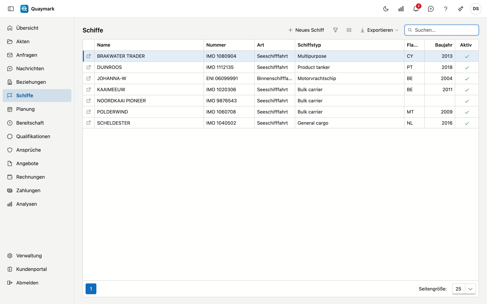
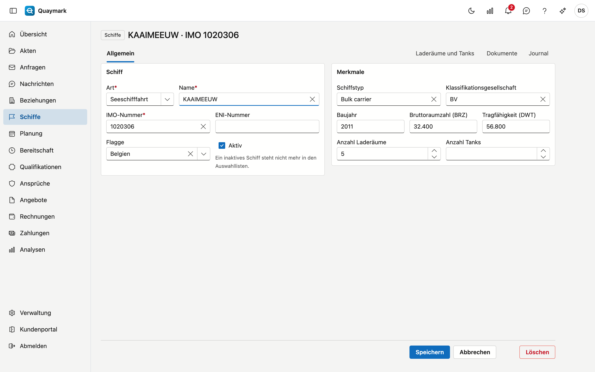
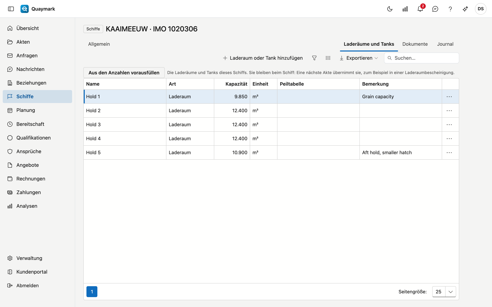
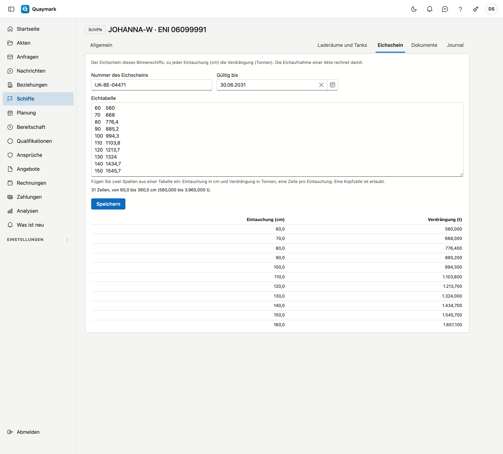

# Schiffe

Die Schiffe, die das Büro besichtigt, See- und Binnenschifffahrt.

## Bildschirm öffnen

Klicken Sie im Menü links auf **Schiffe**.

## Die Liste

- **Nummer** ist die IMO-Nummer eines Seeschiffs oder die ENI-Nummer eines Binnenschiffs.
- Das **Suchfeld** sucht nach Name, Nummer, Art, Schiffstyp, Flagge und Baujahr.
- Doppelklicken Sie auf eine Zeile, um den **Datensatz** zu öffnen; der Pfeil am Zeilenanfang öffnet ihn in einem neuen Tab. **Neues Schiff** legt einen an.

## Schiff

Die Daten eines Schiffs.

- **Schiff**: Art (See- oder Binnenschifffahrt), Name, IMO-Nummer, ENI-Nummer und Flagge. Ein Seeschiff hat eine **IMO-Nummer** (7 Ziffern, die letzte ist eine Prüfziffer), ein Binnenschiff eine **ENI-Nummer** (8 Ziffern). Jede Nummer kommt nur einmal vor, auch im Papierkorb.
- **Merkmale**: Schiffstyp, Klassifikationsgesellschaft, Baujahr, Bruttoraumzahl, Tragfähigkeit, Anzahl Laderäume und Anzahl Tanks. Die Anzahl Laderäume oder Tanks bestimmt, wie viele leere Zeilen eine Tabelle pro Laderaum oder Tank in einer Akte erhält.
- Ein Schiff, das Sie nicht mehr verwenden, setzen Sie auf **inaktiv**: es verschwindet aus der Auswahlliste neuer Akten und einer Anfrage (außer wenn die Nummer der Anfrage übereinstimmt). Die Spalte **Aktiv** in der Liste zeigt es.
- Öffnen Sie ein Schiff, das im Papierkorb liegt (zum Beispiel aus einer alten Akte), sagt der Datensatz das oben, und es kann nur noch angesehen werden.

Ein gespeichertes Schiff hat die Registerkarte **Dokumente** (Pläne, Zertifikate, Tabellen, in Ordnern) und das Journal. Diese Dokumente erscheinen auch in jeder Akte des Schiffs, unter **Vom Schiff**. **Löschen** verschiebt das Schiff in den Papierkorb. Ein neues Schiff erhält sofort die [Standardordner](standaardmappen.md) des Büros, auch wenn es aus einer Akte, einer Anfrage oder einem Angebot entsteht.

Die Registerkarte **Besichtigungshistorie** zeigt alle Akten des Schiffs, neueste zuerst: Datum, Besichtigungsart, Auftraggeber, Hafen und Status. Ein On-hire und sein Off-hire verweisen unter **Verknüpfte Akte** aufeinander (siehe den Block Umstände und Anwesende einer [Akte](dossiers.md#akte)). Ein Klick auf eine Zeile öffnet die Akte.

## Laderäume und Tanks

Die Registerkarte **Laderäume und Tanks** führt pro Schiff die Laderäume und Tanks, damit ein nächster Besuch sie wiederverwendet:

- ein **Name** (Laderaum 1, Tank 3P) und eine **Art**: Laderaum, Ladetank, Ballasttank, Brennstofftank oder andere;
- die **Kapazität** mit ihrer Einheit (m³, L, bbl, t, kg, LT oder ST);
- die **Peiltabelle**: ein Anhang des Schiffs (Registerkarte Dokumente), zum Beispiel die Peiltabelle eines Tanks. Ein Klick auf den Namen öffnet sie: ein PDF in einem Fenster, jede andere Datei als Download. Liegt das Dokument im Papierkorb, zeigt die Liste **Dokument nicht mehr verfügbar**: Stellen Sie es wieder her oder wählen Sie eine andere Peiltabelle;
- eine **Bemerkung**.

**Aus den Anzahlen vorausfüllen** legt Laderaum 1 bis zur Anzahl Laderäume und Tank 1 bis zur Anzahl Tanks an, wie in der Registerkarte Allgemein eingetragen. Ein bereits vorhandener Name wird übersprungen. Unter **⋯** in einer Zeile stehen **Bearbeiten**, **Nach oben** und **Nach unten** (eine Stelle höher oder tiefer in der Liste) und **Löschen**; ein Doppelklick auf eine Zeile öffnet sie ebenfalls.

Eine Laderaumbescheinigung in einer Akte dieses Schiffs erhält sofort eine Zeile pro Laderaum.

## Eichschein

Ein Binnenschiff hat die Registerkarte **Eichschein**: die **Nummer**, **Gültig bis** und die **Eichtabelle**, mit der Verdrängung (Tonnen) zu jeder Eintauchung (cm). Die Eichaufnahme einer Akte rechnet damit (siehe [Akten](dossiers.md#eichaufnahme)).

Fügen Sie die Eichtabelle als zwei Spalten aus einer Tabellenkalkulation ein, eine Zeile pro Eintauchung; eine Kopfzeile ist erlaubt. Quaymark liest sie sofort und zeigt die Zahl der Zeilen und den Bereich, oder die Zeile, die nicht lesbar ist. Daneben steht die Tabelle, wie Quaymark sie liest. Eintauchung und Verdrängung müssen ansteigen, sonst ist **Speichern** nicht möglich. Ein abgelaufener Eichschein gibt hier eine Warnung. Oben steht, wann und von wem der Eichschein gespeichert wurde; eine noch nicht gespeicherte Änderung zeigt **Nicht gespeichert**. Eine bereits gespeicherte Eichaufnahme rechnet weiter mit dem Eichschein von damals: Ändern Sie den Eichschein, ändert sich keine gespeicherte Eichaufnahme (siehe [Akten](dossiers.md#eichaufnahme)). Eine Zahl mit einem einzigen Punkt oder Komma und genau drei Ziffern danach (1.052) kann ein Tausendertrennzeichen oder drei Dezimalstellen sein: Quaymark lehnt die Zeile dann ab, außer die Tabelle zeigt an anderer Stelle, welches Zeichen das Dezimalzeichen ist. Schreiben Sie eine solche Zahl ohne Tausendertrennzeichen (1052).

## Siehe auch

- [Akten](dossiers.md)
