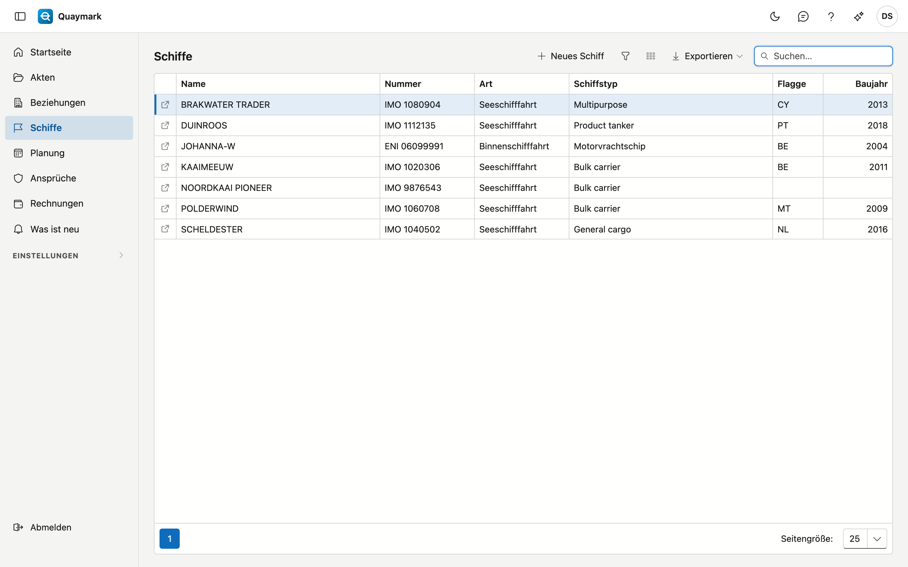
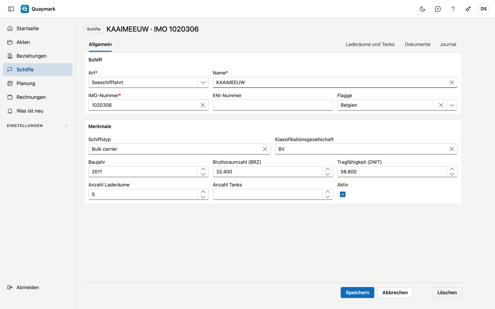
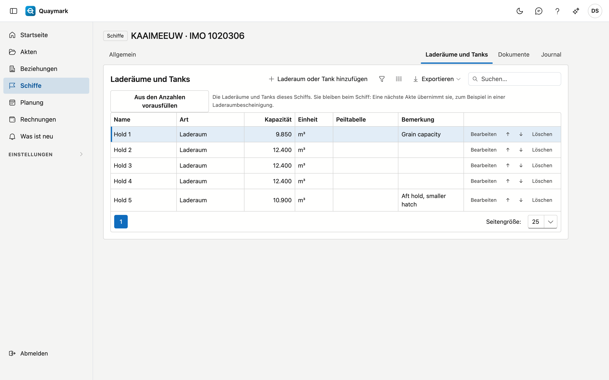

# Schiffe

Die Schiffe, die das Büro besichtigt, See- und Binnenschifffahrt.

## Bildschirm öffnen

Klicken Sie im Menü links auf **Schiffe**.

## Die Liste

- **Nummer** ist die IMO-Nummer eines Seeschiffs oder die ENI-Nummer eines Binnenschiffs.
- Das **Suchfeld** sucht nach Name, Nummer, Art, Schiffstyp, Flagge und Baujahr.
- Doppelklicken Sie auf eine Zeile, um den **Datensatz** zu öffnen; der Pfeil am Zeilenanfang öffnet ihn in einem neuen Tab. **Neues Schiff** legt einen an.

## Schiff

Die Daten eines Schiffs.

- **Schiff**: Art (See- oder Binnenschifffahrt), Name, IMO-Nummer, ENI-Nummer und Flagge. Ein Seeschiff hat eine **IMO-Nummer** (7 Ziffern, die letzte ist eine Prüfziffer), ein Binnenschiff eine **ENI-Nummer** (8 Ziffern). Jede Nummer kommt nur einmal vor, auch im Papierkorb.
- **Merkmale**: Schiffstyp, Klassifikationsgesellschaft, Baujahr, Bruttoraumzahl, Tragfähigkeit, Anzahl Laderäume und Anzahl Tanks. Die Anzahl Laderäume oder Tanks bestimmt, wie viele leere Zeilen eine Tabelle pro Laderaum oder Tank in einer Akte erhält.
- Ein Schiff, das Sie nicht mehr verwenden, setzen Sie auf **inaktiv**: es verschwindet aus der Auswahlliste neuer Akten.

Ein gespeichertes Schiff hat die Registerkarte **Dokumente** (Pläne, Zertifikate, Tabellen, in Ordnern) und das Journal. Diese Dokumente erscheinen auch in jeder Akte des Schiffs, unter **Vom Schiff**. **Löschen** verschiebt das Schiff in den Papierkorb.

## Laderäume und Tanks

Die Registerkarte **Laderäume und Tanks** führt pro Schiff die Laderäume und Tanks, damit ein nächster Besuch sie wiederverwendet:

- ein **Name** (Laderaum 1, Tank 3P) und eine **Art**: Laderaum, Ladetank, Ballasttank, Brennstofftank oder andere;
- die **Kapazität** mit ihrer Einheit (m³, L, bbl, t, kg, LT oder ST);
- die **Peiltabelle**: ein Anhang des Schiffs (Registerkarte Dokumente), zum Beispiel die Peiltabelle eines Tanks;
- eine **Bemerkung**.

**Aus den Anzahlen vorausfüllen** legt Laderaum 1 bis zur Anzahl Laderäume und Tank 1 bis zur Anzahl Tanks an, wie in der Registerkarte Allgemein eingetragen. Ein bereits vorhandener Name wird übersprungen. Die Pfeile setzen einen Laderaum oder Tank eine Stelle höher oder tiefer.

Eine Laderaumbescheinigung in einer Akte dieses Schiffs erhält sofort eine Zeile pro Laderaum.

## Siehe auch

- [Akten](dossiers.md)
