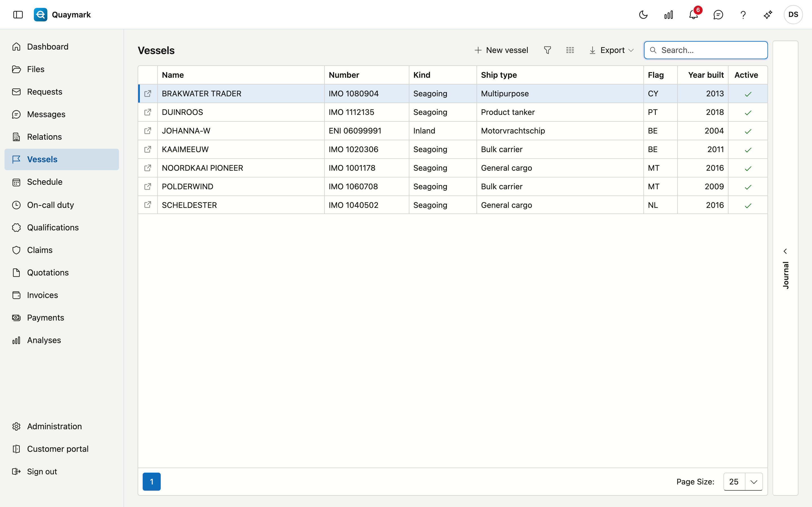
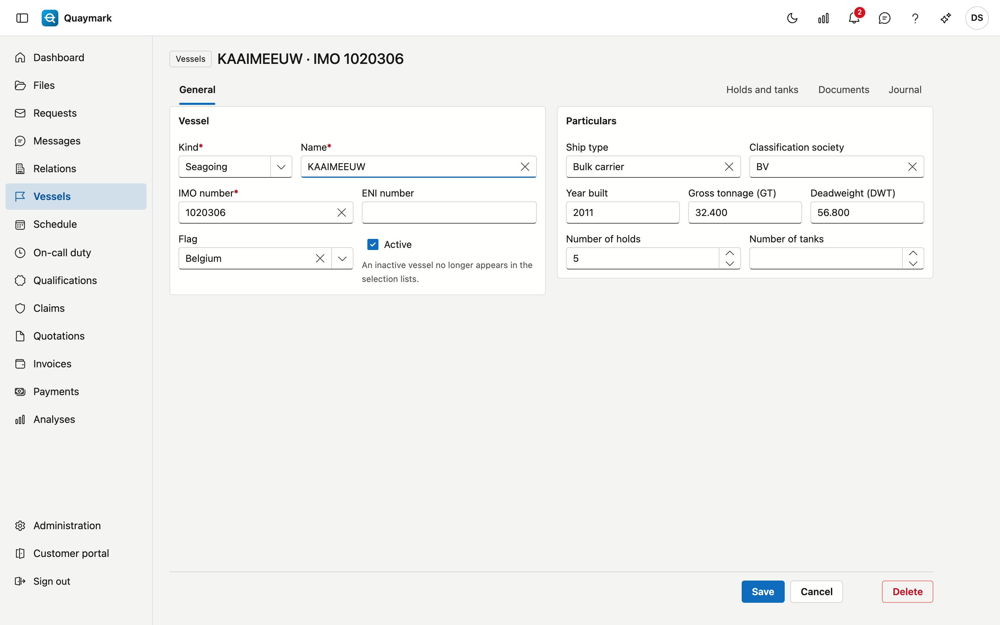
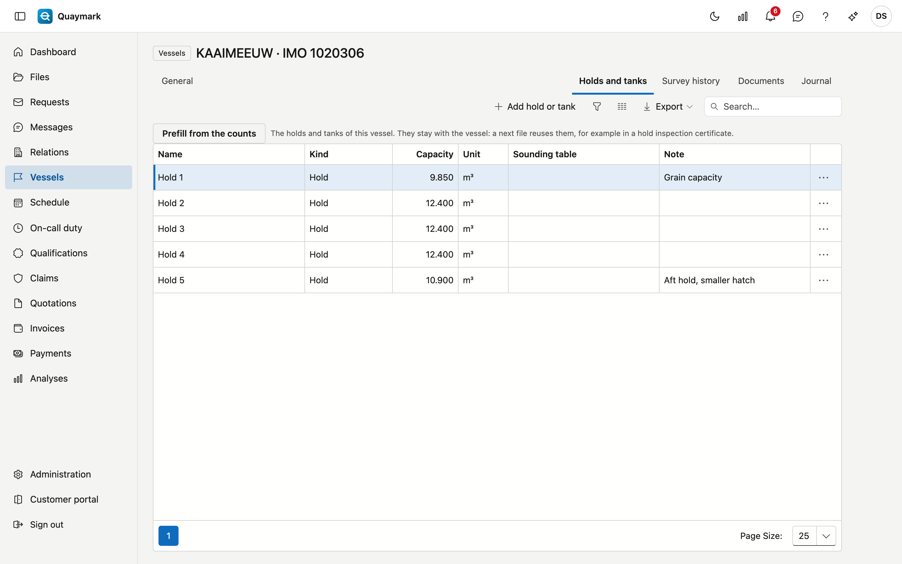
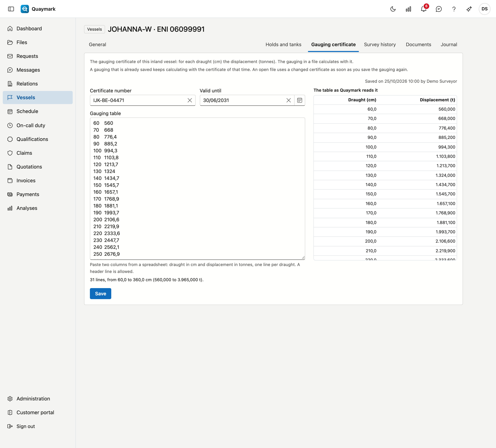

# Vessels

The vessels the office surveys, seagoing and inland.

## Opening the screen

In the menu on the left, click **Vessels**.

## The list

- **Number** is the IMO number of a seagoing vessel or the ENI number of an inland vessel.
- The **search box** searches name, number, kind, ship type, flag and year built.
- Double-click a row to open the **record**; the arrow at the start of the row opens it in a new tab. **New vessel** creates one.

## Vessel

The details of one vessel.

- **Vessel**: kind (seagoing or inland), name, IMO number, ENI number and flag. A seagoing vessel has an **IMO number** (7 digits, the last one is a check digit), an inland vessel an **ENI number** (8 digits). Each number occurs only once, the recycle bin included.
- **Particulars**: ship type, classification society, year built, gross tonnage, deadweight, number of holds and number of tanks. The number of holds or tanks determines how many empty rows a table per hold or tank gets in a file.
- Set a vessel you no longer use to **inactive**: it disappears from the choice list of new files and of a request (unless the number in the request matches). The **Active** column in the list shows it.
- If you open a vessel that is in the recycle bin (for example from an old file), the record says so at the top and it can only be viewed.

A saved vessel has the **Documents** tab (plans, certificates, tables, in folders) and the journal. These documents also appear on every file of the vessel, under **From the vessel**. **Delete** moves the vessel to the recycle bin.

## Holds and tanks

The **Holds and tanks** tab keeps the holds and tanks per vessel, so that a next visit reuses them:

- a **Name** (Hold 1, Tank 3P) and a **Type**: hold, cargo tank, ballast tank, fuel tank or other;
- the **Capacity** with its unit (m³, L, bbl, t, kg, LT or ST);
- the **Sounding table**: an attachment of the vessel (Documents tab), for example the sounding table of a tank. A click on the name opens it: a PDF in a window, any other file as a download. If the document is in the recycle bin, the list shows **Document no longer available**: restore it or choose another sounding table;
- a **Note**.

**Prefill from the counts** creates Hold 1 up to the number of holds, and Tank 1 up to the number of tanks, as filled in on the General tab. A name that already exists is skipped. Under **⋯** on a row you find **Edit**, **Move up** and **Move down** (one place up or down in the list) and **Delete**; a double-click on a row opens it too.

A hold inspection certificate on a file of this vessel immediately gets one line per hold.

## Gauging certificate

An inland vessel has the **Gauging certificate** tab: the **number**, **Valid until** and the **gauging table**, with for each draught (cm) the displacement (tonnes). The gauging in a file calculates with it (see [Files](dossiers.md#barge-gauging)).

Paste the gauging table as two columns from a spreadsheet, one line per draught; a header line is allowed. Quaymark reads it at once and shows the number of lines and the range, or the line it cannot read. Draught and displacement must increase, otherwise **Save** is not possible. An expired certificate gives a warning here. At the top you see when and by whom the certificate was saved; a change that is not saved yet says **Not saved**. A gauging that is already saved keeps calculating with the certificate of that time: if you change the certificate, no saved gauging changes (see [Files](dossiers.md#barge-gauging)).

## See also

- [Files](dossiers.md)
