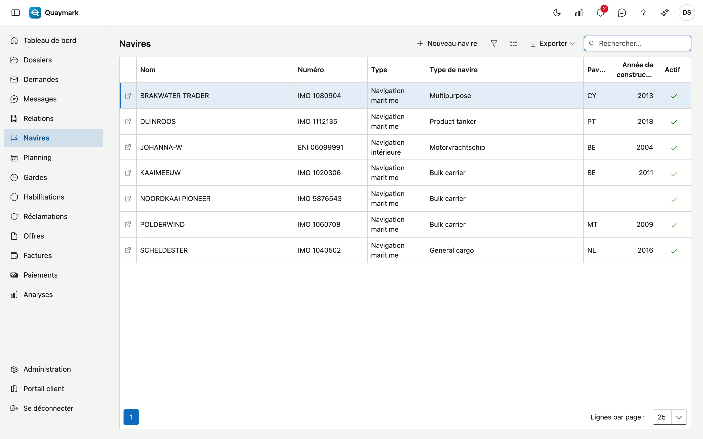
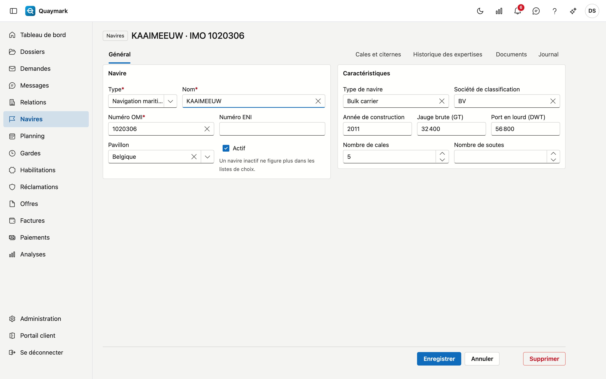
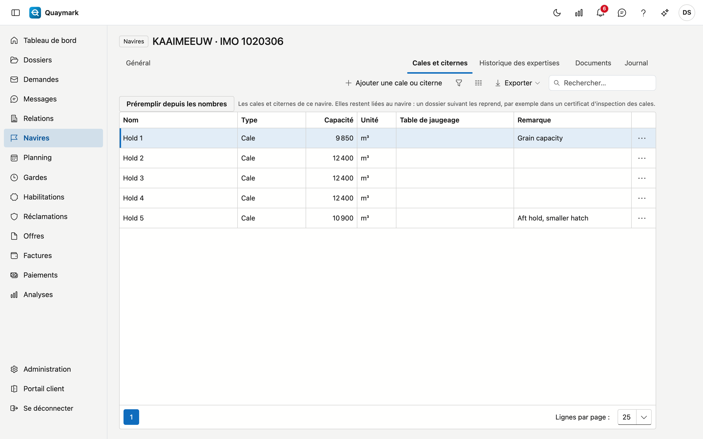
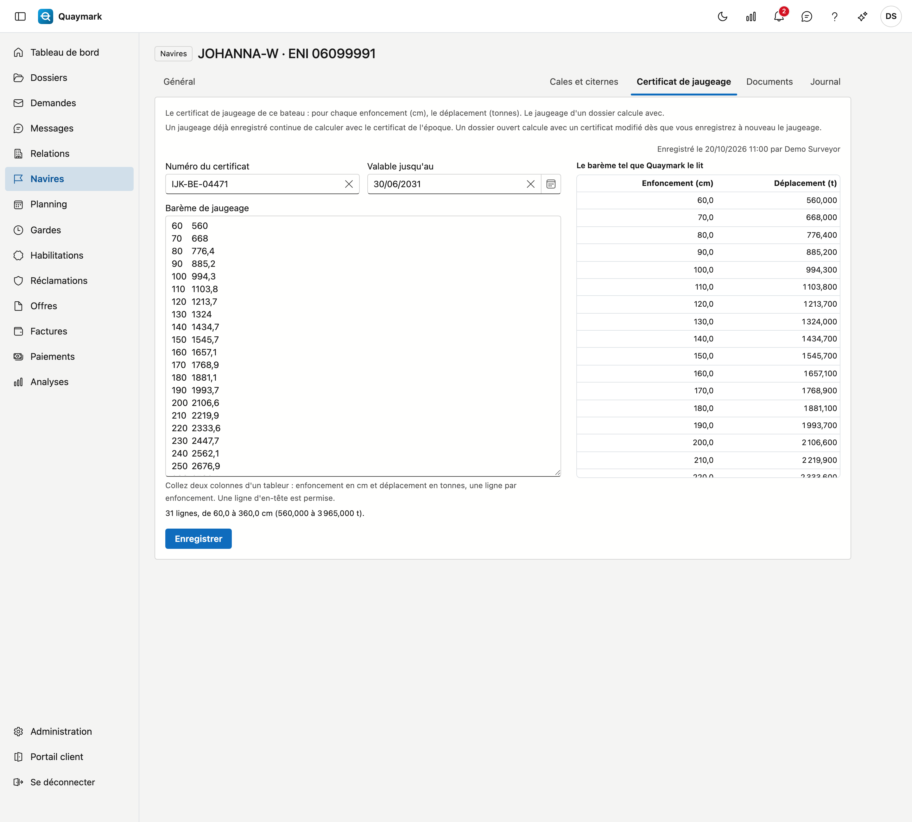

# Navires

Les navires sur lesquels le bureau réalise des expertises, navigation maritime et intérieure.

## Ouvrir l'écran

Dans le menu de gauche, cliquez sur **Navires**.

## La liste

- **Numéro** est le numéro OMI d'un navire de mer ou le numéro ENI d'un bateau de navigation intérieure.
- Le **champ de recherche** cherche sur le nom, le numéro, le type de navigation, le type de navire, le pavillon et l'année de construction.
- Double-cliquez sur une ligne pour ouvrir la **fiche** ; la flèche en début de ligne l'ouvre dans un nouvel onglet. **Nouveau navire** en crée un.

## Navire

Les données d'un navire.

- **Navire** : type (maritime ou intérieure), nom, numéro OMI, numéro ENI et pavillon. Un navire de mer a un **numéro OMI** (7 chiffres, le dernier est un chiffre de contrôle), un bateau de navigation intérieure un **numéro ENI** (8 chiffres). Chaque numéro n'apparaît qu'une fois, corbeille comprise.
- **Caractéristiques** : type de navire, société de classification, année de construction, jauge brute, port en lourd, nombre de cales et nombre de soutes. Le nombre de cales ou de soutes détermine combien de lignes vides un tableau par cale ou par soute reçoit dans un dossier.
- Un navire que vous n'utilisez plus passe en **non actif** : il disparaît de la liste de choix des nouveaux dossiers et d'une demande (sauf si le numéro de la demande correspond). La colonne **Actif** de la liste l'indique.
- Si vous ouvrez un navire qui se trouve dans la corbeille (par exemple depuis un ancien dossier), la fiche l'indique en haut et il ne peut plus qu'être consulté.

Un navire enregistré a l'onglet **Documents** (plans, certificats, tables, en répertoires) et le journal. Ces documents apparaissent aussi dans chaque dossier du navire, sous **Du navire**. **Supprimer** déplace le navire vers la corbeille. Un nouveau navire reçoit aussitôt les [répertoires standard](standaardmappen.md) du bureau, même s'il est créé depuis un dossier, une demande ou une offre.

## Cales et citernes

L'onglet **Cales et citernes** conserve par navire les cales et citernes, pour qu'une visite suivante les réutilise :

- un **Nom** (Cale 1, Citerne 3P) et un **Type** : cale, citerne à cargaison, ballast, soute à combustible ou autre ;
- la **Capacité** avec son unité (m³, L, bbl, t, kg, LT ou ST) ;
- la **Table de jaugeage** : une pièce jointe du navire (onglet Documents), par exemple la table d'une citerne. Un clic sur le nom l'ouvre : un PDF dans une fenêtre, un autre fichier en téléchargement. Si le document est dans la corbeille, la liste affiche **Document plus disponible** : restaurez-le ou choisissez une autre table de jaugeage ;
- une **Remarque**.

**Préremplir depuis les nombres** crée Cale 1 jusqu'au nombre de cales, et Citerne 1 jusqu'au nombre de citernes, tels qu'indiqués dans l'onglet Général. Un nom qui existe déjà est ignoré. Sous **⋯** sur une ligne se trouvent **Modifier**, **Monter** et **Descendre** (une place plus haut ou plus bas dans la liste) et **Supprimer** ; un double-clic sur une ligne l'ouvre aussi.

Un certificat d'inspection des cales sur un dossier de ce navire reçoit directement une ligne par cale.

## Certificat de jaugeage

Un bateau de navigation intérieure a l'onglet **Certificat de jaugeage** : le **numéro**, **Valable jusqu'au** et le **barème de jaugeage**, avec pour chaque enfoncement (cm) le déplacement (tonnes). Le jaugeage d'un dossier calcule avec (voir [Dossiers](dossiers.md#jaugeage-aux-echelles)).

Collez le barème en deux colonnes depuis un tableur, une ligne par enfoncement ; une ligne d'en-tête est permise. Quaymark le lit aussitôt et montre le nombre de lignes et l'étendue, ou la ligne illisible. À côté figure le barème tel que Quaymark le lit. L'enfoncement et le déplacement doivent être croissants, sinon **Enregistrer** n'est pas possible. Un certificat expiré donne ici un avertissement. En haut figure quand et par qui le certificat a été enregistré ; une modification pas encore enregistrée affiche **Non enregistré**. Un jaugeage déjà enregistré continue de calculer avec le certificat de l'époque : si vous modifiez le certificat, aucun jaugeage enregistré ne change (voir [Dossiers](dossiers.md#jaugeage-aux-echelles)).

## Voir aussi

- [Dossiers](dossiers.md)
