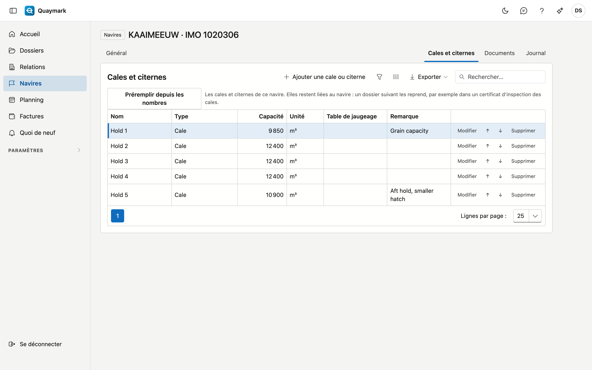

# Navires

Les navires sur lesquels le bureau réalise des expertises, navigation maritime et intérieure.

## Ouvrir l'écran

Dans le menu de gauche, cliquez sur **Navires**.

## La liste

- **Numéro** est le numéro OMI d'un navire de mer ou le numéro ENI d'un bateau de navigation intérieure.
- Le **champ de recherche** cherche sur le nom, le numéro, le type de navigation, le type de navire, le pavillon et l'année de construction.
- Double-cliquez sur une ligne pour ouvrir la **fiche** ; la flèche en début de ligne l'ouvre dans un nouvel onglet. **Nouveau navire** en crée un.

## Navire

Les données d'un navire.

- **Navire** : type (maritime ou intérieure), nom, numéro OMI, numéro ENI et pavillon. Un navire de mer a un **numéro OMI** (7 chiffres, le dernier est un chiffre de contrôle), un bateau de navigation intérieure un **numéro ENI** (8 chiffres). Chaque numéro n'apparaît qu'une fois, corbeille comprise.
- **Caractéristiques** : type de navire, société de classification, année de construction, jauge brute, port en lourd, nombre de cales et nombre de soutes. Le nombre de cales ou de soutes détermine combien de lignes vides un tableau par cale ou par soute reçoit dans un dossier.
- Un navire que vous n'utilisez plus passe en **non actif** : il disparaît de la liste de choix des nouveaux dossiers.

Un navire enregistré a l'onglet **Documents** (plans, certificats, tables, en répertoires) et le journal. Ces documents apparaissent aussi dans chaque dossier du navire, sous **Du navire**. **Supprimer** déplace le navire vers la corbeille.

## Cales et citernes

L'onglet **Cales et citernes** conserve par navire les cales et citernes, pour qu'une visite suivante les réutilise :

- un **Nom** (Cale 1, Citerne 3P) et un **Type** : cale, citerne à cargaison, ballast, soute à combustible ou autre ;
- la **Capacité** avec son unité (m³, L, bbl, t, kg, LT ou ST) ;
- la **Table de jaugeage** : une pièce jointe du navire (onglet Documents), par exemple la table d'une citerne ;
- une **Remarque**.

**Préremplir depuis les nombres** crée Cale 1 jusqu'au nombre de cales, et Citerne 1 jusqu'au nombre de citernes, tels qu'indiqués dans l'onglet Général. Un nom qui existe déjà est ignoré. Les flèches font monter ou descendre une cale ou citerne d'une place.

Un certificat d'inspection des cales sur un dossier de ce navire reçoit directement une ligne par cale.

## Voir aussi

- [Dossiers](dossiers.md)
