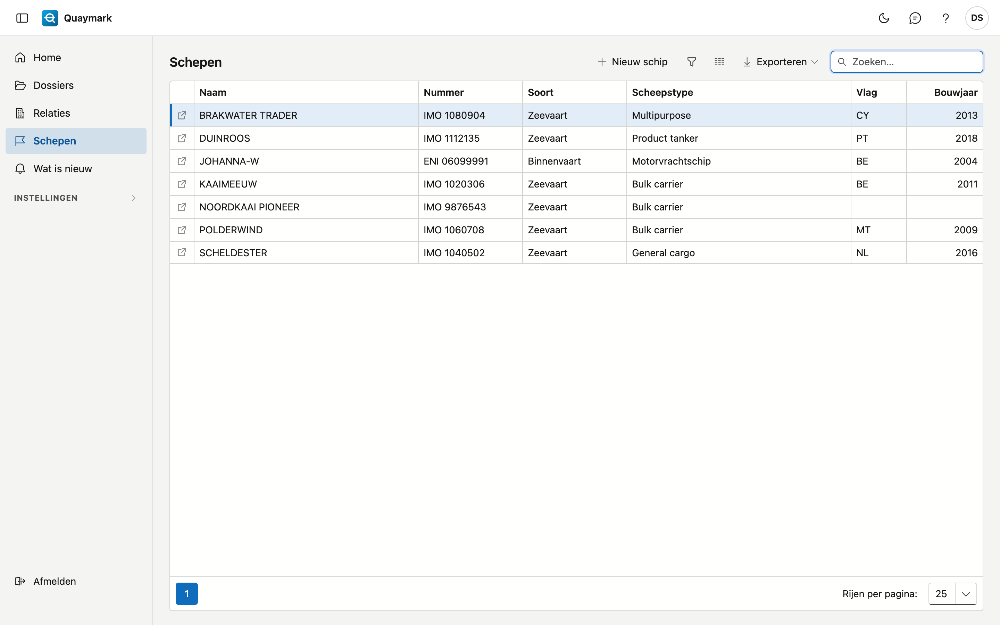
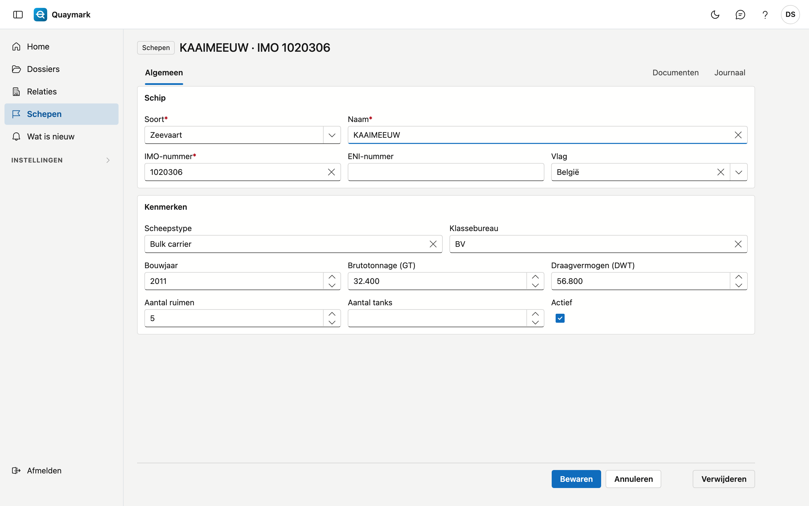

# Schepen

De schepen waarop het bureau surveys uitvoert, zeevaart en binnenvaart.

## Het scherm openen

Klik in het menu links op **Schepen**.

## De lijst

- **Nummer** is het IMO-nummer van een zeeschip of het ENI-nummer van een binnenschip.
- Het **zoekvak** zoekt op naam, nummer, soort, scheepstype, vlag en bouwjaar.
- Dubbelklik op een rij om de **fiche** te openen; met het pijltje vooraan de rij opent ze in een nieuw tabblad. **Nieuw schip** maakt er een aan.

## Schip

De gegevens van één schip.

- **Schip**: soort (zeevaart of binnenvaart), naam, IMO-nummer, ENI-nummer en vlag. Een zeeschip heeft een **IMO-nummer** (7 cijfers, het laatste is een controlecijfer), een binnenschip een **ENI-nummer** (8 cijfers). Elk nummer komt maar één keer voor, ook in de prullenbak.
- **Kenmerken**: scheepstype, klassebureau, bouwjaar, brutotonnage, draagvermogen, aantal ruimen en aantal tanks. Het aantal ruimen of tanks bepaalt hoeveel lege rijen een tabel per ruim of tank in een dossier krijgt.
- Een schip dat u niet meer gebruikt, zet u op **niet actief**: het verdwijnt uit de keuzelijst van nieuwe dossiers.

Een bewaard schip heeft het tabblad **Documenten** (plannen, certificaten, tabellen, in mappen) en het journaal. Die documenten verschijnen ook op elk dossier van het schip, onder **Van het schip**. **Verwijderen** verplaatst het schip naar de prullenbak.

## Zie ook

- [Dossiers](dossiers.md)
