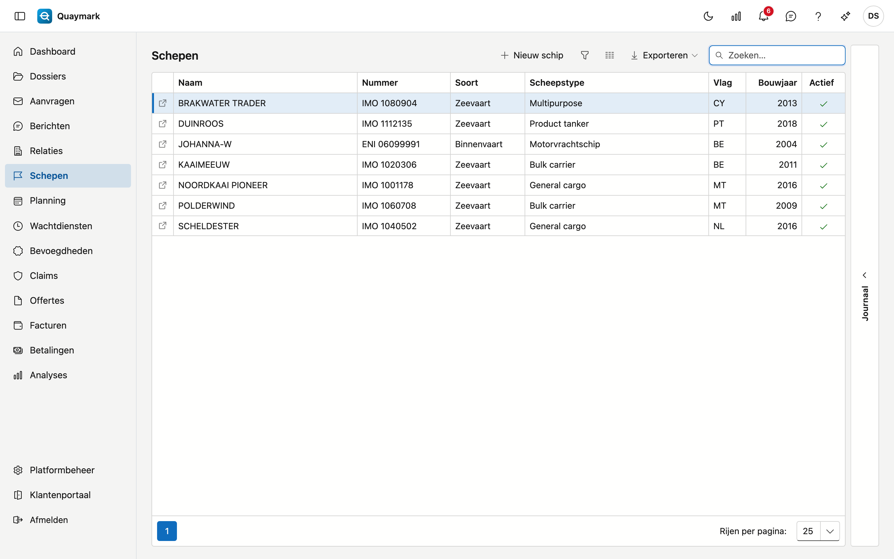
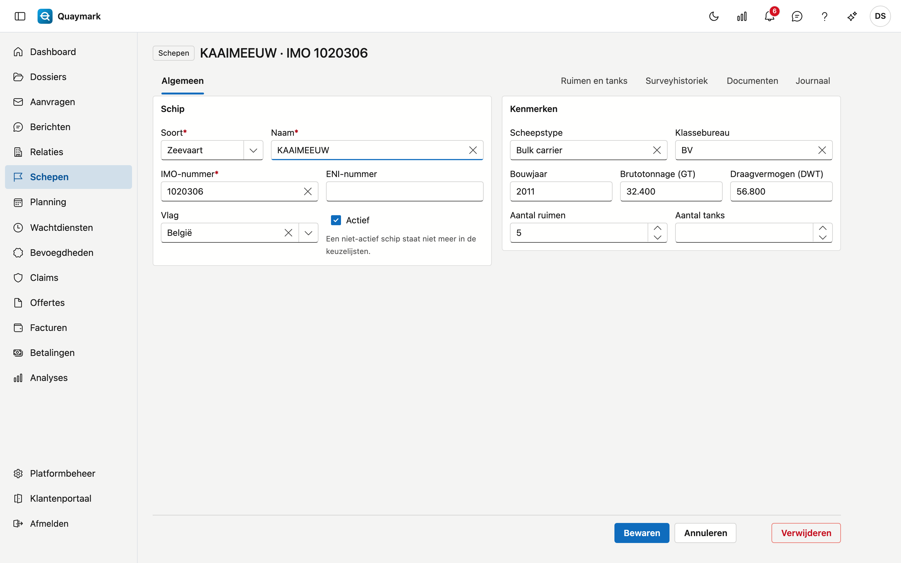
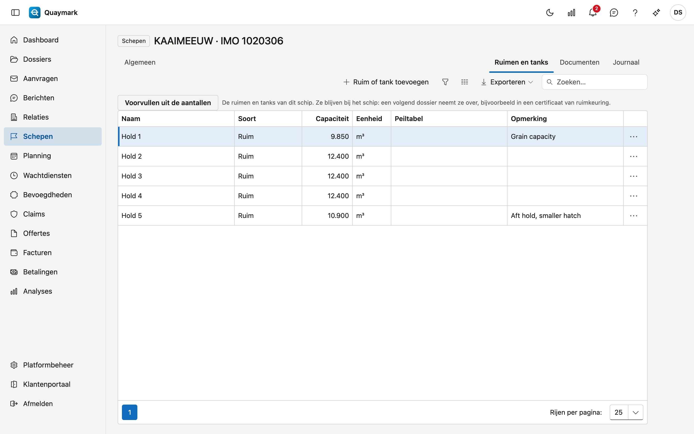
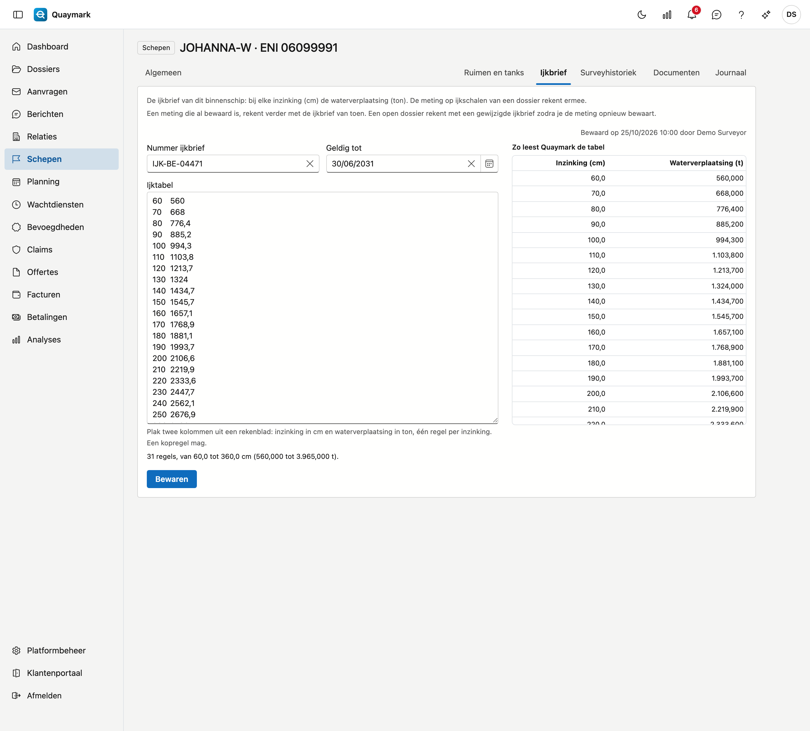

# Schepen

De schepen waarop het bureau surveys uitvoert, zeevaart en binnenvaart.

## Het scherm openen

Klik in het menu links op **Schepen**.

## De lijst

- **Nummer** is het IMO-nummer van een zeeschip of het ENI-nummer van een binnenschip.
- Het **zoekvak** zoekt op naam, nummer, soort, scheepstype, vlag en bouwjaar.
- Dubbelklik op een rij om de **fiche** te openen; met het pijltje vooraan de rij opent ze in een nieuw tabblad. **Nieuw schip** maakt er een aan.

## Schip

De gegevens van één schip.

- **Schip**: soort (zeevaart of binnenvaart), naam, IMO-nummer, ENI-nummer en vlag. Een zeeschip heeft een **IMO-nummer** (7 cijfers, het laatste is een controlecijfer), een binnenschip een **ENI-nummer** (8 cijfers). Elk nummer komt maar één keer voor, ook in de prullenbak.
- **Kenmerken**: scheepstype, klassebureau, bouwjaar, brutotonnage, draagvermogen, aantal ruimen en aantal tanks. Het aantal ruimen of tanks bepaalt hoeveel lege rijen een tabel per ruim of tank in een dossier krijgt.
- Een schip dat u niet meer gebruikt, zet u op **niet actief**: het verdwijnt uit de keuzelijst van nieuwe dossiers en van een aanvraag (behalve als het nummer van de aanvraag overeenkomt). De kolom **Actief** in de lijst toont het.
- Opent u een schip dat in de prullenbak staat (bijvoorbeeld vanuit een oud dossier), dan zegt de fiche dat bovenaan en is het enkel nog te lezen.

Een bewaard schip heeft het tabblad **Documenten** (plannen, certificaten, tabellen, in mappen) en het journaal. Die documenten verschijnen ook op elk dossier van het schip, onder **Van het schip**. **Verwijderen** verplaatst het schip naar de prullenbak. Een nieuw schip krijgt meteen de [standaardmappen](standaardmappen.md) van het bureau, ook als het vanuit een dossier, een aanvraag of een offerte ontstaat.

## Ruimen en tanks

Het tabblad **Ruimen en tanks** houdt per schip de ruimen en tanks bij, zodat een volgend bezoek ze hergebruikt:

- een **Naam** (Ruim 1, Tank 3P) en een **Soort**: ruim, ladingtank, ballasttank, brandstoftank of andere;
- de **Capaciteit** met haar eenheid (m³, L, bbl, t, kg, LT of ST);
- de **Peiltabel**: een bijlage van het schip (tabblad Documenten), bijvoorbeeld de sounding table van een tank. Een klik op de naam opent ze: een pdf in een venster, een ander bestand als download. Staat het document in de prullenbak, dan toont de lijst **Document niet meer beschikbaar**: zet het terug, of kies een andere peiltabel;
- een **Opmerking**.

**Voorvullen uit de aantallen** maakt Ruim 1 tot het aantal ruimen, en Tank 1 tot het aantal tanks, zoals ingevuld op het tabblad Algemeen. Een naam die al bestaat, slaat het over. Onder **⋯** op een regel staan **Bewerken**, **Hoger** en **Lager** (een plaats hoger of lager in de lijst) en **Verwijderen**; een dubbelklik op een regel opent ze ook.

Een certificaat van ruimkeuring op een dossier van dit schip krijgt meteen een regel per ruim.

## Ijkbrief

Een binnenschip heeft het tabblad **Ijkbrief**: het **nummer**, **Geldig tot** en de **ijktabel**, met bij elke inzinking (cm) de waterverplaatsing (ton). De meting op ijkschalen van een dossier rekent ermee (zie [Dossiers](dossiers.md#meting-op-ijkschalen)).

Plak de ijktabel als twee kolommen uit een rekenblad, één regel per inzinking; een kopregel mag. Quaymark leest ze meteen en toont het aantal regels en het bereik, of de regel die niet te lezen is. Ernaast staat de tabel zoals Quaymark ze leest. Inzinking en waterverplaatsing moeten oplopen, anders kan **Bewaren** niet. Een vervallen ijkbrief geeft hier een waarschuwing. Bovenaan staat wanneer en door wie de ijkbrief bewaard werd; een wijziging die nog niet bewaard is, zegt **Niet bewaard**. Een meting die al bewaard is, rekent verder met de ijkbrief van toen: wijzigt u de ijkbrief, dan verandert geen enkele bewaarde meting (zie [Dossiers](dossiers.md#meting-op-ijkschalen)). Een getal met één punt of komma en precies drie cijfers erachter (1.052) kan een duizendtal of drie decimalen zijn: Quaymark weigert de regel dan, tenzij de tabel elders toont welk teken het decimaalteken is. Schrijf zo'n getal zonder duizendtal (1052).

## Zie ook

- [Dossiers](dossiers.md)
