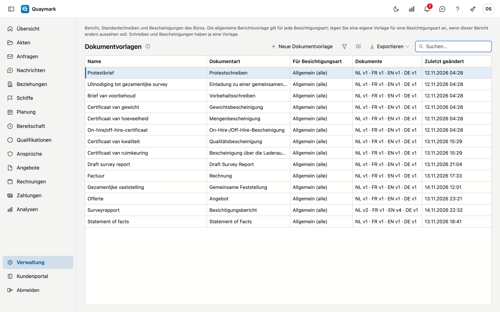

# Vorlagen

Die Word-Dokumente, mit denen Quaymark die Berichte des Büros gestaltet, mit einem Dokument pro Sprache (Niederländisch, Französisch, Englisch, Deutsch).

## Bildschirm öffnen

Klicken Sie unten im Menü auf **Verwaltung** und dann auf die Kachel **Vorlagen**.

## Die Liste

- Jedes Büro startet mit einer **allgemeinen** Vorlage in den vier Sprachen. Sie gilt für jede Besichtigungsart. Fügen Sie Ihr Logo und Ihr Erscheinungsbild ein.
- Soll der Bericht einer Besichtigungsart anders aussehen? Legen Sie mit **Neue Dokumentvorlage** eine Vorlage an und wählen Sie die Besichtigungsart. Diese Vorlage hat Vorrang vor der allgemeinen, pro Sprache: Ohne französisches Dokument nimmt ein französischer Bericht die allgemeine französische Vorlage.
- Die Spalte **Dokumente** zeigt pro Sprache die aktuelle Version. Eine fehlende Sprache fällt so auf.
- Die drei **Standardschreiben** (Protest, Vorbehalt, Einladung zur gemeinsamen Besichtigung) und die fünf **Bescheinigungen** (Menge, Gewicht, On-Hire/Off-Hire, Laderaumbesichtigung, Qualität) haben je eine Vorlage, unabhängig von der Besichtigungsart. Den Text eines Schreibens verfasst der Sachverständige; die Erklärung einer Bescheinigung steht in der Vorlage. Eine Besichtigungsart kann nur beim Bericht gewählt werden: Bei einem Schreiben, einer Bescheinigung, einer Rechnung oder einem Angebot lehnt Quaymark sie ab, denn diese verwenden immer ihre allgemeine Vorlage.

## Berichtsvorlage

Eine Berichtsvorlage: die Versionen pro Sprache und das Word-Dokument selbst.

- Pro Sprache eine Registerkarte mit den Versionen. **Dokument bearbeiten** öffnet das Dokument im Editor; **Zurücksetzen** erstellt eine neue Version mit dem Inhalt einer alten, nichts wird gelöscht. **Löschen** gibt es nur bei einer Vorlage für eine einzelne Besichtigungsart: Danach übernimmt die allgemeine. Eine allgemeine Vorlage bleibt, denn ohne sie kann Quaymark dieses Dokument nicht mehr erstellen.
- Im Editor setzen Sie die festen Daten (Schiff, Aktennummer, Auftraggeber …) mit dem Bereich **Felder** neben dem Dokument: Suchen Sie ein Feld und klicken Sie, um es einzufügen. Die Registerkarte **Seriendruck** zeigt dieselben Felder mit ihrem Code. Eine Tabelle mit Zeilen (Anwesende, Feststellungen, Checkliste) fügen Sie mit der Schaltfläche **Tabelle … einfügen** ein.
- Das Feld **RapportSoort** gibt die Art einer herausgegebenen Version an (vorläufiger Bericht, Zwischenbericht oder Abschlussbericht), in der Sprache des Berichts; in einer Vorschau bleibt es leer. Die allgemeine Vorlage eines neuen Büros hat es bereits; in einer bestehenden Vorlage fügen Sie es selbst ein.
- Was je Besichtigungsart verschieden ist, setzen Sie als **Markierung**: Text zwischen doppelten geschweiften Klammern, wörtlich getippt, wie `{{velden}}` oder `{{rubriek:conclusie}}`. Das Feld **Markierungen** (unten, zum Aufklappen anklicken) zeigt, welche diese Vorlage verwenden darf. Es erscheint nur beim Bericht: Schreiben, Bescheinigungen, die Rechnung und das Angebot füllen keine Markierungen aus. Ein eigenes Feld (`{{veld:…}}`) geht nur in einer Vorlage für eine Besichtigungsart.
- Ein Zahlenfeld kann in einer anderen Einheit im Bericht erscheinen: `{{veld:hoeveelheid:LT}}` zeigt das Feld hoeveelheid in Long Tons. Die Einheiten sind `t`, `kg`, `LT`, `ST`, `m3`, `L` und `bbl`. Zwischen Gewicht und Volumen geht das nicht ohne Dichte: Eine solche Markierung lehnt Quaymark beim Speichern ab.
- `{{tijdlijn}}` setzt das Statement of Facts in den Bericht: die Zusammenfassung und die Ereignisse. Ohne Ereignisse bleibt nichts stehen.
- `{{schadebegroting}}` setzt die Schadenschätzung in den Bericht: die Posten mit geschätztem und akzeptiertem Betrag, dem Abzug und dem Nettobetrag, die Summen, die empfohlene Reserve und die Einigung, falls es eine gibt. Ohne Posten bleibt nichts stehen.
- `{{draftsurvey}}` setzt den Draft Survey in den Bericht: das Ergebnis und die Tabelle mit Anfangs- und Endmessung. Ohne Messung bleibt nichts stehen.
- `{{ijkmeting}}` setzt die Eichaufnahme in den Bericht: das Ergebnis und die Tabelle mit dem Eichschein und den Messungen vorher und nachher. Ohne Eichaufnahme bleibt nichts stehen.
- `{{laytime}}` setzt die Liegezeit in den Bericht: die Bedingungen, das Ergebnis und die Tabelle je Zeitraum. Ohne Bedingungen bleibt nichts stehen; steht die Markierung noch nicht in Ihrer Berichtsvorlage, fügen Sie sie hinzu.
- `{{codes}}` setzt die gescannten Codes in den Bericht: Art, Code, die Nummer der Feststellung, Zeit, Quelle und Prüfziffer. Ohne Codes bleibt nichts stehen.
- `{{bunker}}` setzt die Bunkerbesichtigung in den Bericht: je Produkt vorher, nachher, geliefert und die Differenz zum Lieferschein, und die Tabelle je Tank. Ohne Peilung bleibt nichts stehen.
- `{{aanbevelingen}}` setzt die Punkte der Checkliste mit einem Mangel in den Bericht, nach Priorität: Punkt, Ergebnis, Befund und Empfehlung. Ohne Mangel bleibt nichts stehen. Die Tabelle der Checkliste hat auch eine Spalte mit der Empfehlung.
- `{{handtekeningen}}` setzt die Unterschriften vor Ort in den Bericht: je Unterschrift die Klausel, die Erklärung, das Bild (oder die Verweigerung mit dem Grund), wer und wann, und den Fingerabdruck der Momentaufnahme. Ohne Unterschrift bleibt nichts stehen.
- `{{gezamenlijk}}` setzt die gemeinsamen Besichtigungen in den Bericht: für jede festgehaltene Besichtigung Datum, Ort und Version, den Standpunkt jeder Partei (wer, wann und die Erläuterung), und die Teilnehmer. Ohne festgehaltene gemeinsame Besichtigung bleibt nichts stehen. Ein Büro, das schon eine Vorlage hatte, fügt die Markierung selbst hinzu.
- Die Vorlage **Statement of Facts** bestimmt das Aussehen dieses Dokuments, in den vier Sprachen.
- Die Vorlage **Draft Survey Report** bestimmt das Aussehen dieses Dokuments, in den vier Sprachen.
- Die Vorlage **Rechnung** bestimmt das Aussehen der Rechnungen und Gutschriften, in den vier Sprachen. Der Zahlungs-QR-Code steht an der Stelle des Feldes BetaalQr. Siehe [Rechnungen](facturen.md).
- **Als neue Version speichern** prüft das Dokument und die Markierungen. Eine unbekannte Markierung wird mit Begründung abgelehnt. **Prüfen** sieht nur die Felder, nicht die Markierungen.
- Unten zeigt das Feld **Markierungen**, wie viele Abschnitte die gespeicherte Version noch nicht verwendet, mit ihrer Markierung: zum Beispiel einen Abschnitt, den Quaymark später hinzugefügt hat (ein neuer Abschnitt kommt nur in die Vorlage eines neuen Büros von selbst). Eine Markierung ohne Daten hinterlässt nichts im Bericht: Sie hinzuzufügen ist unbedenklich.

## Siehe auch

- [Standardtexte](standaardteksten.md)
- [Besichtigungsarten](soorten-survey.md)
