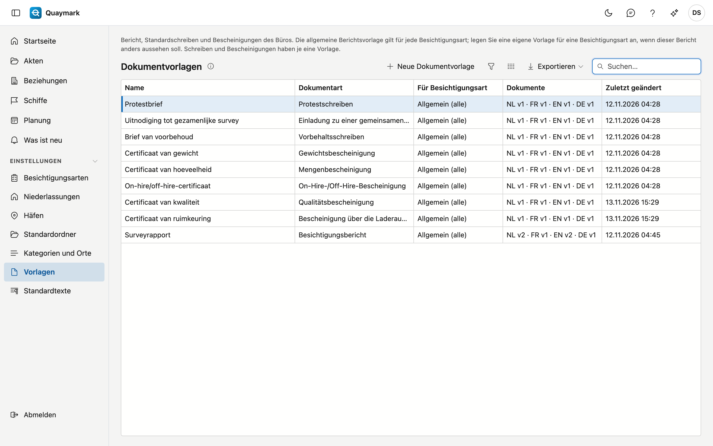

# Vorlagen

Die Word-Dokumente, mit denen Quaymark die Berichte des Büros gestaltet, mit einem Dokument pro Sprache (Niederländisch, Französisch, Englisch, Deutsch).

## Bildschirm öffnen

Klicken Sie im Menü links auf **Einstellungen** und dann auf **Vorlagen**.

## Die Liste

- Jedes Büro startet mit einer **allgemeinen** Vorlage in den vier Sprachen. Sie gilt für jede Besichtigungsart. Fügen Sie Ihr Logo und Ihr Erscheinungsbild ein.
- Soll der Bericht einer Besichtigungsart anders aussehen? Legen Sie mit **Neue Dokumentvorlage** eine Vorlage an und wählen Sie die Besichtigungsart. Diese Vorlage hat Vorrang vor der allgemeinen, pro Sprache: Ohne französisches Dokument nimmt ein französischer Bericht die allgemeine französische Vorlage.
- Die Spalte **Dokumente** zeigt pro Sprache die aktuelle Version. Eine fehlende Sprache fällt so auf.
- Die drei **Standardschreiben** (Protest, Vorbehalt, Einladung zur gemeinsamen Besichtigung) und die fünf **Bescheinigungen** (Menge, Gewicht, On-Hire/Off-Hire, Laderaumbesichtigung, Qualität) haben je eine Vorlage, unabhängig von der Besichtigungsart. Den Text eines Schreibens verfasst der Sachverständige; die Erklärung einer Bescheinigung steht in der Vorlage.

## Berichtsvorlage

Eine Berichtsvorlage: die Versionen pro Sprache und das Word-Dokument selbst.

- Pro Sprache eine Registerkarte mit den Versionen. **Dokument bearbeiten** öffnet das Dokument im Editor; **Zurücksetzen** erstellt eine neue Version mit dem Inhalt einer alten, nichts wird gelöscht.
- Im Editor setzen Sie die festen Daten (Schiff, Aktennummer, Auftraggeber …) über die Registerkarte mit den Feldern, und eine Tabelle mit Zeilen (Anwesende, Feststellungen, Checkliste) mit der Schaltfläche **Tabelle … einfügen**.
- Was je Besichtigungsart verschieden ist, setzen Sie als **Markierung**: Text zwischen doppelten geschweiften Klammern, wörtlich getippt, wie `{{velden}}` oder `{{rubriek:conclusie}}`. Das Feld **Markierungen** zeigt, welche diese Vorlage verwenden darf. Ein eigenes Feld (`{{veld:…}}`) geht nur in einer Vorlage für eine Besichtigungsart.
- Ein Zahlenfeld kann in einer anderen Einheit im Bericht erscheinen: `{{veld:hoeveelheid:LT}}` zeigt das Feld hoeveelheid in Long Tons. Die Einheiten sind `t`, `kg`, `LT`, `ST`, `m3`, `L` und `bbl`. Zwischen Gewicht und Volumen geht das nicht ohne Dichte: Eine solche Markierung lehnt Quaymark beim Speichern ab.
- `{{tijdlijn}}` setzt das Statement of Facts in den Bericht: die Zusammenfassung und die Ereignisse. Ohne Ereignisse bleibt nichts stehen.
- Die Vorlage **Statement of Facts** bestimmt das Aussehen dieses Dokuments, in den vier Sprachen.
- Die Vorlage **Rechnung** bestimmt das Aussehen der Rechnungen und Gutschriften, in den vier Sprachen. Der Zahlungs-QR-Code steht an der Stelle des Feldes BetaalQr. Siehe [Rechnungen](facturen.md).
- **Als neue Version speichern** prüft das Dokument und die Markierungen. Eine unbekannte Markierung wird mit Begründung abgelehnt. **Prüfen** sieht nur die Felder, nicht die Markierungen.

## Siehe auch

- [Standardtexte](standaardteksten.md)
- [Besichtigungsarten](soorten-survey.md)
