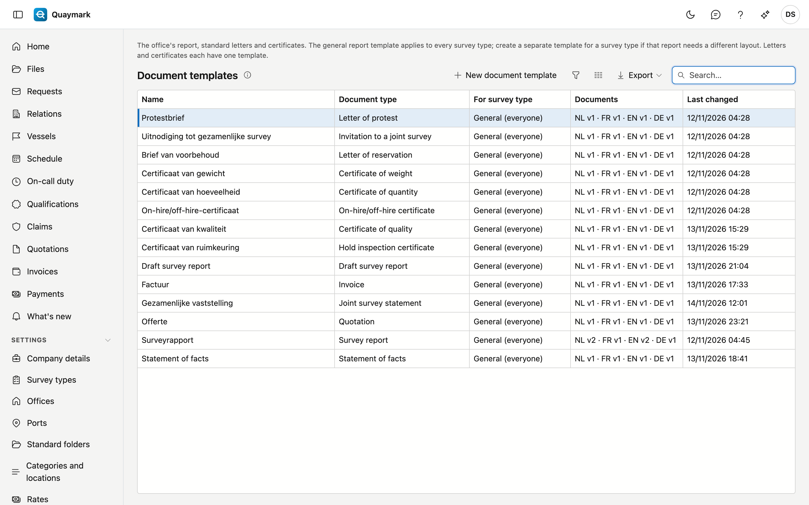

# Templates

The Word documents Quaymark uses to lay out the office's reports, with one document per language (Dutch, French, English, German).

## Opening the screen

In the menu on the left, click **Settings**, then **Templates**.

## The list

- Each office starts with a **general** template in the four languages. It applies to every survey type. Add your logo and house style to it.
- Should the report of one survey type look different? Create a template with **New document template** and choose the survey type. That template takes precedence over the general one, per language: without a French document, a French report uses the general French one.
- The **Documents** column shows the current version per language, so a missing language stands out.
- The three **standard letters** (protest, reservation, invitation to a joint survey) and the five **certificates** (quantity, weight, on-hire/off-hire, hold inspection, quality) each have one template, regardless of the survey type. The surveyor writes the text of each letter; the statement of a certificate is in the template.

## Report template

One report template: the versions per language and the Word document itself.

- One tab per language with the versions. **Edit document** opens the document in the editor; **Restore this version** creates a new version with the content of an old one, nothing is deleted.
- In the editor you place the fixed data (vessel, file number, principal …) via the fields tab, and a table with rows (attendance, findings, checklist) with the **Insert table …** button.
- What differs per survey type goes in as a **marker**: text between double braces, typed literally, such as `{{velden}}` or `{{rubriek:conclusie}}`. The **Markers** panel shows which ones this template may use. A custom field (`{{veld:…}}`) only works in a template for one survey type.
- A number field can appear in another unit in the report: `{{veld:hoeveelheid:LT}}` shows the field hoeveelheid in long tons. The units are `t`, `kg`, `LT`, `ST`, `m3`, `L` and `bbl`. Between weight and volume this is not possible without a density: Quaymark refuses such a marker when you save.
- `{{tijdlijn}}` puts the statement of facts in the report: the summary and the events. Without events, nothing remains.
- `{{schadebegroting}}` puts the damage estimate in the report: the items with their estimated and accepted amount, the deduction and the net amount, the totals, the recommended reserve and the agreement if there is one. Without items, nothing remains.
- `{{draftsurvey}}` puts the draft survey in the report: the result and the table with initial and final survey. Without a measurement, nothing remains.
- `{{gezamenlijk}}` puts the joint surveys in the report: for each recorded survey the date, the place and the version, the position of each party (who, when and the comments), and the participants. Without a recorded joint survey, nothing remains. An office that already had a template adds the marker itself.
- The **Statement of facts** template determines the look of that document, in the four languages.
- The **Draft survey report** template determines the look of that document, in the four languages.
- The **Invoice** template determines the look of invoices and credit notes, in the four languages. The payment QR code takes the place of the BetaalQr field. See [Invoices](facturen.md).
- **Save as new version** checks the document and the markers. An unknown marker is refused, with the reason. **Check** only looks at the fields, not at the markers.

## See also

- [Standard texts](standaardteksten.md)
- [Survey types](soorten-survey.md)
