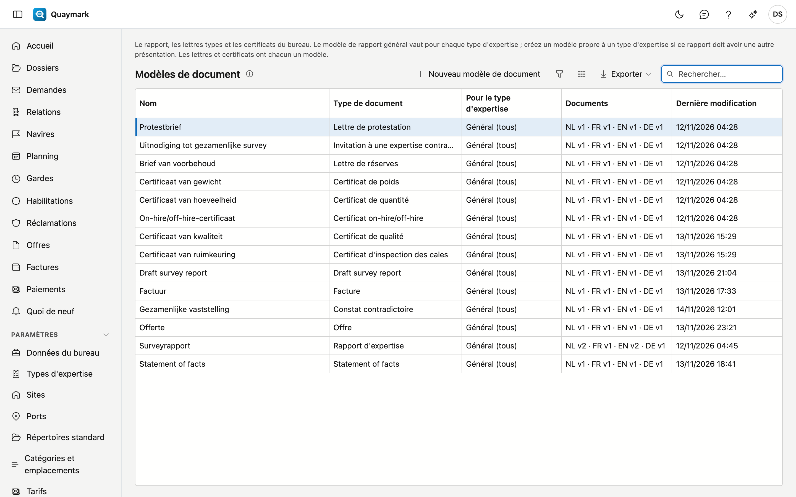

# Modèles

Les documents Word avec lesquels Quaymark met en page les rapports du bureau, avec un document par langue (néerlandais, français, anglais, allemand).

## Ouvrir l'écran

Dans le menu de gauche, cliquez sur **Paramètres** puis sur **Modèles**.

## La liste

- Chaque bureau démarre avec un modèle **général** dans les quatre langues. Il vaut pour chaque type d'expertise. Ajoutez-y votre logo et votre charte graphique.
- Le rapport d'un type d'expertise doit avoir une autre présentation ? Créez un modèle avec **Nouveau modèle de document** et choisissez le type d'expertise. Ce modèle prime sur le modèle général, par langue : sans document français, un rapport en français prend le modèle général français.
- La colonne **Documents** montre la version actuelle par langue. Une langue manquante saute ainsi aux yeux.
- Les trois **lettres types** (protestation, réserves, invitation à une expertise contradictoire) et les cinq **certificats** (quantité, poids, on-hire/off-hire, inspection des cales, qualité) ont chacun un modèle, indépendant du type d'expertise. L'expert rédige le texte de chaque lettre ; la déclaration d'un certificat figure dans le modèle.

## Modèle de rapport

Un modèle de rapport : les versions par langue et le document Word lui-même.

- Un onglet par langue avec les versions. **Modifier le document** ouvre le document dans l'éditeur ; **Rétablir** crée une nouvelle version avec le contenu d'une ancienne, rien n'est effacé.
- Dans l'éditeur, vous placez les données fixes (navire, numéro de dossier, donneur d'ordre …) via l'onglet des champs, et un tableau à lignes (présents, constatations, check-list) avec le bouton **Insérer le tableau …**.
- Ce qui varie selon le type d'expertise se place comme **marqueur** : du texte entre doubles accolades, tapé tel quel, comme `{{velden}}` ou `{{rubriek:conclusie}}`. Le panneau **Marqueurs** montre ceux que ce modèle peut utiliser. Un champ propre (`{{veld:…}}`) n'est possible que dans un modèle pour un type d'expertise.
- Un champ numérique peut figurer dans une autre unité dans le rapport : `{{veld:hoeveelheid:LT}}` affiche le champ hoeveelheid en long tons. Les unités sont `t`, `kg`, `LT`, `ST`, `m3`, `L` et `bbl`. Entre poids et volume, ce n'est pas possible sans densité : Quaymark refuse un tel marqueur à l'enregistrement.
- `{{tijdlijn}}` place le statement of facts dans le rapport : le résumé et les événements. Sans événements, il ne reste rien.
- Le modèle **Statement of facts** détermine la présentation de ce document, dans les quatre langues.
- Le modèle **Facture** détermine la présentation des factures et notes de crédit, dans les quatre langues. Le QR de paiement prend la place du champ BetaalQr. Voir [Factures](facturen.md).
- **Enregistrer comme nouvelle version** vérifie le document et les marqueurs. Un marqueur inconnu est refusé, avec la raison. **Vérifier** ne regarde que les champs, pas les marqueurs.

## Voir aussi

- [Textes standard](standaardteksten.md)
- [Types d'expertise](soorten-survey.md)
