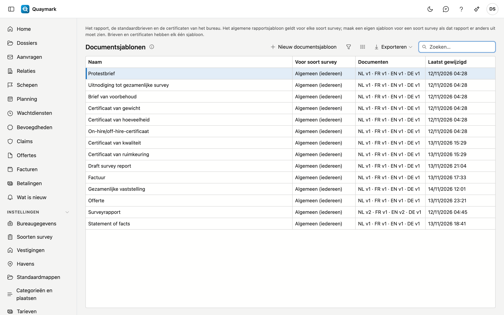

# Sjablonen

De Word-documenten waarmee Quaymark de rapporten van het bureau opmaakt, met een document per taal (Nederlands, Frans, Engels, Duits).

## Het scherm openen

Klik in het menu links op **Instellingen** en dan op **Sjablonen**.

## De lijst

- Elk bureau start met een **algemeen** sjabloon in de vier talen. Het geldt voor elke soort survey. Zet er uw logo en huisstijl in.
- Moet het rapport van één soort survey er anders uitzien? Maak met **Nieuw documentsjabloon** een sjabloon en kies de soort survey. Dat sjabloon gaat voor het algemene, per taal: zonder Frans document neemt een Frans rapport het algemene Franse.
- De kolom **Documenten** toont per taal de huidige versie. Een ontbrekende taal valt zo op.
- De drie **standaardbrieven** (protest, voorbehoud, uitnodiging tot gezamenlijke survey) en de vijf **certificaten** (hoeveelheid, gewicht, on-hire/off-hire, ruimkeuring, kwaliteit) hebben elk één sjabloon, los van de soort survey. De tekst van een brief schrijft de surveyor per brief; de verklaring van een certificaat staat in het sjabloon.

## Rapportsjabloon

Eén rapportsjabloon: de versies per taal en het Word-document zelf.

- Per taal een tabblad met de versies. **Document bewerken** opent het document in de editor; **Terugzetten** maakt een nieuwe versie met de inhoud van een oude, er wordt niets gewist.
- In de editor zet u de vaste gegevens (schip, dossiernummer, opdrachtgever …) via het tabblad met de velden, en een tabel met rijen (aanwezigen, vaststellingen, checklist) met de knop **Tabel … invoegen**.
- Wat per soort survey verschilt, zet u als **markering**: tekst tussen dubbele accolades, letterlijk getypt, zoals `{{velden}}` of `{{rubriek:conclusie}}`. Het paneel **Markeringen** toont welke dit sjabloon mag gebruiken. Een eigen veld (`{{veld:…}}`) kan enkel in een sjabloon voor één soort survey.
- Een getalveld kan in een andere eenheid in het rapport komen: `{{veld:hoeveelheid:LT}}` toont het veld hoeveelheid in long ton. De eenheden zijn `t`, `kg`, `LT`, `ST`, `m3`, `L` en `bbl`. Tussen gewicht en volume kan dat niet zonder dichtheid: zo'n markering weigert Quaymark bij het bewaren.
- `{{tijdlijn}}` zet de statement of facts in het rapport: de samenvatting en de gebeurtenissen. Zonder gebeurtenissen blijft er niets staan.
- `{{schadebegroting}}` zet de schadebegroting in het rapport: de posten met hun geraamde en aanvaarde bedrag, de afschrijving en het netto bedrag, de totalen, de voorgestelde reserve en het akkoord als dat er is. Zonder posten blijft er niets staan.
- `{{draftsurvey}}` zet de draft survey in het rapport: het resultaat en de tabel met begin- en eindmeting. Zonder meting blijft er niets staan.
- `{{gezamenlijk}}` zet de gezamenlijke surveys in het rapport: per vastgelegde survey de datum, de plaats en de versie, het standpunt van elke partij (met wie, wanneer en de toelichting), en de deelnemers. Zonder vastgelegde gezamenlijke survey blijft er niets staan. Een bureau dat al een sjabloon had, voegt de markering zelf toe.
- Het sjabloon **Statement of facts** bepaalt het uitzicht van dat document, in de vier talen.
- Het sjabloon **Draft survey report** bepaalt het uitzicht van dat document, in de vier talen.
- Het sjabloon **Factuur** bepaalt het uitzicht van de facturen en creditnota's, in de vier talen. De betaal-QR komt op de plaats van het veld BetaalQr. Zie [Facturen](facturen.md).
- **Bewaren als nieuwe versie** controleert het document en de markeringen. Een onbekende markering wordt geweigerd met de reden erbij. **Controleren** kijkt enkel naar de velden, niet naar de markeringen.

## Zie ook

- [Standaardteksten](standaardteksten.md)
- [Soorten survey](soorten-survey.md)
