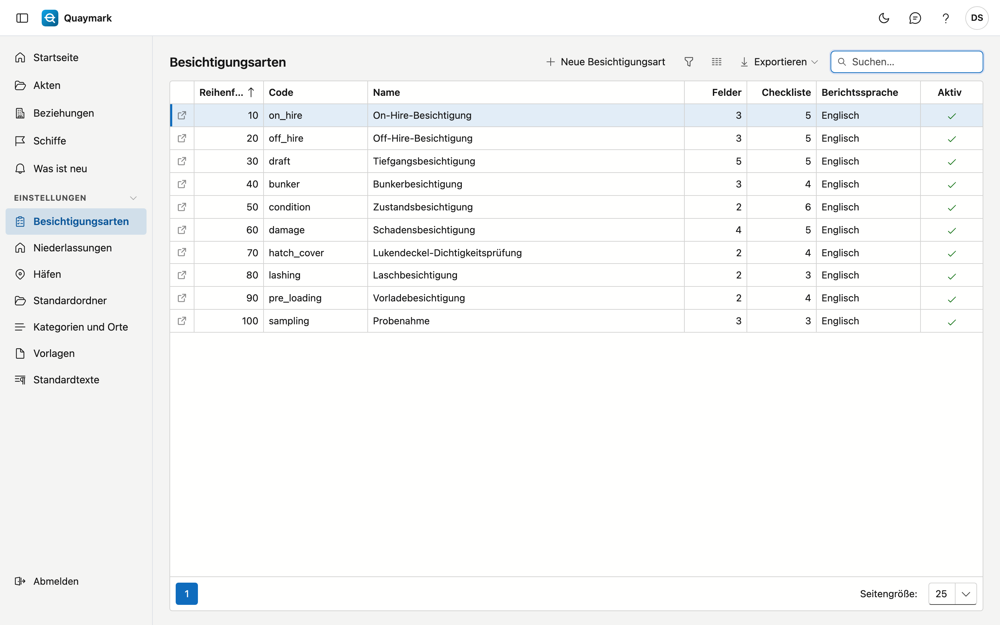

# Besichtigungsarten

Die Besichtigungsarten, die das Büro anbietet. Ein neues Büro startet mit einem Katalog, den Sie anpassen oder ergänzen.

## Bildschirm öffnen

Klicken Sie im Menü links auf **Einstellungen** und dann auf **Besichtigungsarten**.

## Die Liste

- Pro Art sehen Sie den Code, den Namen, die Anzahl **Felder** und **Checklistenpunkte**, die Standard-Berichtssprache und ob die Art aktiv ist.
- Doppelklicken Sie auf eine Zeile, um die Art zu öffnen. **Neue Besichtigungsart** legt eine an.
- Eine Art kann nicht gelöscht werden, weil ältere Akten darauf verweisen. Setzen Sie eine Art, die Sie nicht mehr anbieten, auf **inaktiv**.

## Besichtigungsart

Eine Besichtigungsart: was in der Akte erfasst wird und was der Besichtiger vor Ort abarbeitet.

- **Allgemein**: Code, Standard-Berichtssprache, Reihenfolge in den Listen, aktiv, und der Name in den vier Sprachen. Der Code steht fest, sobald Akten diese Art verwenden.
- **Vier-Augen-Prinzip**: Angehakt wird ein Bericht dieser Art erst nach der Freigabe durch einen zweiten Besichtiger herausgegeben. Siehe [Akten](dossiers.md#vier-augen-prinzip).
- **Erforderliche Qualifikationen**: die Qualifikationen, die der Besichtiger gültig haben muss (zum Beispiel IIMS oder ADR). Planung und Akte warnen sonst. Siehe [Qualifikationen](bevoegdheden.md).
- **Aufbewahrungsfrist (Jahre)**: wie lange eine abgeschlossene Akte dieser Art aufbewahrt wird. Leer = die Frist des Landes der Niederlassung. Siehe [Aufbewahrungsfristen](bewaartermijnen.md).
- **Draft Survey**: Angehakt erhalten Akten dieser Art die Registerkarte Draft Survey mit Anfangs- und Endmessung. Siehe [Akten](dossiers.md#draft-survey).
- **Felder**: die Daten, die eine Akte dieser Art zusätzlich zu den festen Feldern erhält. Ein Feld hat einen **Schlüssel** (Kleinbuchstaben, Ziffern und _, fest, weil Feld-App und Berichte darauf verweisen), eine Art (Text, Zahl, Datum, Ja/Nein, Auswahl oder Tabelle), eine Bezeichnung in vier Sprachen, eine Einheit und ob es Pflicht ist. Eine **Tabelle** hat Spalten und gegebenenfalls feste Zeilen, zum Beispiel eine Zeile pro Laderaum.
- **Checkliste**: die Punkte, die der Besichtiger vor Ort beantwortet, jeweils mit Schlüssel, Bezeichnung und ob eine Antwort oder ein Foto Pflicht ist.
- **Abschnitte**: die Textblöcke des Berichts (Einleitung, Befunde, Schlussfolgerung …). Der Besichtiger schreibt sie in der Registerkarte Bericht der Akte; eine Berichtsvorlage zeigt sie mit der Markierung in der Spalte daneben. Eine neue Besichtigungsart startet mit den fünf Standardabschnitten.
- Der Pfeil **↑** setzt ein Feld oder einen Punkt eine Stelle höher. Änderungen an Feldern und Checkliste gelten erst nach **Speichern**.

Die Registerkarte **Verlauf** zeigt, wer was geändert hat.

## Siehe auch

- [Vorlagen](sjablonen.md)
- [Kategorien und Orte](categorieen-en-plaatsen.md)
