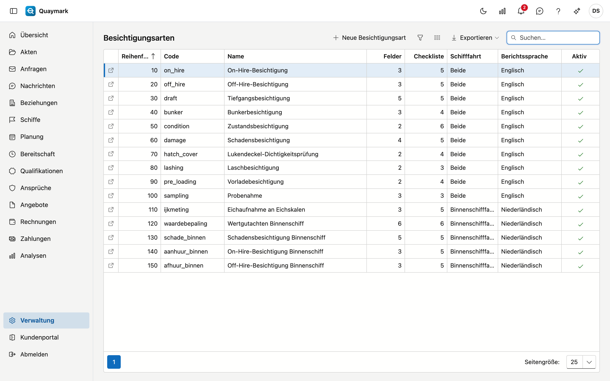
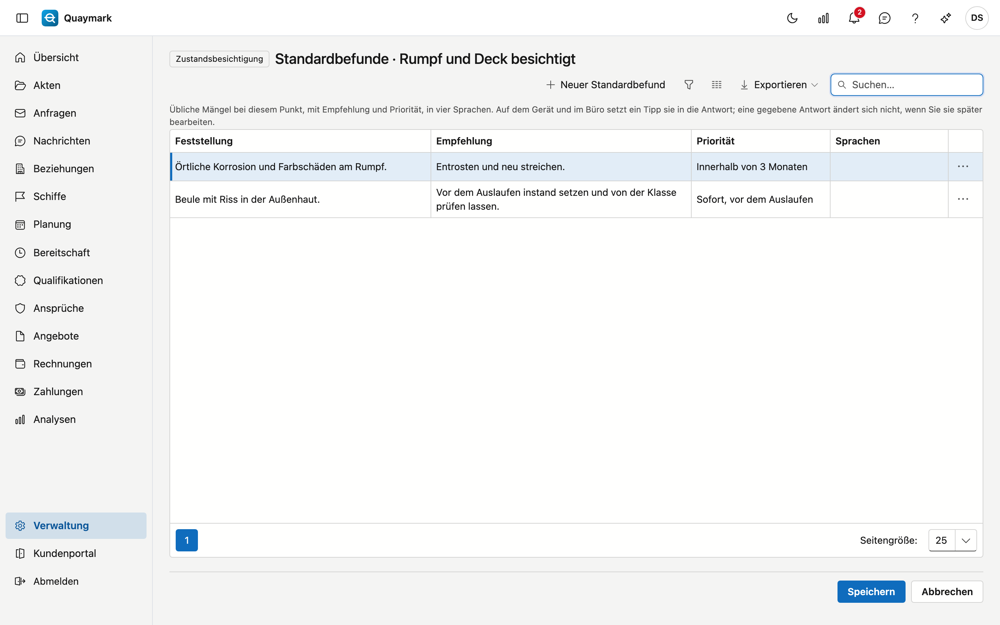

# Besichtigungsarten

Die Besichtigungsarten, die das Büro anbietet. Ein neues Büro startet mit einem Katalog, den Sie anpassen oder ergänzen.

## Bildschirm öffnen

Klicken Sie unten im Menü auf **Verwaltung** und dann auf die Kachel **Besichtigungsarten**.

## Die Liste

- Pro Art sehen Sie den Code, den Namen, die Anzahl **Felder** und **Checklistenpunkte**, die **Schifffahrt**, die Standard-Berichtssprache und ob die Art aktiv ist.
- Doppelklicken Sie auf eine Zeile, um die Art zu öffnen. **Neue Besichtigungsart** legt eine an.
- Eine Art kann nicht gelöscht werden, weil ältere Akten darauf verweisen. Setzen Sie eine Art, die Sie nicht mehr anbieten, auf **inaktiv**.
- **Besichtigungsarten für die Binnenschifffahrt hinzufügen** erscheint nur, wenn eine fehlt, mit der Anzahl in Klammern. Die Schaltfläche fügt die Arten für die Binnenschifffahrt hinzu, die es noch nicht gibt: Eichaufnahme, Wertgutachten, Schaden, On-Hire und Off-Hire. Was schon da ist, bleibt unverändert. Ein neues Büro hat sie von Anfang an. Damit die Eichaufnahme im Bericht erscheint, fügen Sie `{{ijkmeting}}` in Ihre Berichtsvorlage ein (siehe [Vorlagen](sjablonen.md)).

## Besichtigungsart

Eine Besichtigungsart: was in der Akte erfasst wird und was der Besichtiger vor Ort abarbeitet.

- **Allgemein**: Code, Standard-Berichtssprache, Reihenfolge in den Listen, aktiv, und der Name in den vier Sprachen. Der Code steht fest, sobald Akten diese Art verwenden.
- **Vier-Augen-Prinzip**: Angehakt wird ein Bericht dieser Art erst nach der Freigabe durch einen zweiten Besichtiger herausgegeben. Siehe [Akten](dossiers.md#vier-augen-prinzip).
- **Erforderliche Qualifikationen**: die Qualifikationen, die der Besichtiger gültig haben muss (zum Beispiel IIMS oder ADR). Planung und Akte warnen sonst. Siehe [Qualifikationen](bevoegdheden.md).
- **Aufbewahrungsfrist (Jahre)**: wie lange eine abgeschlossene Akte dieser Art aufbewahrt wird. Leer = die Frist des Landes der Niederlassung. Siehe [Aufbewahrungsfristen](bewaartermijnen.md).
- **Draft Survey**: Angehakt erhalten Akten dieser Art die Registerkarte Draft Survey mit Anfangs- und Endmessung. Siehe [Akten](dossiers.md#draft-survey).
- **Bunkerbesichtigung**: Angehakt erhalten Akten dieser Art die Registerkarte Bunker mit Peilungen vorher und nachher, dem Lieferschein und der Berechnung in Tonnen. Siehe [Akten](dossiers.md#bunkerbesichtigung).
- **Eichaufnahme**: Angehakt erhalten Akten dieser Art die Registerkarte Eichaufnahme mit den Eichskalen vorher und nachher und dem Eichschein des Binnenschiffs. Siehe [Akten](dossiers.md#eichaufnahme).
- **Schifffahrt**: See-, Binnenschifffahrt oder beide. In einer Akte stehen die zum Schiff passenden Arten oben, und die Akte warnt bei einer Art für die andere Schifffahrt. Sie lehnt nicht ab.
- **Skala der Checkliste**: **in Ordnung / nicht in Ordnung / entfällt** für eine Kontrolle, oder ein **Zustand** (gut / befriedigend / mangelhaft / schlecht / entfällt) für eine Zustandsbesichtigung. Bestehende Antworten bleiben, wie sie gegeben wurden.
- **Felder**: die Daten, die eine Akte dieser Art zusätzlich zu den festen Feldern erhält. Ein Feld hat einen **Schlüssel** (Kleinbuchstaben, Ziffern und _, nach dem Speichern fest, weil Akten ihre Werte darunter speichern), eine Art (Text, Zahl, Datum, Ja/Nein, Auswahl oder Tabelle), eine Bezeichnung in vier Sprachen, eine Einheit und ob es Pflicht ist. Eine **Tabelle** hat Spalten und gegebenenfalls feste Zeilen, zum Beispiel eine Zeile pro Laderaum. Ein Feld, für das eine Akte bereits einen Wert hat, können Sie nicht löschen; machen Sie es optional, wenn Sie es nicht mehr brauchen.
- **Checkliste**: die Punkte, die der Besichtiger vor Ort beantwortet, jeweils mit Schlüssel, Bezeichnung und ob eine Antwort oder ein Foto Pflicht ist. Der Link **Standardbefunde** öffnet je gespeichertem Punkt die üblichen Mängel, jeweils mit Befund, Empfehlung und Priorität, in vier Sprachen. Fehlt eine Sprache, zeigt die Spalte **Sprachen**, welche: Eine Akte in dieser Sprache erhält den niederländischen Text, auch im Bericht. Der Besichtiger fügt einen mit einem Tippen in seine Antwort ein; eine gegebene Antwort ändert sich nicht, wenn Sie sie später bearbeiten. Neue Punkte erhalten den Link nach **Speichern**.
- **Abschnitte**: die Textblöcke des Berichts (Einleitung, Befunde, Schlussfolgerung …). Der Besichtiger schreibt sie in der Registerkarte Bericht der Akte; eine Berichtsvorlage zeigt sie mit der Markierung in der Spalte daneben. Eine neue Besichtigungsart startet mit den fünf Standardabschnitten.
- **Arbeitsanweisung** (eigene Registerkarte): was der Surveyor bei dieser Art von Auftrag tut, ein Schritt pro Zeile, in vier Sprachen. Jede Akte dieser Art zeigt sie oben, in der Sprache des Benutzers, mit denselben Markierungen wie die [Standardtexte](standaardteksten.md) ausgefüllt.
- **Registerkarten** (eigene Registerkarte): welche Registerkarten eine Akte dieser Art zeigt. Feststellungen, Checkliste, Schaden, gemeinsame Besichtigung, Unterschriften, Bordunterlagen, Codes, Zeitablauf und Laytime lassen sich ausschalten; die Laytime wird aus dem Zeitablauf berechnet und verschwindet mit ihm. Was schon darin stand, bleibt gespeichert (auch im Bericht und im Beweispaket) und kehrt zurück, sobald Sie es wieder einschalten.
- Unter **⋯** neben einem Feld, Punkt oder Abschnitt: **Bearbeiten**, **Nach oben**, **Nach unten** und **Löschen**; ein Doppelklick öffnet es auch. Die Reihenfolge der Liste ist die der Akte, der Feld-App und des Berichts. Änderungen an Feldern, Checkliste und Abschnitten gelten erst nach **Speichern**; **Abbrechen** macht sie rückgängig.

Die Registerkarte **Verlauf** zeigt, wer was geändert hat.

## Siehe auch

- [Vorlagen](sjablonen.md)
- [Kategorien und Orte](categorieen-en-plaatsen.md)
