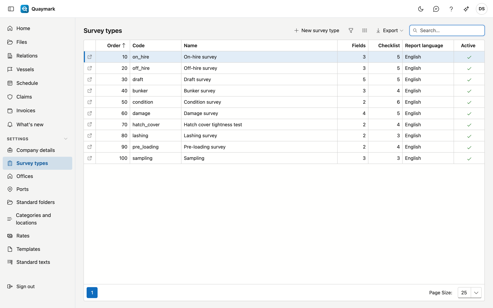

# Survey types

The survey types the office offers. A new office starts with a catalogue that you adapt or extend.

## Opening the screen

In the menu on the left, click **Settings**, then **Survey types**.

## The list

- For each type you see the code, the name, the number of **fields** and **checklist items**, the default report language and whether the type is active.
- Double-click a row to open the type. **New survey type** creates one.
- A type cannot be deleted, because older files refer to it. Set a type you no longer offer to **inactive**.

## Survey type

One survey type: what is entered in the file and what the surveyor goes through on site.

- **General**: code, default report language, order in the lists, active, and the name in the four languages. The code is fixed once files use this type.
- **Four-eyes review**: when ticked, a report of this type is only issued after a second surveyor has approved it. See [Files](dossiers.md#four-eyes-review).
- **Required qualifications**: the qualifications the surveyor must hold validly (for example IIMS or ADR). The schedule and the file warn if not. See [Qualifications](bevoegdheden.md).
- **Retention period (years)**: how long a closed file of this type is kept. Empty = the period of the office's country. See [Retention periods](bewaartermijnen.md).
- **Draft survey**: when ticked, files of this type get the Draft survey tab with initial and final survey. See [Files](dossiers.md#draft-survey).
- **Bunker survey**: when ticked, files of this type get the Bunkers tab with soundings before and after, the delivery note and the calculation to tonnes. See [Files](dossiers.md#bunker-survey).
- **Fields**: the data a file of this type gets on top of the fixed fields. A field has a **key** (lower-case letters, digits and _, fixed because the field app and reports refer to it), a type (text, number, date, yes/no, choice or table), a label in four languages, a unit and whether it is required. A **table** has columns and optionally fixed rows, for example one row per hold.
- **Checklist**: the items the surveyor answers on site, each with a key, a label, and whether an answer or a photo is required.
- **Sections**: the text blocks of the report (introduction, observations, conclusion …). The surveyor writes them on the Report tab of the file; a report template shows them with the marker in the next column. A new survey type starts with the five standard sections.
- The arrow **↑** moves a field or item up one place. Changes to fields and checklist only count after **Save**.

The **History** tab shows who changed what.

## See also

- [Templates](sjablonen.md)
- [Categories and locations](categorieen-en-plaatsen.md)
