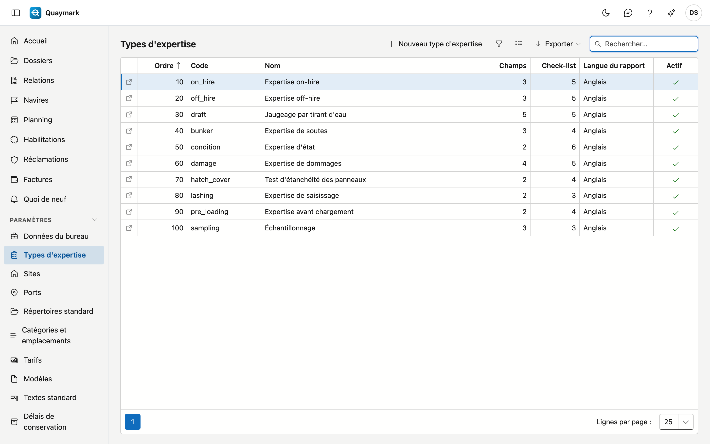

# Types d'expertise

Les types d'expertise proposés par le bureau. Un nouveau bureau démarre avec un catalogue que vous adaptez ou complétez.

## Ouvrir l'écran

Dans le menu de gauche, cliquez sur **Paramètres** puis sur **Types d'expertise**.

## La liste

- Pour chaque type, vous voyez le code, le nom, le nombre de **champs** et de **points de contrôle**, la langue par défaut du rapport et si le type est actif.
- Double-cliquez sur une ligne pour ouvrir le type. **Nouveau type d'expertise** en crée un.
- Un type ne peut pas être supprimé, car d'anciens dossiers y renvoient. Passez un type que vous ne proposez plus en **non actif**.

## Type d'expertise

Un type d'expertise : ce qui est saisi dans le dossier et ce que l'expert vérifie sur place.

- **Général** : code, langue par défaut du rapport, ordre dans les listes, actif, et le nom dans les quatre langues. Le code est fixé dès que des dossiers utilisent ce type.
- **Double contrôle** : coché, un rapport de ce type n'est émis qu'après l'approbation d'un second expert. Voir [Dossiers](dossiers.md#double-controle).
- **Habilitations requises** : les habilitations que l'expert doit avoir de valides (par exemple IIMS ou ADR). Le planning et le dossier avertissent sinon. Voir [Habilitations](bevoegdheden.md).
- **Délai de conservation (ans)** : combien de temps un dossier clôturé de ce type est conservé. Vide = le délai du pays du site. Voir [Délais de conservation](bewaartermijnen.md).
- **Champs** : les données qu'un dossier de ce type reçoit en plus des champs fixes. Un champ a une **clé** (minuscules, chiffres et _, fixe car l'application mobile et les rapports y font référence), un type (texte, nombre, date, oui/non, choix ou tableau), un libellé en quatre langues, une unité et un caractère obligatoire ou non. Un **tableau** a des colonnes et éventuellement des lignes fixes, par exemple une ligne par cale.
- **Check-list** : les points auxquels l'expert répond sur place, chacun avec une clé, un libellé, et l'obligation ou non d'une réponse ou d'une photo.
- **Rubriques** : les blocs de texte du rapport (introduction, observations, conclusion …). L'expert les rédige dans l'onglet Rapport du dossier ; un modèle de rapport les affiche avec le marqueur de la colonne voisine. Un nouveau type d'expertise démarre avec les cinq rubriques standard.
- La flèche **↑** remonte un champ ou un point d'une place. Les modifications des champs et de la check-list ne comptent qu'après **Enregistrer**.

L'onglet **Historique** montre qui a modifié quoi.

## Voir aussi

- [Modèles](sjablonen.md)
- [Catégories et emplacements](categorieen-en-plaatsen.md)
