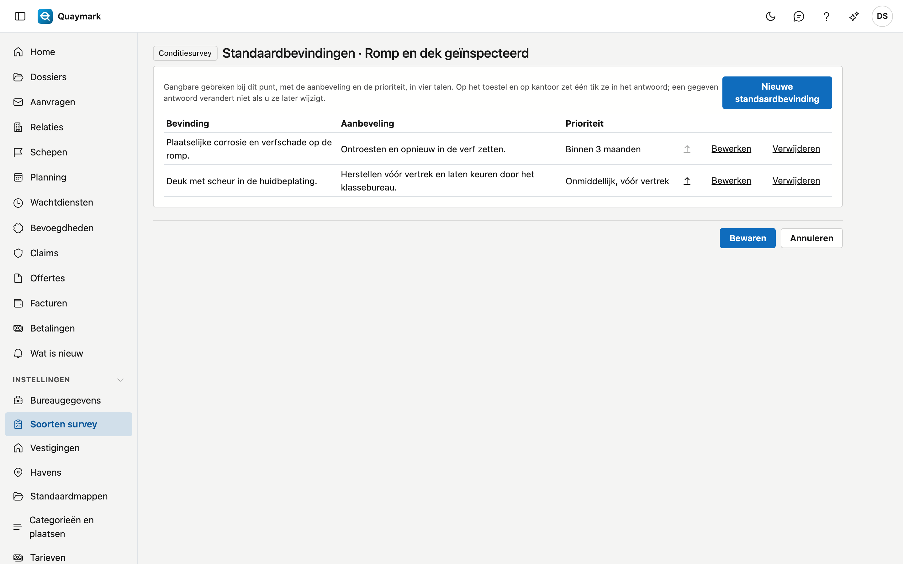

# Soorten survey

De soorten survey die het bureau aanbiedt. Een nieuw bureau start met een catalogus die u aanpast of aanvult.

## Het scherm openen

Klik in het menu links op **Instellingen** en dan op **Soorten survey**.

## De lijst

- Per soort ziet u de code, de naam, het aantal **velden** en **checklistpunten**, de standaardtaal van het rapport en of de soort actief is.
- Dubbelklik op een rij om de soort te openen. **Nieuw soort survey** maakt er een aan.
- Een soort verwijderen kan niet, want oude dossiers verwijzen ernaar. Zet een soort die u niet meer aanbiedt op **niet actief**.

## Soort survey

Eén soort survey: wat er in het dossier ingevuld wordt en wat de surveyor ter plaatse afloopt.

- **Algemeen**: code, standaardtaal van het rapport, volgorde in de lijsten, actief, en de naam in de vier talen. De code ligt vast zodra er dossiers met deze soort bestaan.
- **Vier-ogen**: aangevinkt, dan wordt een rapport van deze soort pas uitgegeven na de goedkeuring van een tweede surveyor. Zie [Dossiers](dossiers.md#vier-ogen).
- **Vereiste bevoegdheden**: de bevoegdheden die de surveyor geldig moet hebben (bijvoorbeeld IIMS of ADR). Planning en dossier waarschuwen als dat niet zo is. Zie [Bevoegdheden](bevoegdheden.md).
- **Bewaartermijn (jaar)**: hoe lang een afgesloten dossier van deze soort bewaard wordt. Leeg = de termijn van het land van de vestiging. Zie [Bewaartermijnen](bewaartermijnen.md).
- **Draft survey**: aangevinkt, dan krijgen dossiers van deze soort het tabblad Draft survey met begin- en eindmeting. Zie [Dossiers](dossiers.md#draft-survey).
- **Bunker survey**: aangevinkt, dan krijgen dossiers van deze soort het tabblad Bunker met peilingen vóór en na, de leveringsbon en de berekening naar ton. Zie [Dossiers](dossiers.md#bunker-survey).
- **Schaal van de checklist**: **In orde / niet in orde / n.v.t.** voor een controle, of een **staat** (goed / redelijk / matig / slecht / n.v.t.) voor een conditiesurvey. Bestaande antwoorden blijven staan zoals ze gegeven zijn.
- **Velden**: de gegevens die een dossier van deze soort bovenop de vaste velden krijgt. Een veld heeft een **sleutel** (kleine letters, cijfers en _, ligt vast omdat de veldapp en de rapporten ernaar verwijzen), een soort (tekst, getal, datum, ja/nee, keuze of tabel), een label in vier talen, een eenheid en of het verplicht is. Een **tabel** heeft kolommen en eventueel vaste rijen, bijvoorbeeld één rij per ruim.
- **Checklist**: de punten die de surveyor ter plaatse beantwoordt, elk met een sleutel, een label, en of een antwoord of een foto verplicht is. De link **Standaardbevindingen** opent per bewaard punt de gangbare gebreken, elk met een bevinding, een aanbeveling en een prioriteit, in vier talen. De surveyor zet er één met een tik in zijn antwoord; een gegeven antwoord verandert niet als u ze later wijzigt. Nieuwe punten krijgen die link na **Bewaren**.
- **Rubrieken**: de tekstblokken van het rapport (inleiding, bevindingen, conclusie …). De surveyor schrijft ze op het tabblad Rapport van het dossier; een rapportsjabloon toont ze met de markering in de kolom ernaast. Een nieuw soort survey start met de vijf standaardrubrieken.
- De pijl **↑** zet een veld of punt een plaats hoger. Wijzigingen aan velden en checklist tellen pas na **Bewaren**.

Het tabblad **Historiek** toont wie wat wijzigde.

## Zie ook

- [Sjablonen](sjablonen.md)
- [Categorieën en plaatsen](categorieen-en-plaatsen.md)
