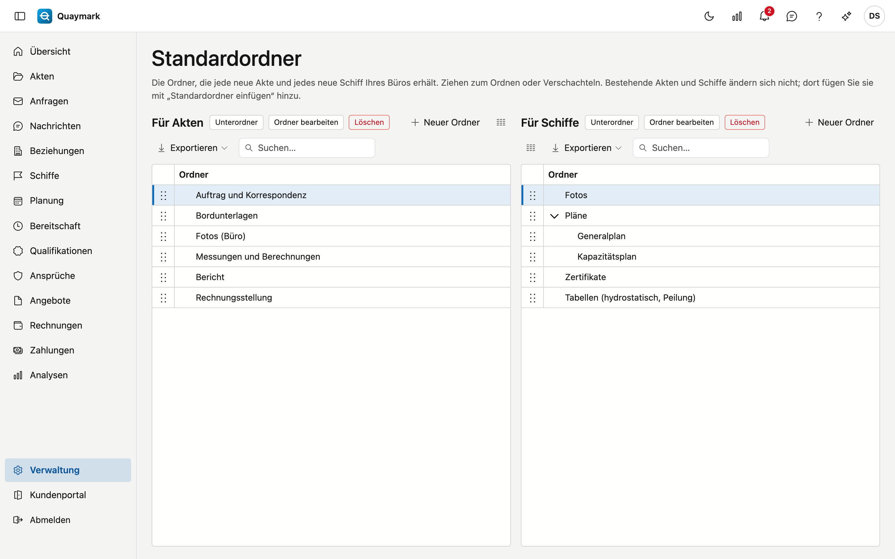

# Standardordner

Die Ordner, die jede neue Akte und jedes neue Schiff Ihres Büros unter der Registerkarte Dokumente erhält.

## Bildschirm öffnen

Klicken Sie unten im Menü auf **Verwaltung** und dann auf die Kachel **Standardordner**.

## Felder und Funktionen

- Links die Ordner **für Akten**, rechts die **für Schiffe**. Ein Ordner hat einen Namen in den vier Sprachen.
- **Ziehen** Sie einen Ordner, um die Reihenfolge zu ändern oder ihn in einen anderen Ordner zu setzen.
- Zwei Ordner mit demselben Namen an derselben Stelle sind nicht möglich: Eine neue Akte oder ein neues Schiff würde nur einen erhalten.
- Einen Ordner **löschen** Sie erst, wenn er keine Unterordner mehr hat; bestehende Akten und Schiffe behalten ihren Ordner.
- Eine neue Akte oder ein neues Schiff erhält diese Ordner sofort, wie auch immer sie entstehen: in ihrer Akte, aus einer Anfrage oder einem Angebot, oder ein Schiff aus einer Akte.
- Bestehende Akten und Schiffe ändern sich nicht. Dort fügen Sie die Ordner mit **Standardordner einfügen** in der Registerkarte Dokumente hinzu; bereits vorhandene Ordner werden nicht verdoppelt.

## Siehe auch

- [Akten](dossiers.md)
