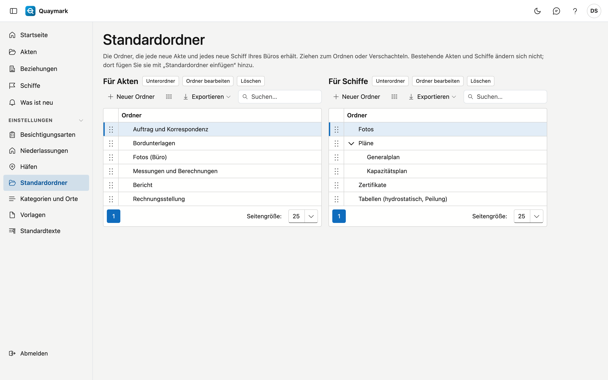

# Standardordner

Die Ordner, die jede neue Akte und jedes neue Schiff Ihres Büros unter der Registerkarte Dokumente erhält.

## Bildschirm öffnen

Klicken Sie im Menü links auf **Einstellungen** und dann auf **Standardordner**.

## Felder und Funktionen

- Links die Ordner **für Akten**, rechts die **für Schiffe**. Ein Ordner hat einen Namen in den vier Sprachen.
- **Ziehen** Sie einen Ordner, um die Reihenfolge zu ändern oder ihn in einen anderen Ordner zu setzen.
- Bestehende Akten und Schiffe ändern sich nicht. Dort fügen Sie die Ordner mit **Standardordner einfügen** in der Registerkarte Dokumente hinzu; bereits vorhandene Ordner werden nicht verdoppelt.

## Siehe auch

- [Akten](dossiers.md)
