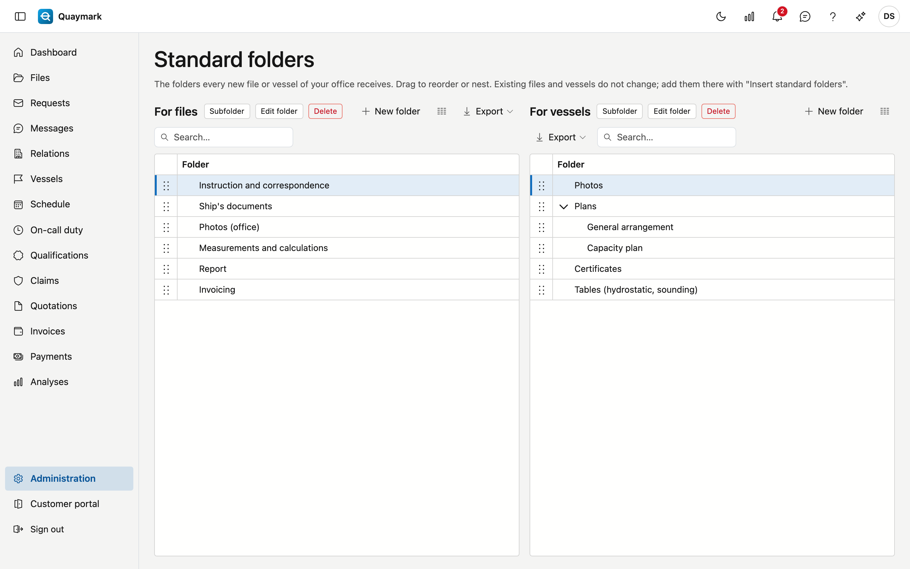

# Standard folders

The folders every new file and every new vessel of your office receives, under the Documents tab.

## Opening the screen

At the bottom of the menu, click **Administration**, then the **Standard folders** tile.

## Fields and functions

- On the left the folders **for files**, on the right those **for vessels**. A folder has a name in the four languages.
- **Drag** a folder to change the order or to put it inside another folder.
- A new file or vessel gets these folders at once, however it is created: on its record, from a request or a quote, or a vessel from a file.
- Existing files and vessels do not change. Add the folders there with **Insert standard folders** on the Documents tab; folders that are already there are not duplicated.

## See also

- [Files](dossiers.md)
