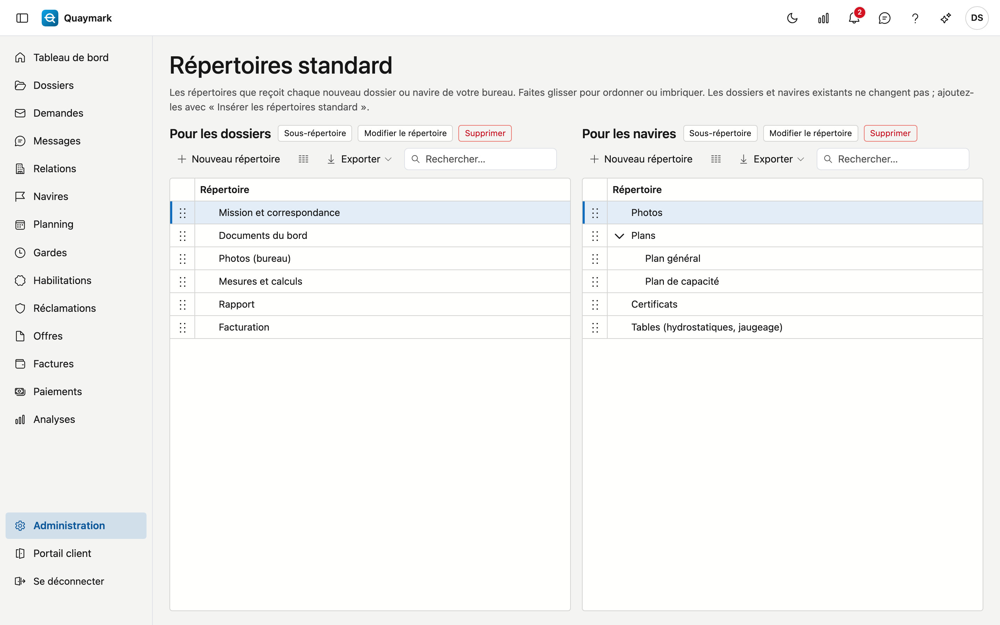

# Répertoires standard

Les répertoires que reçoit chaque nouveau dossier et chaque nouveau navire de votre bureau, sous l'onglet Documents.

## Ouvrir l'écran

En bas du menu, cliquez sur **Administration**, puis sur la tuile **Répertoires standard**.

## Champs et fonctions

- À gauche les répertoires **pour les dossiers**, à droite ceux **pour les navires**. Un répertoire a un nom dans les quatre langues.
- **Faites glisser** un répertoire pour changer l'ordre ou le placer dans un autre répertoire.
- Un nouveau dossier ou navire reçoit ces répertoires aussitôt, quelle que soit la façon dont il est créé : sur sa fiche, depuis une demande ou une offre, ou un navire depuis un dossier.
- Les dossiers et navires existants ne changent pas. Ajoutez-y les répertoires avec **Insérer les répertoires standard** dans l'onglet Documents ; les répertoires déjà présents ne sont pas dédoublés.

## Voir aussi

- [Dossiers](dossiers.md)
