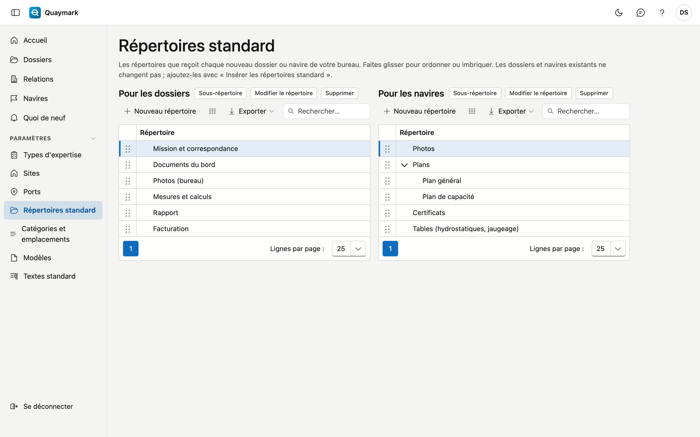

# Répertoires standard

Les répertoires que reçoit chaque nouveau dossier et chaque nouveau navire de votre bureau, sous l'onglet Documents.

## Ouvrir l'écran

Dans le menu de gauche, cliquez sur **Paramètres** puis sur **Répertoires standard**.

## Champs et fonctions

- À gauche les répertoires **pour les dossiers**, à droite ceux **pour les navires**. Un répertoire a un nom dans les quatre langues.
- **Faites glisser** un répertoire pour changer l'ordre ou le placer dans un autre répertoire.
- Les dossiers et navires existants ne changent pas. Ajoutez-y les répertoires avec **Insérer les répertoires standard** dans l'onglet Documents ; les répertoires déjà présents ne sont pas dédoublés.

## Voir aussi

- [Dossiers](dossiers.md)
