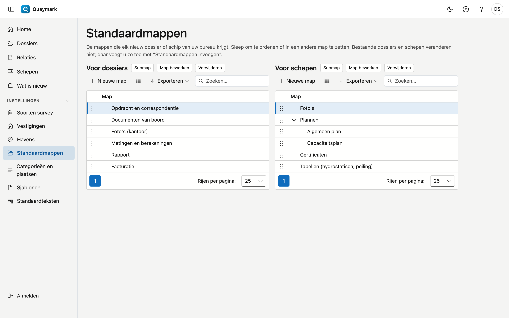

# Standaardmappen

De mappen die elk nieuw dossier en elk nieuw schip van uw bureau krijgt, onder het tabblad Documenten.

## Het scherm openen

Klik in het menu links op **Instellingen** en dan op **Standaardmappen**.

## Velden en functies

- Links de mappen **voor dossiers**, rechts die **voor schepen**. Een map heeft een naam in de vier talen.
- **Sleep** een map om de volgorde te wijzigen of om ze in een andere map te zetten.
- Bestaande dossiers en schepen veranderen niet. Daar voegt u de mappen toe met **Standaardmappen invoegen** op het tabblad Documenten; mappen die er al staan, worden niet verdubbeld.

## Zie ook

- [Dossiers](dossiers.md)
