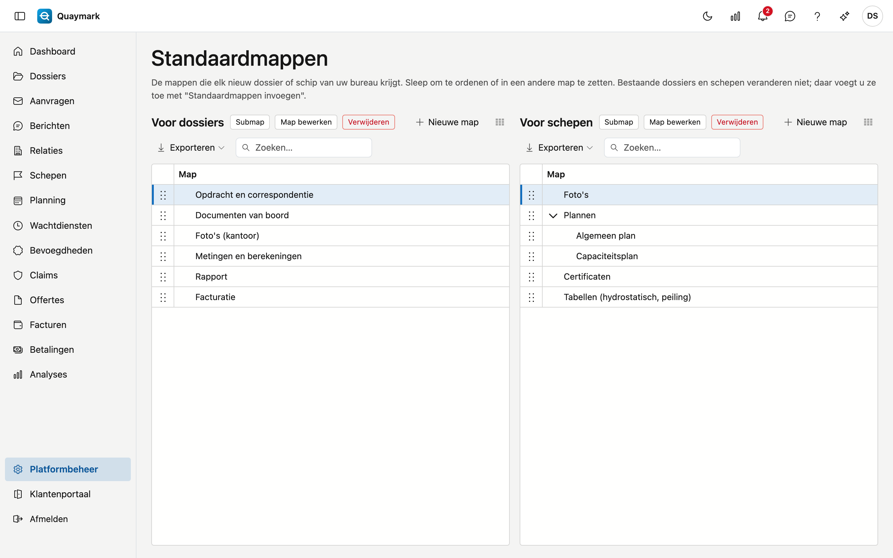

# Standaardmappen

De mappen die elk nieuw dossier en elk nieuw schip van uw bureau krijgt, onder het tabblad Documenten.

## Het scherm openen

Klik onderaan het menu op **Platformbeheer** en dan op de tegel **Standaardmappen**.

## Velden en functies

- Links de mappen **voor dossiers**, rechts die **voor schepen**. Een map heeft een naam in de vier talen.
- **Sleep** een map om de volgorde te wijzigen of om ze in een andere map te zetten.
- Twee mappen met dezelfde naam op dezelfde plaats kan niet: een nieuw dossier of schip zou er maar één krijgen.
- Een map **verwijdert** u pas als ze geen submappen meer heeft; bestaande dossiers en schepen houden hun map.
- Een nieuw dossier of schip krijgt deze mappen meteen, op welke manier het ook ontstaat: op zijn fiche, uit een aanvraag of een offerte, of een schip vanuit een dossier.
- Bestaande dossiers en schepen veranderen niet. Daar voegt u de mappen toe met **Standaardmappen invoegen** op het tabblad Documenten; mappen die er al staan, worden niet verdubbeld.

## Zie ook

- [Dossiers](dossiers.md)
