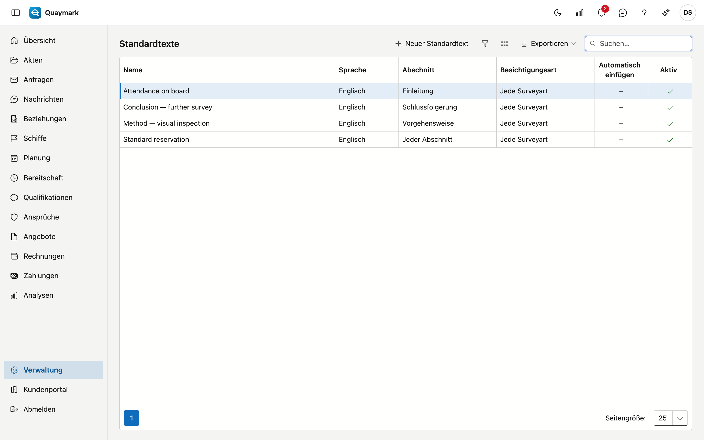

# Standardtexte

Feste Texte, die ein Besichtiger in der Registerkarte **Bericht** einer Akte in einen Abschnitt einfügt, zum Beispiel den üblichen Vorbehalt des Büros.

## Bildschirm öffnen

Klicken Sie unten im Menü auf **Verwaltung** und dann auf die Kachel **Standardtexte**.

## Felder und Funktionen

- Jeder Text hat eine **Sprache**: Die Registerkarte Bericht bietet nur Texte in der Sprache des Berichts an.
- Wählen Sie einen **Abschnitt**, um einen Text nur dort anzubieten; leer = in jedem Abschnitt.
- Formatierung: fett, kursiv, unterstrichen und Aufzählungen. Mehr zeigt der Bericht nicht.
- Einen Text, den Sie nicht mehr verwenden, setzen Sie auf **nicht aktiv**. Was schon in eine Akte eingefügt wurde, bleibt dort.

- Wählen Sie eine **Besichtigungsart**, um einen Text nur für diese Art anzubieten; leer = für jede Art.
- **Automatisch einfügen** (nur mit einem Abschnitt): Der Text steht in diesem Abschnitt bereit, wenn er in einer Akte dieser Art leer ist. Ein Text für eine Art geht einem Text für jede Art vor.
- **Markierungen** werden zu den Daten der Akte: {{schip}}, {{imo}}, {{haven}}, {{terminal}}, {{opdrachtgever}}, {{referentie}}, {{dossier}}, {{surveyor}} und {{veld:schlüssel}} für ein Feld der Besichtigungsart (zum Beispiel die Containernummer). Was die Akte nicht weiß, wird eine offene Stelle.
- Text in eckigen Klammern, wie [Ort], ist eine **offene Stelle**, die der Surveyor ausfüllt. Solange eine bleibt, wird der Bericht nicht ausgegeben. → [Akten](dossiers.md#standardsatze-und-offene-stellen)

## Siehe auch

- [Vorlagen](sjablonen.md)
