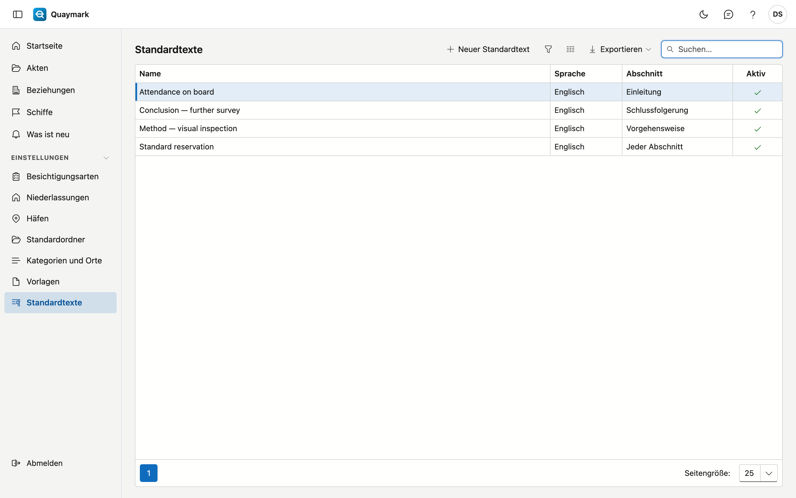

# Standardtexte

Feste Texte, die ein Besichtiger in der Registerkarte **Bericht** einer Akte in einen Abschnitt einfügt, zum Beispiel den üblichen Vorbehalt des Büros.

## Bildschirm öffnen

Klicken Sie im Menü links auf **Einstellungen** und dann auf **Standardtexte**.

## Felder und Funktionen

- Jeder Text hat eine **Sprache**: Die Registerkarte Bericht bietet nur Texte in der Sprache des Berichts an.
- Wählen Sie einen **Abschnitt**, um einen Text nur dort anzubieten; leer = in jedem Abschnitt.
- Formatierung: fett, kursiv, unterstrichen und Aufzählungen. Mehr zeigt der Bericht nicht.
- Einen Text, den Sie nicht mehr verwenden, setzen Sie auf **nicht aktiv**. Was schon in eine Akte eingefügt wurde, bleibt dort.

## Siehe auch

- [Vorlagen](sjablonen.md)
