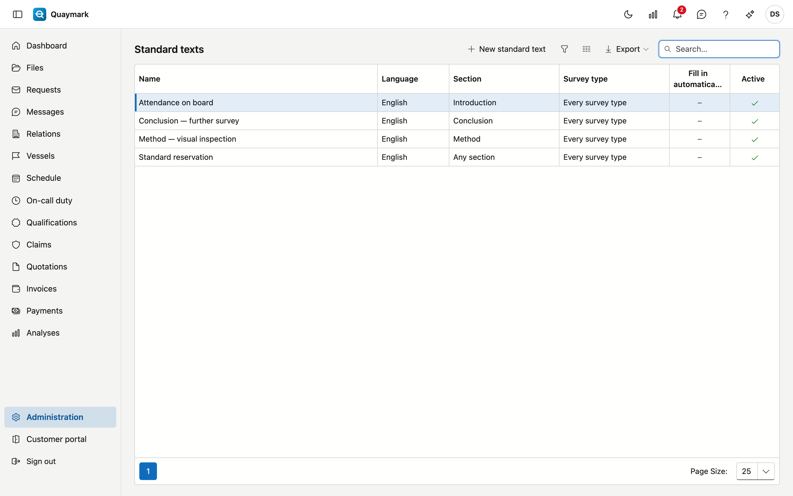

# Standard texts

Fixed texts that a surveyor inserts into a section from the **Report** tab of a file, for example the office's usual reservations.

## Opening the screen

At the bottom of the menu, click **Administration**, then the **Standard texts** tile.

## Fields and functions

- Each text has a **language**: the Report tab only offers texts in the language of the report.
- Choose a **section** to offer a text only in that section; empty = in every section.
- Formatting: bold, italic, underline and lists. The report shows nothing more.
- Set a text you no longer use to **inactive**. What was already inserted into a file stays there.

- Choose a **survey type** to offer a text only for that type; empty = for every type.
- **Fill in automatically** (only with a section): the text is ready in that section when it is empty in a file of that type. A text for one type goes before a text for every type. There can be only one automatic text per language, section and type: Quaymark refuses a second, naming the text that already has that place. If you clear the section, the box is unticked.
- **Placeholders** become the file's data: {{schip}}, {{imo}}, {{haven}}, {{terminal}}, {{opdrachtgever}}, {{referentie}}, {{dossier}}, {{surveyor}}, and {{veld:key}} for a field of the survey type (for example the container number). What the file does not know becomes a blank.
- Text between square brackets, like [location], is a **blank** the surveyor fills in. While one remains, the report is not issued. → [Files](dossiers.md#standard-sentences-and-blanks)

## See also

- [Templates](sjablonen.md)
