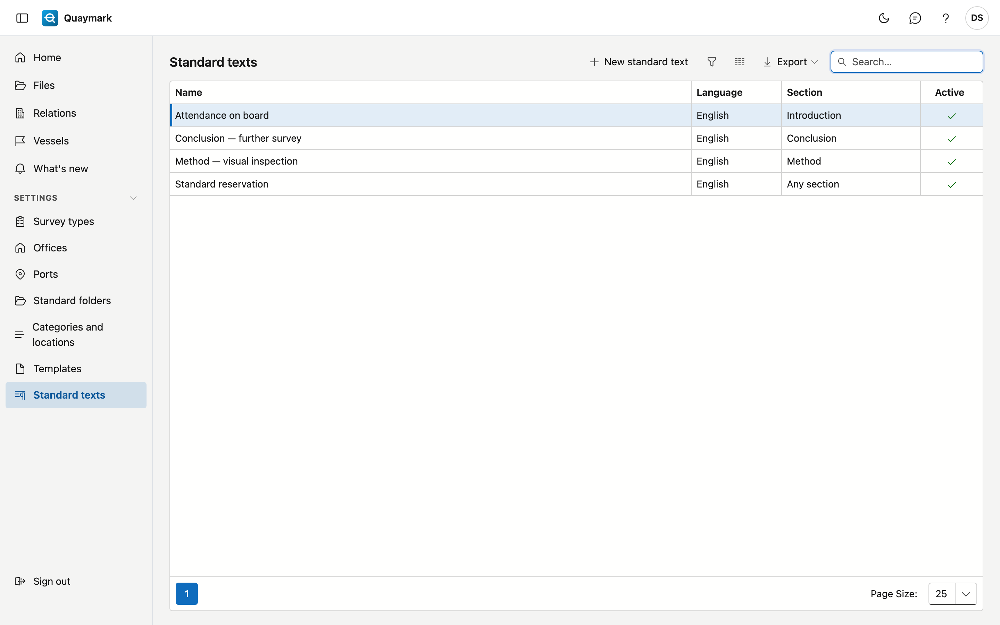

# Standard texts

Fixed texts that a surveyor inserts into a section from the **Report** tab of a file, for example the office's usual reservations.

## Opening the screen

In the menu on the left, click **Settings**, then **Standard texts**.

## Fields and functions

- Each text has a **language**: the Report tab only offers texts in the language of the report.
- Choose a **section** to offer a text only in that section; empty = in every section.
- Formatting: bold, italic, underline and lists. The report shows nothing more.
- Set a text you no longer use to **inactive**. What was already inserted into a file stays there.

## See also

- [Templates](sjablonen.md)
