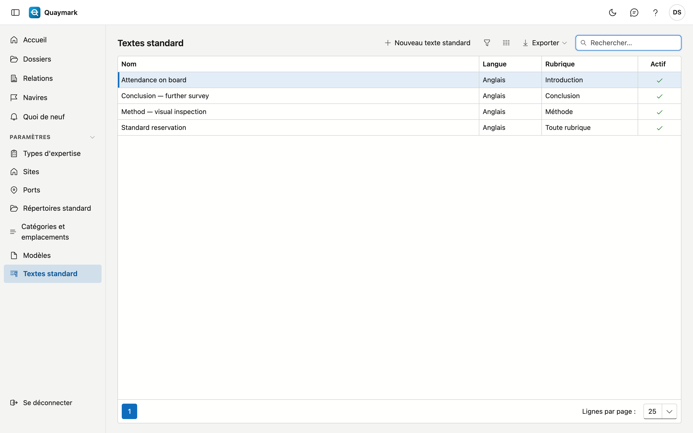

# Textes standard

Des textes fixes que l'expert insère dans une rubrique depuis l'onglet **Rapport** d'un dossier, par exemple les réserves habituelles du bureau.

## Ouvrir l'écran

Dans le menu de gauche, cliquez sur **Paramètres** puis sur **Textes standard**.

## Champs et fonctions

- Chaque texte a une **langue** : l'onglet Rapport ne propose que les textes dans la langue du rapport.
- Choisissez une **rubrique** pour ne proposer un texte que dans cette rubrique ; vide = dans chaque rubrique.
- Mise en forme : gras, italique, souligné et listes. Le rapport n'en affiche pas davantage.
- Un texte que vous n'utilisez plus passe en **non actif**. Ce qui a déjà été inséré dans un dossier y reste.

## Voir aussi

- [Modèles](sjablonen.md)
