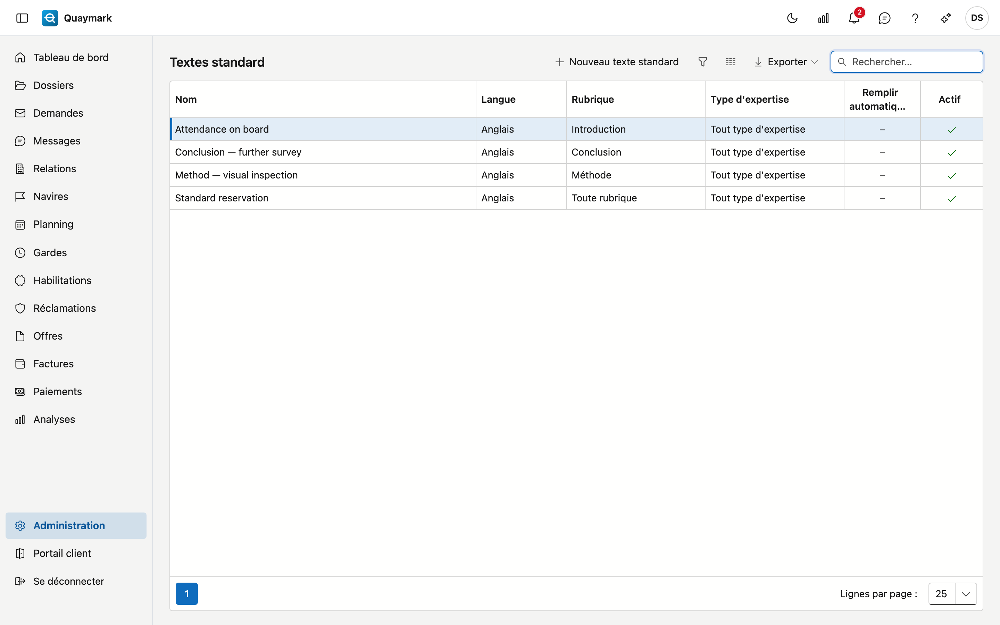

# Textes standard

Des textes fixes que l'expert insère dans une rubrique depuis l'onglet **Rapport** d'un dossier, par exemple les réserves habituelles du bureau.

## Ouvrir l'écran

En bas du menu, cliquez sur **Administration**, puis sur la tuile **Textes standard**.

## Champs et fonctions

- Chaque texte a une **langue** : l'onglet Rapport ne propose que les textes dans la langue du rapport.
- Choisissez une **rubrique** pour ne proposer un texte que dans cette rubrique ; vide = dans chaque rubrique.
- Mise en forme : gras, italique, souligné et listes. Le rapport n'en affiche pas davantage.
- Un texte que vous n'utilisez plus passe en **non actif**. Ce qui a déjà été inséré dans un dossier y reste.

- Choisissez un **type d'expertise** pour proposer un texte uniquement pour ce type ; vide = pour chaque type.
- **Remplir automatiquement** (uniquement avec une rubrique) : le texte est prêt dans cette rubrique si elle est vide dans un dossier de ce type. Un texte pour un type passe avant un texte pour chaque type. Par langue, rubrique et type, il ne peut y avoir qu'un texte automatique : Quaymark refuse un second, avec le nom du texte qui occupe déjà cette place. Si vous videz la rubrique, la case se décoche.
- Les **repères** deviennent les données du dossier : {{schip}}, {{imo}}, {{haven}}, {{terminal}}, {{opdrachtgever}}, {{referentie}}, {{dossier}}, {{surveyor}}, et {{veld:clé}} pour un champ du type d'expertise (par exemple le numéro de conteneur). Ce que le dossier ne sait pas devient un emplacement à compléter.
- Un texte entre crochets, comme [lieu], est un **emplacement à compléter** par l'expert. Tant qu'il en reste un, le rapport n'est pas émis. → [Dossiers](dossiers.md#phrases-standard-et-emplacements-a-completer)

## Voir aussi

- [Modèles](sjablonen.md)
