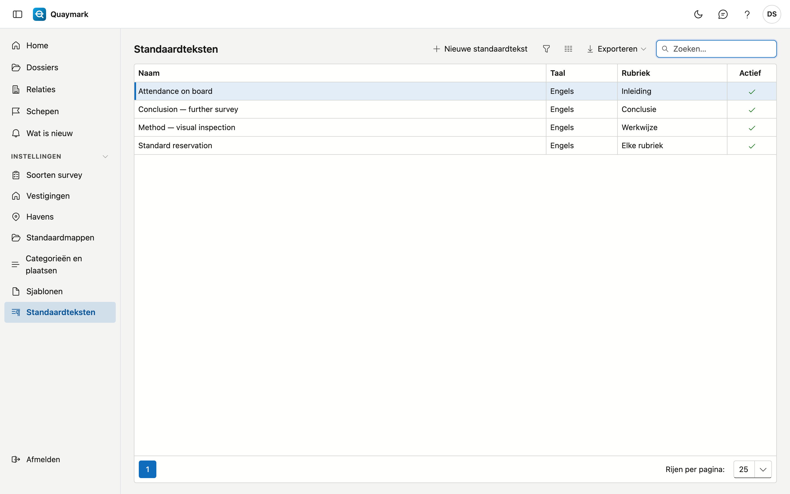

# Standaardteksten

Vaste teksten die een surveyor op het tabblad **Rapport** van een dossier in een rubriek invoegt, bijvoorbeeld het vaste voorbehoud van het bureau.

## Het scherm openen

Klik in het menu links op **Instellingen** en dan op **Standaardteksten**.

## Velden en functies

- Elke tekst heeft een **taal**: op het tabblad Rapport verschijnen enkel de teksten in de taal van het rapport.
- Kies een **rubriek** om een tekst enkel bij die rubriek aan te bieden; leeg = bij elke rubriek.
- Opmaak: vet, cursief, onderstreept en opsommingen. Meer toont het rapport niet.
- Een tekst die u niet meer gebruikt, zet u op **niet actief**. Wat al in een dossier ingevoegd werd, blijft daar staan.

## Zie ook

- [Sjablonen](sjablonen.md)
