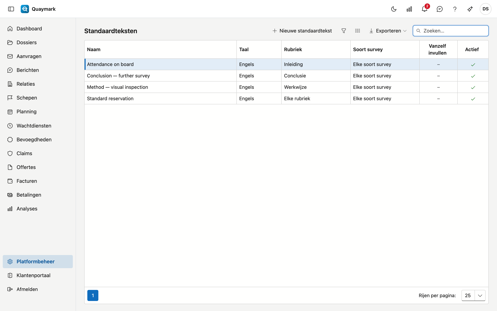

# Standaardteksten

Vaste teksten die een surveyor op het tabblad **Rapport** van een dossier in een rubriek invoegt, bijvoorbeeld het vaste voorbehoud van het bureau.

## Het scherm openen

Klik onderaan het menu op **Platformbeheer** en dan op de tegel **Standaardteksten**.

## Velden en functies

- Elke tekst heeft een **taal**: op het tabblad Rapport verschijnen enkel de teksten in de taal van het rapport.
- Kies een **rubriek** om een tekst enkel bij die rubriek aan te bieden; leeg = bij elke rubriek.
- Opmaak: vet, cursief, onderstreept en opsommingen. Meer toont het rapport niet.
- Een tekst die u niet meer gebruikt, zet u op **niet actief**. Wat al in een dossier ingevoegd werd, blijft daar staan.

- Kies een **soort survey** om een tekst enkel bij die soort aan te bieden; leeg = bij elke soort.
- **Vanzelf invullen** (enkel met een rubriek): de tekst staat klaar in die rubriek als ze leeg is bij een dossier van die soort. Een tekst voor één soort gaat voor een tekst voor elke soort. Per taal, rubriek en soort kan er maar één automatische tekst zijn: een tweede weigert Quaymark, met de naam van de tekst die die plaats al heeft. Maakt u de rubriek leeg, dan gaat het vinkje uit.
- **Markeringen** worden de gegevens van het dossier: {{schip}}, {{imo}}, {{haven}}, {{terminal}}, {{opdrachtgever}}, {{referentie}}, {{dossier}}, {{surveyor}}, en {{veld:sleutel}} voor een veld van de soort survey (bijvoorbeeld het containernummer). Wat het dossier niet weet, wordt een open plek.
- Tekst tussen rechte haken, zoals [locatie], is een **open plek** die de surveyor invult. Zolang er een staat, wordt het rapport niet uitgegeven. → [Dossiers](dossiers.md#standaardzinnen-en-open-plekken)

## Zie ook

- [Sjablonen](sjablonen.md)
