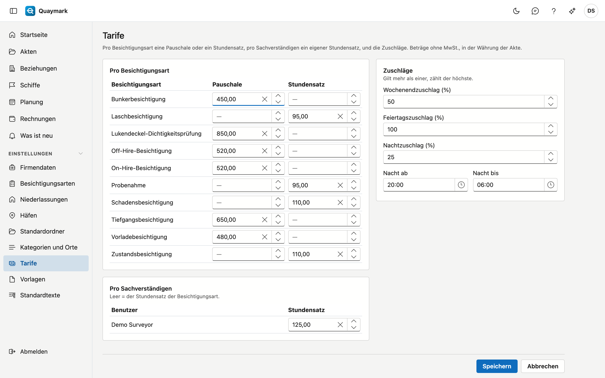

# Tarife

Die Tarife, mit denen Quaymark eine Rechnung vorschlägt. Beträge ohne MwSt., in der Währung der Akte.

## Bildschirm öffnen

Klicken Sie im Menü links unter **Einstellungen** auf **Tarife**. Nur der Administrator des Büros sieht diesen Bildschirm.

## Pro Besichtigungsart

Jede Besichtigungsart erhält eine **Pauschale** (einen festen Betrag pro Akte) oder einen **Stundensatz**, nicht beides. Lassen Sie beide leer für eine Art, die Sie nicht nach einem festen Tarif abrechnen.

## Pro Sachverständigen

Ein Sachverständiger kann einen eigenen **Stundensatz** haben. Er gilt vor dem Stundensatz der Besichtigungsart. Leer bedeutet: der Stundensatz der Art.

## Zuschläge

Ein Zuschlag in Prozent für das **Wochenende**, einen **Feiertag** und die **Nacht**. Die Nacht läuft von **Nacht ab** bis **Nacht bis** (standardmäßig von 20:00 bis 06:00). Gilt mehr als ein Zuschlag, zählt der höchste; sie werden nicht addiert.

## Siehe auch

- [Akten](dossiers.md)
