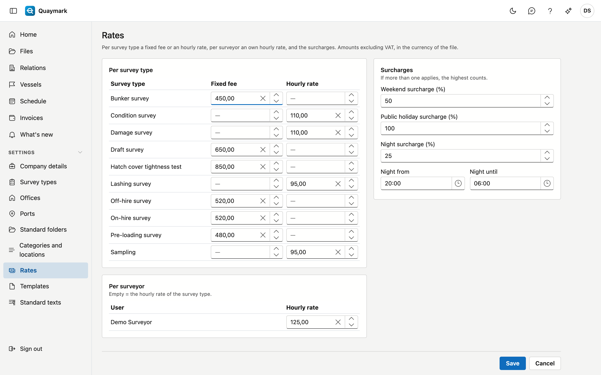

# Rates

The rates Quaymark uses to propose an invoice. Amounts excluding VAT, in the currency of the file.

## Opening the screen

Click **Rates** under **Settings** in the menu on the left. Only the office administrator sees this screen.

## Per survey type

Each survey type gets a **Fixed fee** (a fixed amount per file) or an **Hourly rate**, not both. Leave both empty for a type you do not charge at a fixed rate.

## Per surveyor

A surveyor can have an own **Hourly rate**. It takes precedence over the hourly rate of the survey type. Empty means: the hourly rate of the type.

## Surcharges

A surcharge as a percentage for **weekends**, **public holidays** and **nights**. The night runs from **Night from** to **Night until** (by default from 20:00 to 06:00). If more than one surcharge applies, the highest counts; they are not added up.

## See also

- [Files](dossiers.md)
