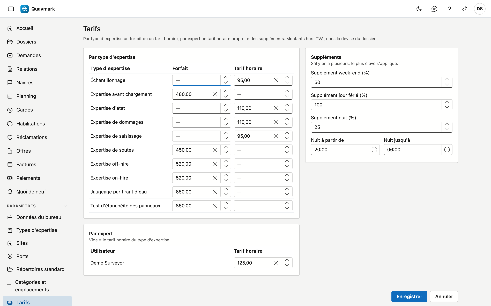

# Tarifs

Les tarifs avec lesquels Quaymark propose une facture. Montants hors TVA, dans la devise du dossier.

## Ouvrir l'écran

Cliquez sur **Tarifs** sous **Paramètres** dans le menu de gauche. Seul l'administrateur du bureau voit cet écran.

## Par type d'expertise

Chaque type d'expertise reçoit un **Forfait** (un montant fixe par dossier) ou un **Tarif horaire**, pas les deux. Laissez les deux vides pour un type que vous ne facturez pas selon un tarif fixe.

## Par expert

Un expert peut avoir son propre **Tarif horaire**. Il prime sur le tarif horaire du type d'expertise. Vide signifie : le tarif horaire du type.

## Suppléments

Un supplément en pourcentage pour le **week-end**, un **jour férié** et la **nuit**. La nuit va de **Nuit à partir de** à **Nuit jusqu'à** (par défaut de 20:00 à 06:00). S'il y a plusieurs suppléments, le plus élevé s'applique ; ils ne s'additionnent pas.

## Accords-cadres

Un donneur d'ordre avec ses propres accords reçoit ses tarifs sur la fiche de la relation, onglet Accords-cadres. Ils priment sur cette grille, y compris sur le tarif d'un expert. → [Accords-cadres](relaties.md#accords-cadres)

## Voir aussi

- [Dossiers](dossiers.md)
